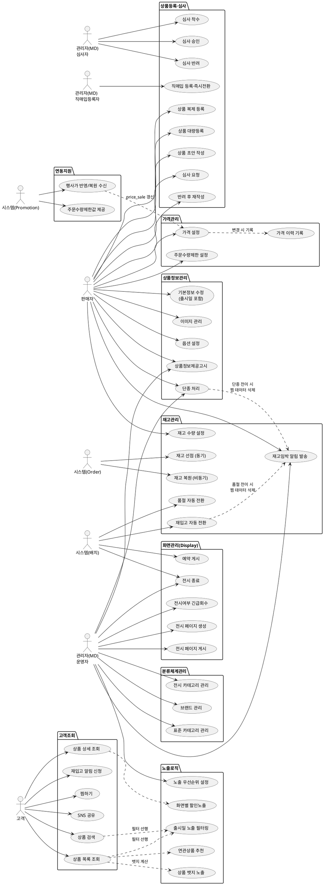

# 상위 유스케이스 — Catalog

> **단계**: 구조설계
> **문서범위**: Domain
> **문서종류**: Design
>
> **작성 목적**: 도메인 정의서(⑤)의 책임 목록을 "누가(액터) 무엇을(업무) 하는가" 단위로 분해한다.
> **흐름 내 위치**: ⑤ 도메인 정의서 → **⑥ 상위 유스케이스** → ⑦ 메뉴구조도 → ⑧ EARS
> **작성 주체**: 시니어 개발자 + AI 협업 (기획자·현업 검토·확인)

| 항목 | 내용 |
|---|---|
| ID | DESIGN-UC-CATALOG-001 |
| 상태 | **Draft** |
| 작성일 | 2026-08-21 |
| 갱신일 | 2026-11-06 |

> **2026-10-26 갱신 안내**: 작성 이후 확정된 `D6A-업무인터뷰결과서/catalog.md`·
> `DBA-도메인정책서/catalog.md`의 결정 사항을 반영했다. 이번 갱신에서는 업무그룹 분류 자체를
> **"책임 단위"**로 재편했다(Promotion DC가 도메인정의서 핵심 책임=쿠폰/할인/이벤트기획전과
> 1:1 대응시킨 기준과 동일 적용) — ① 성격이 다른 책임을 억지로 합친 그룹(재고·가격관리)을
> 분리하고, ② 액터가 "고객"이 아니라 "시스템"인 조회 보조 로직(출시일 필터링·화면별 할인노출·
> 연관상품추천·노출우선순위)을 고객 행위 그룹에서 떼어 별도 그룹(노출로직)으로 신설했으며,
> ③ 외부 도메인(Promotion) 트리거로 수동 반영되는 항목을 연동지원으로 모았다.
>
> **2026-11-06 재동기화**: DBA가 2026-11-04에 번호를 재정비한 뒤 바뀐 섹션 번호를 전체
> 반영하고, DD-EARS REQ-CAT-056~070에 대응하는 신규 유스케이스(복제등록·대량등록·
> 재고임박알림·주문수량제한값제공·찜하기·SNS공유·상품뱃지·추천위젯실패대체·전시여부
> 긴급회수·상품정보제공고시)를 추가했다. 최근 본 상품(DBA §1.15)은 클라이언트 전용 기능이라
> Catalog 액터·시스템이 수행하는 유스케이스가 성립하지 않아 포함하지 않았다.

---

## ① 액터 정의

| 액터 | 설명 | 채널 |
|---|---|---|
| 관리자(MD) — 심사자 | 입점형 상품의 심사·반려·분류체계·전시 관리 권한. 판매자가 작성한 상품을 제3자로서 검증 | A(Admin) |
| 관리자(MD) — 직매입 등록자 | 직매입(자사) 상품을 직접 작성·등록. 심사 게이트 없이 본인이 등록한 즉시 ON_SALE 전환(셀프 등록이라 입점형 심사자 역할과 분리) | A(Admin) |
| 관리자(MD) — 운영자 | 분류체계·전시·노출 설정 등 심사·직매입 등록 외 일반 운영 권한. 직매입 상품의 재고 임박 알림도 수신 | A(Admin) |
| 판매자 | 입점 판매 사업자. 상품 등록(입점형)·수정·재고 관리. 입점형 상품의 재고 임박 알림 수신 담당자 | V(Partner) |
| 고객 | 로그인한 최종 구매자. 상품 조회·검색·찜하기·공유 | M(Mobile) |
| 시스템(Order) | Order 도메인의 재고 차감/복원 요청, 주문 취소 이벤트, 주문 수량 제한 값 소비 | C(Consumer) |
| 시스템(Promotion) | Promotion 도메인의 행사가 반영·복원 요청(price_sale 연동), 수량조건 대상 상품 필터링을 위한 주문수량제한 값 소비 | C(Consumer) |
| 시스템(배치) | 스케줄러. 전시 페이지 예약 게시, 재입고 재고 상태 자동 전환 | B(Batch) |

> **용어 정정(C2 3관점 원칙)**: "판매자(벤더)" → **"판매자"**로 통일. 업무 주체를 가리킬 때는
> 판매자가 유일 표준어이며, 코드·도메인(Vendor)과 앱 채널(partner)은 다른 층위라 별개
> 표기를 쓴다(2026-10-26, C2 용어 3관점 협의 반영).

---

## ② 업무그룹별 유스케이스

> 9개 업무그룹: **상품등록·심사 / 상품정보관리 / 분류체계관리 / 재고관리 / 가격관리 /
> 고객조회 / 노출로직 / 화면관리(Display) / 연동지원**. 각 그룹은 하나의 책임만 다루며,
> 외부 도메인이 트리거하는 항목은 소유 그룹이 아니라 연동지원에 둔다.

### 상품등록·심사

> **직매입/입점형 분기**: D6A Q1·DBA §1.5.1에서 확정한 대로 직매입(자사 등록) 경로를 별도
> 유스케이스로 둔다 — 심사 게이트 없이 DRAFT→ON_SALE로 즉시 전환된다.

| 유스케이스 | 액터 | 도출 근거 |
|---|---|---|
| **[직매입]** 상품 등록·즉시 판매 전환 (DRAFT→ON_SALE) | 관리자(MD) — 직매입 등록자 | DBA §1.5.1 — 심사 게이트 생략, 등록 즉시 ON_SALE |
| **[입점형]** 상품 초안 작성 (DRAFT) | 판매자 | DBA §1.5.1 — 판매자가 어드민(파트너 BO)에서 작성 |
| **[입점형]** 심사 요청 (DRAFT→REVIEW_REQUESTED) | 판매자 | DBA §1.5.1 |
| **[입점형]** 심사 착수 (REVIEW_REQUESTED→UNDER_REVIEW) | 관리자(MD) — 심사자 | DBA §1.6 심사 정책 |
| **[입점형]** 심사 승인 (UNDER_REVIEW→ON_SALE) | 관리자(MD) — 심사자 | DBA §1.6 심사 정책 |
| **[입점형]** 심사 반려 (UNDER_REVIEW→REJECTED) | 관리자(MD) — 심사자 | DBA §1.6 심사 정책 — 반려 사유 판매자 BO 명시 |
| **[입점형]** 반려 사유 확인 후 재작성 (REJECTED→DRAFT) | 판매자 | DBA §1.6 — 재제출 기한 30일, 초과 시 DRAFT 자동삭제 |
| 동일 사유 반복 반려 에스컬레이션 | 관리자(MD) — 심사자 | DBA §1.6 — 3회 이상 반복 시 입점 심사팀 에스컬레이션 |
| 상품 복제 등록 (본인 상품만, 가격·재고·판매자상품코드 제외) | 판매자 | DBA §1.5.3(2026-11-06 신설) |
| 상품 대량등록 (엑셀 업로드) | 판매자 | DBA §1.5.2 — 기존 DBA 정책에 있었으나 이 문서에 미반영 상태였던 항목 소급 반영 |

### 상품정보관리

| 유스케이스 | 액터 | 도출 근거 |
|---|---|---|
| 상품 기본정보 수정 (이름·카테고리·가격·**출시일** 등) | 판매자 | 도메인정의서 Catalog 책임 "상품 등록·수정·전시" — 출시일(release_date)은 DBA §1.3·§2.4에서 노출로직 그룹의 입력값으로 쓰이는 기본정보 필드 중 하나 |
| 상품 이미지 등록·순서변경·삭제 | 판매자 | DBA §1.3.2 |
| 옵션그룹·옵션값 설정 (최대 2단계) | 판매자 | DBA §1.4 SKU·옵션 정책 |
| 상품 단종 처리 (ON_SALE/SOLD_OUT→DISCONTINUED) | 판매자/관리자(MD) — 운영자 | DBA §1.9·§1.11 — 재고 수량과 무관한 별도 의사결정, 수동 전환만 허용, 재판매 금지 |
| 상품 상세 조회 (관리) | 관리자(MD) — 운영자/판매자 | DBA §1.3 포함범위 |
| 상품정보제공고시 항목 입력·노출 (대분류별 법정 고시 항목) | 판매자/관리자(MD) | DBA §1.3.8(2026-11-06 신설) — **[Human Review] 법무 확인 전 참고용 항목 기준** |

### 분류체계관리

| 유스케이스 | 액터 | 도출 근거 |
|---|---|---|
| 표준 카테고리 생성·수정·삭제 (대분류-중분류-소분류 3단계) | 관리자(MD) — 운영자 | DBA §1.2.1 카테고리·분류 정책 |
| 전시 카테고리 생성·수정·삭제 | 관리자(MD) — 운영자 | DBA §2.5.1 — 카테고리 마스터 데이터 관리(전시 콘텐츠 자체는 화면관리 그룹) |
| 카테고리-상품 매핑 (1상품=1표준카테고리) | 관리자(MD) — 운영자/판매자 | DBA §1.2.1 — 다중 카테고리 미허용 |
| 브랜드 등록·수정 | 관리자(MD) — 운영자 | **[Human Review]** DBA에 더 이상 전용 브랜드 마스터 섹션이 없고 §1.2.2 예시(브랜드 속성)로만 흡수돼 있음 — 별도 브랜드 마스터 유스케이스가 실제로 필요한지 확인 필요(DD HR #8과 동일 쟁점) |

### 재고관리

> **분리(2026-10-26)**: 기존 "재고·가격관리"에서 재고 책임만 분리했다. **재고 자동전환
> (대안 A)**: 재입고 시 "MD 확인 없이 재고 1 이상 복원 시 자동 ON_SALE 전환"으로 확정했다
> (DBA §1.10 — 재고 변경 빈도가 높아 전량 승인은 운영 불가).

| 유스케이스 | 액터 | 도출 근거 |
|---|---|---|
| SKU 재고 수량 설정·변경 | 판매자 | DBA §1.10 재고-상태 연동 정책 |
| 재고 선점 (동기, Order 연동) | 시스템(Order) | `DB-도메인정의서.md` §1 Order "의존" 행(← Catalog) |
| 재고 복원 (비동기, 주문 취소) | 시스템(Order) | DBA §1.10 — 주문 취소 시 자동 ON_SALE 전환 |
| 재고 부족 시 품절 자동 전환 (ON_SALE→SOLD_OUT) | 시스템 | DBA §1.10 — 재고 0 시 자동 전환 |
| **재입고 시 판매 재개 자동 전환 (SOLD_OUT→ON_SALE)** | 시스템 | DBA §1.10(대안A) — 발생 원인(주문취소/반품교환확정/판매자재고등록) 무관, **MD 확인 불필요**, 재고 1 이상이면 자동 |
| 재고 품절 임박 알림 발송 (상품별 기준수량 이하 시) | 시스템 → 판매자/관리자(MD) | DBA §1.10(2026-11-06 신설) — 입점형은 판매자, 직매입은 관리자가 수신 |
| 재고 품절 임박 기준수량 설정 (상품 단위, 기본값 5) | 판매자 | DBA §1.10(2026-11-06 신설) |

### 가격관리

> **분리(2026-10-26)**: 기존 "재고·가격관리"에서 가격 책임만 분리했다. Promotion이 트리거하는
> 행사가 반영·복원은 Catalog의 가격 "설정" 행위가 아니라 외부 요청 수신이므로 연동지원
> 그룹으로 옮겼다(DBA §1.7.4 — 1차 정책 소유는 Promotion).

| 유스케이스 | 액터 | 도출 근거 |
|---|---|---|
| 판매가·공급가·정가 설정·변경 | 판매자 | DBA §1.7.1 가격 구조(정가≥판매가≥공급가) |
| 가격 변경 이력 기록 | 시스템 | DBA §1.7.1 가격 구조 — 가격 변경 추적 |
| 주문 수량 제한(최대 주문수량) 설정 (상품 단위, 선택) | 판매자 | DBA §1.8(2026-11-06 신설) — 기본값 NULL(무제한) |

### 고객조회

> **분리(2026-10-26)**: 기존 "고객조회·응대"에서 액터가 **고객**인 조회 행위만 남겼다.
> 액터가 시스템인 조회 보조 로직(출시일 필터링·화면별 할인노출·연관상품추천)은 아래
> "노출로직" 그룹으로 이동했다 — 고객이 "하는" 행위와 시스템이 그 결과에 "적용하는" 로직을
> 구분한다(Promotion DC가 "쿠폰 사용"을 고객 UC가 아닌 시스템 연동 UC로 분류한 것과 동일 원칙).

| 유스케이스 | 액터 | 도출 근거 |
|---|---|---|
| 상품 목록 조회 (카테고리별) | 고객 | 도메인정의서 Catalog 책임 "상품 등록·수정·전시" |
| 상품 상세 조회 | 고객 | DBA §1.3 포함범위 |
| 상품 검색 (키워드·필터) | 고객 | 도메인정의서 Catalog 책임 범위 |
| 재입고 알림 신청 (SOLD_OUT 상태 SKU 한정) | 고객 | DBA §1.10 — SKU당 1건, SOLD_OUT→ON_SALE 전환 이벤트 소비 |
| 찜하기 등록·해제, 찜한 상품 목록 조회 | 고객 | DBA §1.14(2026-11-06 신설) — 로그인 회원만, 상품당 1건 |
| 상품 상세·전시 페이지 공유 (SNS·URL 복사) | 고객 | DBA §1.16(2026-11-06 신설) — 리워드 없음, 메타데이터만 제공 |

### 노출로직

> **신설(2026-10-26)**: 고객 조회 결과에 시스템이 적용하는 필터링·가공 로직을 모은 그룹이다.
> D6A Q18·DBA §2.4·§2.8.1·§2.9에서 확정했다. "노출 우선순위"(기존 화면관리 그룹)도 전시
> 페이지 콘텐츠가 아니라 상품 목록 노출 순서를 다루므로 이 그룹으로 옮겼다.

| 유스케이스 | 액터 | 도출 근거 |
|---|---|---|
| 출시일 노출 필터링 (목록·검색·전시·상세 딥링크 포함) | 시스템 | DBA §2.4(C안) — `release_date > now`인 상품은 상세 페이지 직접 접근까지 포함해 전부 제외, 상태 전이 없이 쿼리 필터로만 처리 |
| 화면별 할인가 노출 (목록/상세/장바구니/주문서 그룹별) | 시스템 | DBA §2.8.1 — Catalog가 1차 소유로 확정, Order 소유 화면(장바구니·주문서)과 기준 공유 |
| 연관상품 추천 위젯 제공 (검증필터·프로모션연동 포함) | 시스템 | DBA §2.9 — Catalog가 외부 추천 SaaS 연동 전담, 자체 노출기준 재조회·할인가 동일적용까지 Catalog가 수행, Order는 화면 배치만 |
| 연관상품 추천 실패 시 판매량 상위 N개로 대체 노출 | 시스템 | DBA §2.9(2026-11-06 신설) — 기본 N=20, 영역별 설정 가능 |
| 노출 우선순위 수동 설정 (MD Override) | 관리자(MD) — 운영자 | DBA §2.6 — `exposure_priority = COALESCE(md_override, sales_rank, default_order)`, MD 값 항상 우선 |
| 상품 뱃지 노출 (NEW·BEST·품절임박) | 시스템 | DBA §2.6(2026-11-06 신설) — 기존 필드(release_date·sales_rank·재고임박기준) 재사용, 복수 뱃지 동시 노출 |

### 화면관리(Display)

> **범위 조정(2026-10-26)**: 노출 우선순위(상품 목록 순서)는 "노출로직"으로 이동했으므로,
> 이 그룹은 전시 페이지(기획전·배너 등 콘텐츠) 생명주기만 다룬다.

| 유스케이스 | 액터 | 도출 근거 |
|---|---|---|
| 전시 페이지 생성·편집 (DRAFT) | 관리자(MD) — 운영자 | DBA §2.7.1 전시 페이지 상태 |
| 전시 페이지 게시 (PUBLISHED) | 관리자(MD) — 운영자 | DBA §2.7.1 전시 페이지 상태 |
| 전시 페이지 예약 게시 (SCHEDULED→PUBLISHED) | 시스템(배치) | DBA §2.10 — 예약 시간 도래 시 |
| PUBLISHED 수정 중 임시본 관리 (DRAFT_EDIT) | 관리자(MD) — 운영자 | DBA §2.10 — 2세트 구조, 고객 화면 영향 없음 |
| 전시 섹션·템플릿 구성 (콘텐츠유형×전시유형 2축) | 관리자(MD) — 운영자 | DBA §2.2 MD 수동 운영 영역, §2.3(2026-11-06 2축 체계로 보강) |
| 전시 페이지 종료 (CLOSED) | 관리자(MD) — 운영자/시스템(배치) | DBA §2.7.1 전시 페이지 상태 |
| 전시여부 플래그로 긴급 게시·회수 (상태 전이 없이 즉시 토글) | 관리자(MD) — 운영자 | DBA §2.10(2026-11-06 신설) — 홈 지정 페이지가 꺼지면 기본 카테고리 화면으로 대체 |

### 연동지원

> **확장(2026-10-26)**: Order 연동뿐 아니라 Promotion이 트리거하는 가격 반영·복원 2건을
> "가격관리"에서 이곳으로 옮겨, 외부 도메인 연동이 전부 한 그룹에 모이도록 했다.

| 유스케이스 | 액터 | 도출 근거 |
|---|---|---|
| PublicApi: 상품 정보 조회 (Order 연동) | 시스템(Order) | `DB-도메인정의서.md` §1 Order "의존" 행(← Catalog) |
| PublicApi: 재고 차감 요청 | 시스템(Order) | DBA §1.10 — 재고 선점·차감 연동 |
| PublicApi: 재고 확인 (가용 수량) | 시스템(Order) | DBA §1.10 — 재고-상태 연동 정책 |
| 이벤트 발행: StockChanged | 시스템 | DBA §1.10 — 재고 변동에 따른 상태 전환 전파 |
| 이벤트 수신: ORDER_CANCELLED | 시스템(Order) | DBA §1.10 — 주문 취소 시 자동 ON_SALE 전환 |
| PublicApi: 판매자 단위 배송 속성 제공 | 시스템(Order) | DBA §1.13.1 — vendor_id 그룹핑 속성 제공, 묶음배송·배송비 계산은 Order가 수행 |
| PublicApi: 상품-행사 그룹핑 속성 제공 (vendor_id·price_sale) | 시스템(Promotion) | DBA §1.7.4 — 수량할인 그룹 판정은 Promotion이 수행, Catalog는 속성값만 제공 |
| **[이동]** 행사가 반영 요청 수신 (price_sale 갱신) | 시스템(Promotion) | DBA §1.7.4 — 1차 정책 소유는 Promotion, Catalog는 price_sale 필드 연동만 담당 |
| **[이동]** 행사 종료 시 가격 자동 복원 요청 수신 | 시스템(Promotion) | DBA §1.7.4 |
| PublicApi: 주문 수량 제한(`max_order_quantity`) 값 제공 | 시스템(Promotion) | DBA §1.8(2026-11-06 신설) — Promotion이 수량조건(1+1 등) 대상 상품 필터링에 사용, 실제 필터링은 Promotion이 수행(DBA §6 HR #34) |

---

## ③ 액터-유스케이스 관계도

---

## ④ 권한 범위

| 규칙 | 도출 근거 |
|---|---|
| 판매자는 본인 등록 상품만 수정·삭제·복제 가능 | DBA §1.12 원칙② 등록 경로 분리, §1.5.3 복제등록도 본인 상품 한정 |
| 직매입 상품은 관리자(MD)가 직접 등록·관리하며 심사 게이트가 없음 | DBA §1.5.1 |
| 심사 승인/반려 권한은 관리자(MD)에게만 부여 (입점형 전용) | DBA §1.6 |
| 고객은 ON_SALE/SOLD_OUT 상품만 조회 가능 (DRAFT/REJECTED/DISCONTINUED 노출 불가) | DBA §1.9 상품 상태 |
| ON_SALE 상품 중 `release_date > now`인 상품은 목록·검색·전시·상세 딥링크에서 추가로 제외 | DBA §2.4(C안) |
| 재고 차감은 Order 도메인의 동기 요청으로만 수행 | DBA §1.10 재고-상태 연동 정책 |
| 재고 복원에 따른 SOLD_OUT→ON_SALE 전환은 MD 확인 없이 시스템이 자동 처리 | DBA §1.10(대안A) |
| 판매종료(DISCONTINUED) 전환은 판매자/관리자의 수동 처리만 허용 (자동화 대상 아님) | DBA §1.10 |
| 전시 페이지 관리·전시여부 플래그 조작은 관리자(MD)에게만 부여 | DBA §2.7.1·§2.10 |
| 노출 우선순위 수동 설정(MD Override)은 관리자(MD)에게만 부여, 설정값은 판매량 순위보다 항상 우선 | DBA §2.6 |
| 가격 변경·주문수량제한 설정 시 반드시 이력 기록(가격) | DBA §1.7.1 가격 구조 |
| 행사가(price_sale) 반영·복원은 Promotion 요청에 따라 시스템이 처리, Catalog가 할인 정책을 직접 결정하지 않음 | DBA §1.7.4 |
| 화면별 할인가 노출 기준은 Catalog가 1차 소유, Order 소유 화면과 기준값을 공유 | DBA §2.8.1 |
| 찜하기는 로그인 회원만 가능, 상품당 1건 | DBA §1.14 |
| 재고 품절임박 알림 기준수량은 판매자가 상품별로 직접 설정 가능(기본값 5) | DBA §1.10 |

---

## ⑤ Bolt 분할 후보

| Bolt 후보 | 업무그룹 | 예상 규모 |
|---|---|---|
| 직매입 등록 (심사 생략) | 상품등록·심사 | 반나절 |
| 입점형 상품 등록·초안·복제·대량등록 | 상품등록·심사 | 1일 |
| 입점형 상품 심사 프로세스 | 상품등록·심사 | 반나절 |
| 상품정보 수정 (이미지·옵션·출시일·상품정보제공고시 포함) | 상품정보관리 | 1일 |
| 분류체계 CRUD | 분류체계관리 | 반나절 |
| 재고 관리 (선점·복원·자동전환·임박알림) | 재고관리 | 1일 |
| 가격 관리·이력·주문수량제한 | 가격관리 | 반나절 |
| 고객 조회 API (목록·상세·검색·재입고알림·찜하기·공유) | 고객조회 | 1일 |
| 노출로직 (출시일게이트·화면할인노출·연관상품추천·우선순위·뱃지) | 노출로직 | 1일 |
| 전시 페이지 관리 (전시여부 플래그 포함) | 화면관리(Display) | 1일 |
| PublicApi (Order·Promotion 연동, 행사가 반영/복원·주문수량제한값 포함) | 연동지원 | 1일 |

---

## 근거

> **원칙(2026-10-26)**: 구조설계 단계(DC 이후) 산출물은 AS-IS 정책서를 직접 인용하지 않는다.
> AS-IS 정책서는 D6A·DBA 작성 시점까지만 참조 자료로 쓰이고, 그 결과가 `DBA-도메인정책서`로
> 정식 확정된 뒤에는 DC~이후 산출물이 **DBA를 1차 근거로** 삼는다. 범위정의 단계 산출물(DB
> 도메인정의서, D9 컴포넌트)은 S1 정식 산출물이라 계속 인용 가능하다.

| 항목 | 출처 |
|---|---|
| 업무그룹 재편 기준 ("책임 단위") | `deliverables/S2-구조설계/DC-상위유스케이스/promotion.md` ② — 도메인정의서 핵심 책임과 1:1 대응시킨 선례 |
| 업무그룹 분류 | `deliverables/S1-범위정의/DB-도메인정의서.md` §3(Catalog) "책임" 행 — "상품 등록·수정·삭제, 카테고리 체계, 브랜드 관리, 전시(Display) 관리" |
| 액터·채널 | `deliverables/S1-범위정의/DB-도메인정의서.md` §3(Catalog) "채널" 행(mobile/admin/partner) + `deliverables/S1-범위정의/D9-컴포넌트.md` "도메인 패키지 ↔ 컴포넌트 매핑" |
| 재고 연동 (Order↔Catalog 의존 관계) | `deliverables/S1-범위정의/DB-도메인정의서.md` §1(Order) "의존" 행(← Catalog) + §3(Catalog) "의존" 행 |
| 상품 등록·심사(직매입/입점형 분기, 상태, 재고연동, 자동전환 대안A, 복제·대량등록) | `deliverables/S2-구조설계/DBA-도메인정책서/catalog.md` §1.5·§1.6·§1.9·§1.10 |
| 카테고리·분류 | `deliverables/S2-구조설계/DBA-도메인정책서/catalog.md` §1.2·§2.5 |
| 가격·수수료·주문수량제한 | `deliverables/S2-구조설계/DBA-도메인정책서/catalog.md` §1.7·§1.8 |
| SKU·옵션 | `deliverables/S2-구조설계/DBA-도메인정책서/catalog.md` §1.4 |
| 노출·전시(우선순위, 뱃지, MD수동운영, 전시페이지상태, 전시여부) | `deliverables/S2-구조설계/DBA-도메인정책서/catalog.md` §2.2·§2.3·§2.6·§2.7·§2.10 |
| 고객 참여 기능(찜하기·최근본상품·SNS공유) | `deliverables/S2-구조설계/DBA-도메인정책서/catalog.md` §1.14~§1.16 |
| Promotion·Order 소유권 경계 (판매자단위배송, 상품-행사연동, 화면별할인노출, 연관상품추천) | `deliverables/S2-구조설계/DBA-도메인정책서/catalog.md` §1.13.1·§1.7.4·§2.8.1·§2.9 |
| 용어 "판매자" 통일 | C2 용어 3관점 협의 (업무=판매자 / 도메인=Vendor / 앱=partner) |
| MD 역할 분리(심사자/직매입등록자/운영자) | `deliverables/S2-구조설계/DBA-도메인정책서/catalog.md` §1.5.1·§1.6 — 입점형 심사와 직매입 셀프등록이 서로 다른 권한·책임임을 반영 |

> **2026-10-26 경로 정정 완료**: 이전 갱신에서 "도메인정의서 §4"로 잘못 인용했던 항목을
> 모두 수정했다 — `DB-도메인정의서.md`는 번호(§N) 체계가 아니라 "### N. 도메인명" 섹션
> 구조이며, "채널"·"의존"은 각 도메인 섹션 안의 표 행으로 존재한다(공통 섹션 번호 없음).
> 위 표는 실제 파일 경로와 섹션명으로 전면 재확인했다.
