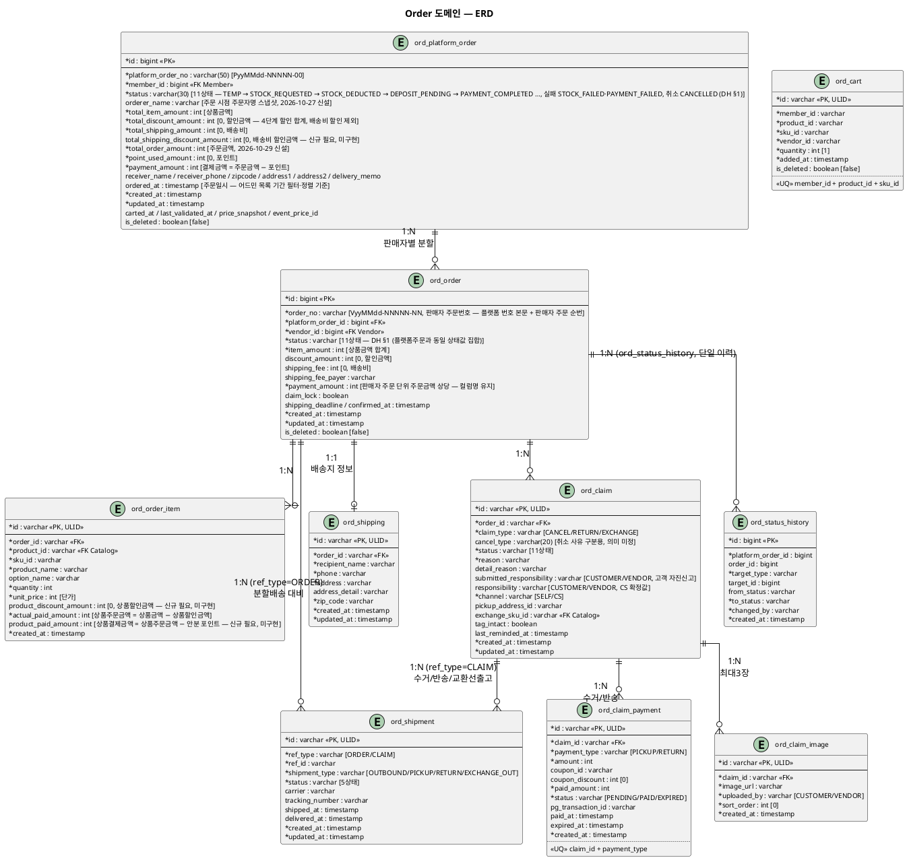

# 도메인 모델 (ERD) — Order

> **단계**: 구조설계
> **문서범위**: Domain
> **문서종류**: Design
>
> **작성 목적**: EARS(DD)에서 도출된 엔티티·속성·관계를 테이블 설계로 구체화한다.
> **흐름 내 위치**: DD EARS → **DF 도메인 모델(ERD)** → DG 비즈니스 프로세스
> **작성 주체**: 시니어 개발자 + AI 협업 (DBA/아키텍트 검토)
> **갱신일**: 2026-10-29
---

## ERD 다이어그램 (PlantUML)



---

## 2계층 주문 구조

```
ord_platform_order (고객 주문 단위, 1:N)
  └── ord_order (판매자별 처리 단위)
        ├── ord_order_item (주문상품 라인)
        ├── ord_shipping (배송지 정보, 1:1)
        ├── ord_shipment (배송 실행, 1:N — ref_type=ORDER, 분할배송 대비)
        ├── ord_claim (클레임)
        │     ├── ord_claim_payment (클레임 배송비 결제)
        │     ├── ord_claim_image (클레임 첨부 이미지)
        │     └── ord_shipment (배송 실행, 1:N — ref_type=CLAIM, 수거/반송/교환선출고)

ord_cart (장바구니, 독립)
ord_platform_order.status = TEMP(주문서 진입 임시주문, 2026-10-26 — 목록/집계 제외)
ord_platform_order_discount (TEMP 단계에서 주문서 쿠폰 적용 시 1건 영속, 2026-10-26) + ord_platform_order.total_discount_amount/point_used_amount/total_order_amount/payment_amount — 주문서의 쿠폰·포인트 적용값과 주문금액·결제금액을 결제 전부터 보관
ord_outbox_event (주문 비동기 처리 아웃박스 — STOCK_DEDUCT_REQUESTED/PAYMENT_REQUESTED, PENDING/DONE/FAILED, 2026-10-26 신설. API가 적재, 별도 컨슈머 앱이 조회·상태 관리)
cat_sku_stock / cat_stock_deduction (Catalog 소유 — SKU별 재고, 차감 이력 겸 request_id 멱등 키, 2026-10-26 신설)
ord_platform_order.status 접수 후 흐름 = TEMP → STOCK_REQUESTED → STOCK_DEDUCTED → DEPOSIT_PENDING → PAYMENT_COMPLETED (재고차감 3회 소진 시 STOCK_FAILED, 누적 결제 실패 3회 시 PAYMENT_FAILED, 입금대기 고객 취소·12시간 만료 시 CANCELLED)
ord_status_history (상태전이 이력 — 주문/결제/배송/클레임, 2026-10-26 신설)
```

> **v6 (2026-08-20 신설)**: 배송 실행(택배사·운송장·집화/배송중/배송완료)을 `ord_order.status`·`ord_claim.status`에서 분리해 `ord_shipment`로 통합. 두 상태는 이제 "고객·판매자·CS가 판단·결정하는 지점"만 표현한다.

### 금액·조회 기준 (2026-10-27, 어드민 주문목록 정책 확인 회신 반영)

| 항목 | 기준 |
|---|---|
| 상품금액(`total_item_amount`) | Σ (판매가 + 옵션 추가금액) × 수량 (할인 전) |
| 할인금액(`total_discount_amount`) | 상품 즉시할인 → 상품 쿠폰할인 → 장바구니 가격할인 → 장바구니 쿠폰할인 4단계의 합계. 배송비 할인금액 제외 |
| 주문금액(`total_order_amount`, 2026-10-29 신설) | `total_item_amount − total_discount_amount + total_shipping_amount − 배송비 할인금액` = 포인트 + 결제금액 (어드민·고객 목록의 "금액" 컬럼) |
| 결제금액(`payment_amount`) | `total_order_amount − point_used_amount` (PG 결제수단 지불분 — 컬럼명은 유지, 값 의미 불변) |
| 배송비 할인금액 | 신규 필요(`total_shipping_discount_amount`) — 현재 배송비 0·배송비 쿠폰 미구현이라 식에서 0으로 본다. 도입 시 `total_shipping_amount`가 할인 반영 전 값임을 확인 필요 |
| 주문일시 | `ord_platform_order.ordered_at` (어드민 목록 기간 필터·정렬·표시). `created_at`은 사용하지 않음 — **확정** |
| 어드민 조회 테이블 | `ord_platform_order` (플랫폼 오더). 판매자(partner) 화면만 `ord_order` 사용 — **확정** |
| 고객명 | 주문 시점 `orderer_name` 스냅샷 컬럼 (회원 개명·탈퇴와 무관하게 주문 당시 값 유지) — **확정, DDL·적재 로직 추가 필요** |
| 주문번호 | 플랫폼 `PyyMMdd-NNNNN-00` / 판매자 `VyyMMdd-NNNNN-NN`(끝 2자리 = 해당 주문 내 판매자 순번) (C2 용어 참조) |

---

## DBML

```dbml
Table ord_platform_order {
  id bigint [pk, increment]
  platform_order_no varchar(50) [not null, unique, note: 'PyyMMdd-NNNNN-00 — 어드민 "주문번호"(고객 노출 주문번호는 C2 참조)']
  member_id bigint [not null, note: '주문자 (Member 도메인)']
  status varchar(30) [not null, default: 'TEMP', note: 'TEMP / STOCK_REQUESTED / STOCK_DEDUCTED / DEPOSIT_PENDING / PAYMENT_COMPLETED / PREPARING / DELIVERED / CONFIRMED / CANCELLED / PAYMENT_FAILED / STOCK_FAILED (11상태, 상태머신(DH) §1과 동일 — ord_order.status와 일원화. 플랫폼주문은 접수~결제 구간 중심)']
  orderer_name varchar [note: '주문 시점 주문자명 스냅샷 (2026-10-27 신설) — 어드민 고객명 표시·검색 소스']
  total_item_amount int [not null, note: '상품금액 (할인 전 합계)']
  total_discount_amount int [default: 0, note: '할인금액 — 4단계 할인 합계(배송비 할인 제외)']
  total_shipping_amount int [default: 0, note: '배송비 합계']
  total_shipping_discount_amount int [default: 0, note: '배송비 할인금액 — 신규 필요(미구현)']
  total_order_amount int [not null, note: '주문금액 = total_item_amount − total_discount_amount + total_shipping_amount − total_shipping_discount_amount (2026-10-29 신설)']
  point_used_amount int [default: 0, note: '포인트 사용액']
  payment_amount int [not null, note: '결제금액 = total_order_amount − point_used_amount (PG 결제분)']
  receiver_name varchar
  receiver_phone varchar
  zipcode varchar
  address1 varchar
  address2 varchar
  delivery_memo varchar
  ordered_at timestamp [note: '주문일시(주문 접수 시각). 어드민 목록 기간 필터·정렬 기준 (created_at 아님)']
  carted_at timestamp
  last_validated_at timestamp
  price_snapshot jsonb
  event_price_id bigint
  created_at timestamp [not null]
  updated_at timestamp [not null]
  is_deleted boolean [default: false]
  deleted_at timestamp
  deleted_by bigint

  indexes {
    member_id [name: 'idx_porder_member']
    ordered_at [name: 'idx_porder_ordered']
  }

  note: '고객이 보는 주문 단위. 어드민 주문 목록·상세는 이 테이블 기준, 판매자(partner)는 ord_order 기준. 접수 후 판매자별 ord_order로 분할'
}

Table ord_order {
  id bigint [pk, increment]
  order_no varchar [not null, note: 'VyyMMdd-NNNNN-NN (플랫폼 번호 본문 + 판매자 주문 순번)']
  platform_order_id bigint [not null, ref: > ord_platform_order.id]
  vendor_id bigint [not null, note: '판매자 ID (Vendor 도메인)']
  status varchar [not null, note: 'TEMP / STOCK_REQUESTED / STOCK_DEDUCTED / DEPOSIT_PENDING / PAYMENT_COMPLETED / PREPARING / DELIVERED / CONFIRMED / CANCELLED / PAYMENT_FAILED / STOCK_FAILED (11상태, 상태머신(DH) §1과 동일 체계. v6: IN_DELIVERY 제거 — ord_shipment로 이관. 2026-10-29: 폐기된 ORDER_RECEIVED·PAYMENT_PENDING 삭제, 비동기 접수 상태 추가. 플랫폼주문(ord_platform_order.status)과 같은 상태값 집합을 쓰며 함께 전이, 클레임(ord_claim.status)은 별도 11상태 체계)']
  item_amount int [not null, note: '상품금액 합계']
  discount_amount int [default: 0, note: '할인금액']
  shipping_fee int [default: 0, note: '배송비']
  shipping_fee_payer varchar
  payment_amount int [not null, note: '판매자 주문 단위 주문금액 상당(item_amount − discount_amount + shipping_fee). 포인트는 플랫폼 주문 단위로만 관리 — 컬럼명 유지']
  claim_lock boolean [default: false]
  shipping_deadline timestamp
  confirmed_at timestamp
  created_at timestamp [not null]
  updated_at timestamp [not null]
  is_deleted boolean [default: false]
  deleted_at timestamp
  deleted_by bigint

  indexes {
    platform_order_id [name: 'idx_order_platform']
    vendor_id [name: 'idx_order_vendor']
    (status, created_at) [name: 'idx_order_status_date']
  }

  note: '판매자별 처리 단위. 배송·정산·클레임의 기본 단위'
}

Table ord_order_item {
  id varchar [pk, note: 'ULID']
  order_id varchar [not null, ref: > ord_order.id]
  product_id varchar [not null, note: 'Catalog 상품 ID']
  sku_id varchar [not null, note: 'SKU (옵션 조합)']
  product_name varchar [not null, note: '주문 시점 스냅샷']
  option_name varchar
  quantity int [not null]
  unit_price int [not null, note: '주문 시점 단가']
  product_discount_amount int [default: 0, note: '상품할인금액 — 신규 필요(미구현). 상품 즉시할인·상품 쿠폰할인 + 안분된 장바구니 가격할인·쿠폰할인']
  actual_paid_amount int [not null, note: '상품주문금액 = 상품금액(unit_price × quantity) − 상품할인금액 (할인 안분 후, 포인트 차감 전). 컬럼명 유지, 용어 "실결제 상품금액" 폐기']
  product_paid_amount int [note: '상품결제금액 = 상품주문금액 − 안분 포인트 — 신규 필요(미구현). 포인트는 최종 할인 후 안분']
  created_at timestamp [not null]

  indexes {
    order_id [name: 'idx_oitem_order']
  }
}

Table ord_cart {
  id varchar [pk, note: 'ULID']
  member_id varchar [not null]
  product_id varchar [not null]
  sku_id varchar [not null]
  vendor_id varchar [not null]
  quantity int [not null, default: 1]
  added_at timestamp [not null]
  is_deleted boolean [default: false]

  indexes {
    member_id [name: 'idx_cart_member']
    (member_id, product_id, sku_id) [unique, name: 'uq_cart_member_sku']
  }

  note: '장바구니. 동일 상품+옵션은 수량 합산 (REQ-ORD-005)'
}

Table ord_shipping {
  id varchar [pk, note: 'ULID']
  order_id varchar [not null, ref: > ord_order.id]
  recipient_name varchar [not null]
  phone varchar [not null, note: '마스킹: 010-****-5678']
  address varchar [not null]
  address_detail varchar
  zip_code varchar [not null]
  created_at timestamp [not null]
  updated_at timestamp [not null]

  indexes {
    order_id [name: 'idx_shipping_order']
  }

  note: '배송지 정보 전용 (v6: carrier/tracking_number/shipped_at/delivered_at은 ord_shipment로 이관)'
}

Table ord_status_history {
  id bigint [pk, increment]
  platform_order_id bigint [not null]
  order_id bigint [note: 'ord_order.id(vendor 주문) — 결제완료까지의 플랫폼주문 단위 이력(주문 생성·결제)이면 null, 이후 배송·클레임 전이는 vendor 주문 단위로 필수']
  target_type varchar [not null, note: 'ORDER / PAYMENT / DELIVERY / CLAIM']
  target_id bigint [note: '대상 레코드 PK(ord_order/pay_payment/ord_shipment/ord_claim)']
  from_status varchar [note: 'null = 최초 생성']
  to_status varchar [not null]
  changed_by varchar [not null, default: 'SYSTEM', note: 'SYSTEM/CUSTOMER/VENDOR/ADMIN']
  reason varchar [note: '작업 내용 요약(예: PG 결제 요청/PG 승인 수신). PG payload는 저장하지 않음']
  created_at timestamp [not null]

  indexes {
    (platform_order_id, created_at) [name: 'idx_status_history_platform_order']
    (target_type, target_id) [name: 'idx_status_history_target']
  }

  note: '상태전이 이력 단일 테이블(ord_order_history 폐기, 2026-11-03 확정; REQ-ORD-039). append-only, 2026-10-26 신설, DDL: db/order-status-history.sql). 주문/결제/배송/클레임 상태가 바뀔 때만 기록하며(기록 단위: 결제완료까지는 플랫폼주문, 이후 배송·클레임은 vendor 주문) 상태변경과 같은 트랜잭션에서 INSERT. admin 주문상세 변경이력 탭의 소스'
}

Table ord_shipment {
  id varchar [pk, note: 'ULID']
  ref_type varchar [not null, note: 'ORDER / CLAIM']
  ref_id varchar [not null, note: 'ord_order.id 또는 ord_claim.id']
  shipment_type varchar [not null, note: 'OUTBOUND(주문출고) / PICKUP(클레임수거) / RETURN(클레임반송) / EXCHANGE_OUT(교환선출고)']
  status varchar [not null, default: 'PENDING', note: 'PENDING / IN_TRANSIT / DELIVERED / FAILED / CANCELLED']
  carrier varchar
  tracking_number varchar
  shipped_at timestamp
  delivered_at timestamp
  created_at timestamp [not null]
  updated_at timestamp [not null]

  indexes {
    (ref_type, ref_id) [name: 'idx_shipment_ref']
    (ref_type, ref_id, shipment_type) [name: 'idx_shipment_ref_type']
    (status, created_at) [name: 'idx_shipment_status_date']
  }

  note: '배송 실행 전용 (v6 신설). 데이터모델은 order 1건에 N건 가능(분할배송 — (ref_type,ref_id,shipment_type) unique 아님)하도록 설계했으나, 1차 파트 S3(인터페이스명세·화면레이아웃)는 1주문:1배송만 구현 — 분할배송 API/UI는 Phase 2 범위(2026-08-21 바텀업 검토 확인). claim 1건이 PICKUP+EXCHANGE_OUT 동시 보유 가능(맞교환)은 현재 구현됨. order.status/claim.status의 배송완료 전이는 이 테이블의 DELIVERED 이벤트를 구독해 파생 갱신'
}

Table ord_claim {
  id varchar [pk, note: 'ULID']
  order_id varchar [not null, ref: > ord_order.id]
  claim_type varchar [not null, note: 'CANCEL / RETURN / EXCHANGE. CANCEL은 주문 취소(고객 직접·어드민 예외 취소) 시 같은 트랜잭션에서 생성(REQ-ORD-082, 2026-10-29) — 귀책 판정·수거·검수 없음, responsibility 비움. 확정(2026-11-03): 입금대기 취소 RECEIVED→COMPLETED, 환불 필요 취소 RECEIVED→REFUNDED→COMPLETED']
  cancel_type varchar [note: '취소 사유 구분용, 의미 미정. 코드(Claim.kt cancelType: String?)·DDL(order-admin-erd-redesign.sql ord_claim.cancel_type VARCHAR(20), NULL 허용)에 컬럼만 있고 코드값·주석·사용처가 없어 의미를 확정할 수 없음. claim_type=CANCEL 클레임에서만 쓰일 것으로 추정되나 미확정']
  status varchar [not null, note: 'RECEIVED / PAYMENT_PENDING / PAYMENT_EXPIRED / INSPECTING / PICKED_UP / PICKUP_REJECTED / REFUNDED / RETURN_PAYMENT_PENDING / DISPOSED / COMPLETED / REJECTED (11상태, v6: PICKUP/RETURN_SHIPPING/RETURN_DELIVERED 제거 — ord_shipment로 이관)']
  reason varchar [not null]
  detail_reason varchar [note: '상세 사유 (선택)']
  submitted_responsibility varchar [note: '고객이 신청 시 자진신고한 값(CUSTOMER/VENDOR). CS 판정 후에도 변경되지 않음 — REQ-ORD-076']
  responsibility varchar [note: 'CS 귀책판정 확정값. CUSTOMER(고객귀책) / VENDOR(판매자귀책, 상품불량 등 — 사진 최소 1장 필수). submitted_responsibility와 다를 수 있음(CS가 번복, REQ-ORD-066)']
  channel varchar [not null, default: 'SELF', note: '신청경로: SELF(고객직접) / CS(콜센터)']
  pickup_address_id varchar [note: '회수지 주소 ID (기본: 주문 배송지)']
  exchange_sku_id varchar [note: '교환 대상 SKU (Catalog 도메인, claim_type=EXCHANGE 전용, 선출고 시 사용)']
  tag_intact boolean [note: '품질점검 판정 근거 — 택(TAG) 부착 여부 (claim_type=EXCHANGE 전용)']
  last_reminded_at timestamp [note: 'RECEIVED 24시간 미처리 리마인드 최종 발송 시각 (REQ-ORD-068, 중복 발송 방지)']
  created_at timestamp [not null]
  updated_at timestamp [not null]

  indexes {
    order_id [name: 'idx_claim_order']
    (claim_type, status) [name: 'idx_claim_type_status']
    (status, created_at) [name: 'idx_claim_status_date']
  }

  note: '클레임. v3(2026-08-12) 14상태 확장 — 반송 배송비결제 대기/반송배송완료 포함. v4(2026-08-20): 교환(EXCHANGE) 맞교환 원칙 — exchange_sku_id/tag_intact 필드 추가. v6(2026-08-20): 배송실행 3상태(PICKUP/RETURN_SHIPPING/RETURN_DELIVERED) 제거해 11상태로 축소(ord_shipment로 이관), responsibility를 CUSTOMER/VENDOR 2종으로 단순화(PLATFORM 제거). v7(2026-08-21 바텀업 재검증): submitted_responsibility 필드 추가(CS 확정 후에도 고객 자진신고 이력 보존, REQ-ORD-076). RECEIVED/PAYMENT_PENDING 상태에서 고객 자진취소 시 REJECTED로 전환(사유="고객 자진 철회", REQ-ORD-073) — 신규 claim_type 없이 기존 REJECTED 재사용'
}

Table ord_claim_payment {
  id varchar [pk, note: 'ULID']
  claim_id varchar [not null, ref: > ord_claim.id]
  payment_type varchar [not null, note: 'PICKUP(수거배송비) / RETURN(반송배송비)']
  amount int [not null, note: '배송비 금액']
  coupon_id varchar [note: '배송비 쿠폰 적용 시']
  coupon_discount int [default: 0]
  paid_amount int [not null, note: '결제금액 (amount - coupon_discount)']
  status varchar [not null, note: 'PENDING / PAID / EXPIRED']
  pg_transaction_id varchar [note: 'PG 거래번호']
  paid_at timestamp
  expired_at timestamp [note: '결제 만료 시각 (접수 후 24시간)']
  created_at timestamp [not null]

  indexes {
    claim_id [name: 'idx_cpay_claim']
    (claim_id, payment_type) [unique, name: 'uq_cpay_claim_type']
  }

  note: '클레임 배송비 결제. 수거/반송 구분 관리'
}

Table ord_claim_image {
  id varchar [pk, note: 'ULID']
  claim_id varchar [not null, ref: > ord_claim.id]
  image_url varchar [not null]
  uploaded_by varchar [not null, note: 'CUSTOMER(접수 시) / VENDOR(품질점검 판정 시) — REQ-ORD-075']
  sort_order int [not null, default: 0]
  created_at timestamp [not null]

  indexes {
    claim_id [name: 'idx_cimg_claim']
    (claim_id, uploaded_by) [name: 'idx_cimg_claim_uploader']
  }

  note: '클레임 첨부 이미지. uploaded_by별로 각각 최대 3장 독립 적용(REQ-ORD-075) — CUSTOMER(접수 시, VENDOR귀책 신청은 최소 1장 필수 REQ-ORD-058) / VENDOR(품질점검 거부 시, EXCHANGE 유형은 최소 1장 필수 REQ-ORD-072)'
}
```

> 상태 이력 테이블은 `ord_status_history` 단일이다(2026-11-03 확정, `ord_order_history`는 폐기). `ord_platform_order_discount`·`ord_outbox_event`의 DBML 정의는 아직 없다.

---

## 불변식 (Invariants)

| 불변식 | 검증 시점 | 도출 근거 |
|---|---|---|
| `SUM(ord_order_item.actual_paid_amount)` (상품주문금액 합) `== ord_order.item_amount − ord_order.discount_amount` | 주문 생성 시 | 부분반품 환불 기준 정합성 (2026-10-29 용어 개편 — 옛 `total_amount` 컬럼은 없음) |
| `ord_cart` 동일 member+sku는 unique | 담기 시 | REQ-ORD-005: 수량 합산, 중복 라인 방지 |
| `ord_platform_order.total_order_amount == total_item_amount − total_discount_amount + total_shipping_amount − 배송비 할인금액` | 주문 생성·쿠폰/포인트 적용 시 | 주문금액 산식 |
| `ord_platform_order.total_order_amount == payment_amount + point_used_amount` | 주문 생성·쿠폰/포인트 적용 시 | 주문금액 = 포인트 + 결제금액 |
| `ord_platform_order.total_order_amount == SUM(ord_order.payment_amount)` | 주문 분할 시 | 플랫폼주문↔판매자 주문 금액 정합 — **설계 불변식, 현행 미충족**(주문서 쿠폰 할인을 판매자 주문에 안분하지 않아 `ord_order.discount_amount`가 0) |
| `ord_order.status`(·`ord_platform_order.status`) 전이는 상태머신(DH) §1 11상태 허용 전이만 가능 | 상태 변경 시 | 금지 전이 위반 방지 |
| `ord_claim.status` 전이는 상태머신(DH) 클레임 11상태 허용 전이만 가능 | 상태 변경 시 | 클레임 금지 전이 위반 방지 |
| `ord_claim_payment` 동일 claim+payment_type는 unique | 배송비 결제 시 | 수거/반송 배송비 중복 결제 방지 |
| `ord_claim_image` 동일 claim+uploaded_by는 각각 최대 3건 (접수분/판정분 독립) | 이미지 첨부 시 | REQ-ORD-075: 첨부 제한 3장은 업로더별 독립 적용 |
| `ord_claim_image` uploaded_by=CUSTOMER, submitted_responsibility=VENDOR 클레임은 최소 1건 이상 | 클레임 접수 확인 시 | REQ-ORD-058: 상품불량 등 판매자귀책 사유는 사진 증빙 필수 |
| `ord_claim_image` uploaded_by=VENDOR, claim_type=EXCHANGE 품질점검거부는 최소 1건 이상 | 품질점검 거부 판정 시 | REQ-ORD-072: 교환 판정도 사진 증빙 필수 |
| `ord_claim.submitted_responsibility`는 신청 후 불변, `responsibility`만 CS가 갱신 | 귀책 판정 확정 시 | REQ-ORD-076: 자진신고 이력 보존 |
| `ord_shipment.status` 전이는 상태머신(DH) 배송 5상태 허용 전이만 가능 | 상태 변경 시 | 배송 금지 전이 위반 방지 |

---

## Soft Delete 정책

| 테이블 | 정책 | 사유 |
|---|---|---|
| ord_cart | `is_deleted = true`, 30일 보관 후 배치 물리 삭제 | 비즈니스 데이터 아님 |
| ord_platform_order | `is_deleted = true`, 영구 보관 | 법적 보관 의무 (전자상거래법 5년) |
| ord_order | `is_deleted = true`, 영구 보관 | 법적 보관 의무 |
| ord_order_item | 물리 삭제 없음 | 주문 이력 일부 |
| ord_shipping | 물리 삭제 없음 | 배송지 증빙 |
| ord_shipment | 물리 삭제 없음 | 배송 실행 증빙 (v6 신설) |
| ord_claim | 물리 삭제 없음 | 클레임 이력 |
| ord_claim_payment | 물리 삭제 없음 | 배송비 결제 증빙 |
| ord_claim_image | 물리 삭제 없음 | 클레임 증빙 이미지 |
| ord_status_history | 물리 삭제 없음 | 감사 로그 (구 ord_order_history 폐기, 단일 이력) |

---

## 근거

| 항목 | 출처 |
|---|---|
| 엔티티 도출 | `../DD-EARS기능요구/order.md` 주어/목적어 명사 추출 |
| 테이블 접두사 `ord_` | `DB-도메인정의서.md` 스키마 그룹핑 |
| 2계층 주문구조 | 도메인정의서 §4: Order-Vendor 관계 + 정산 단위 요구 |
| 장바구니 50개 제한 | REQ-ORD-004 |
| 스냅샷 원칙 (product_name, unit_price) | REQ-ORD-009 |
| 반품 기한 10일 | REQ-ORD-030 |
| 배송 실행 분리(ord_shipment) | 상태머신(DH) v6 — "고객·판매자·CS 의사결정 지점만 order/claim status로, 택배사 이동 구간은 별도" 원칙 |
| 판매자귀책 사진 필수 | REQ-ORD-058 |
| 비동기 접수 상태·아웃박스 | REQ-ORD-008·012·077·078·079 |
| 입금대기 취소·구매확정 후 어드민 접수·취소 클레임(`claim_type=CANCEL`) | REQ-ORD-080·081·082 |
