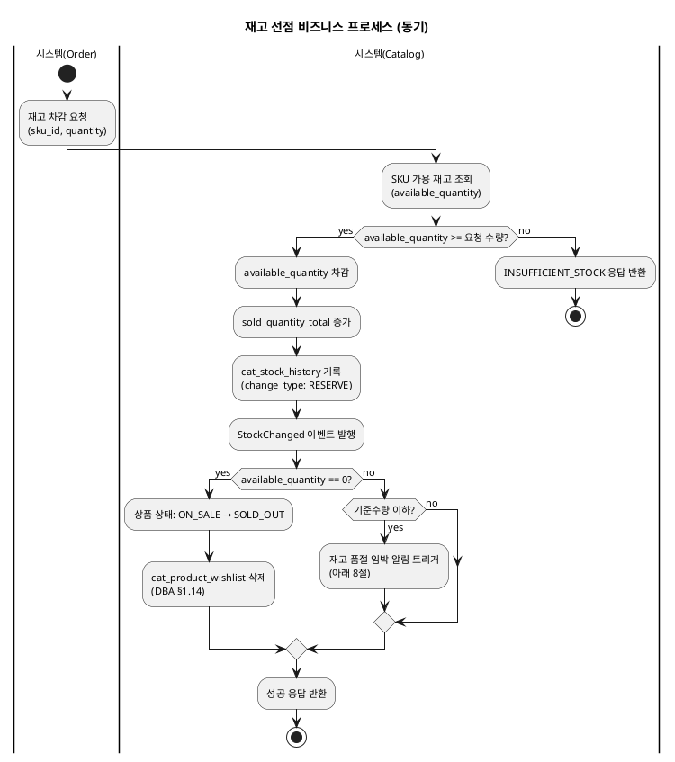
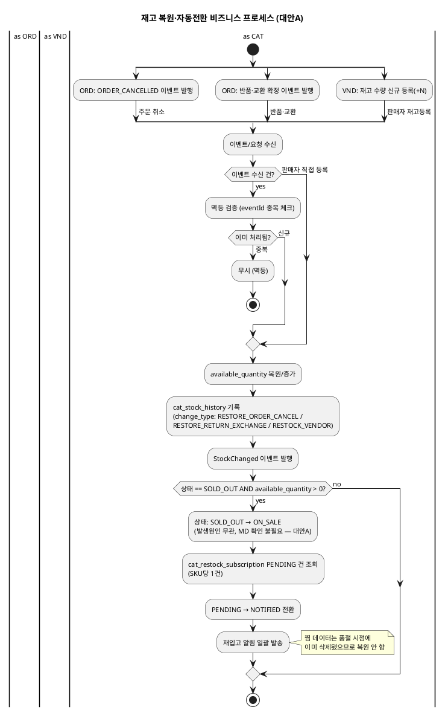
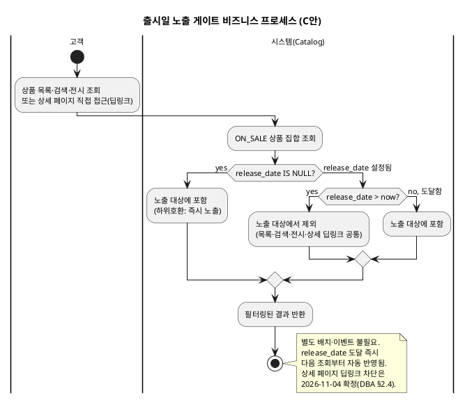
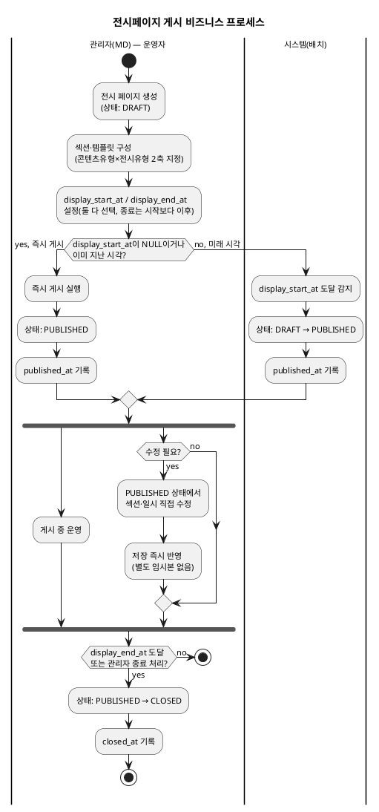
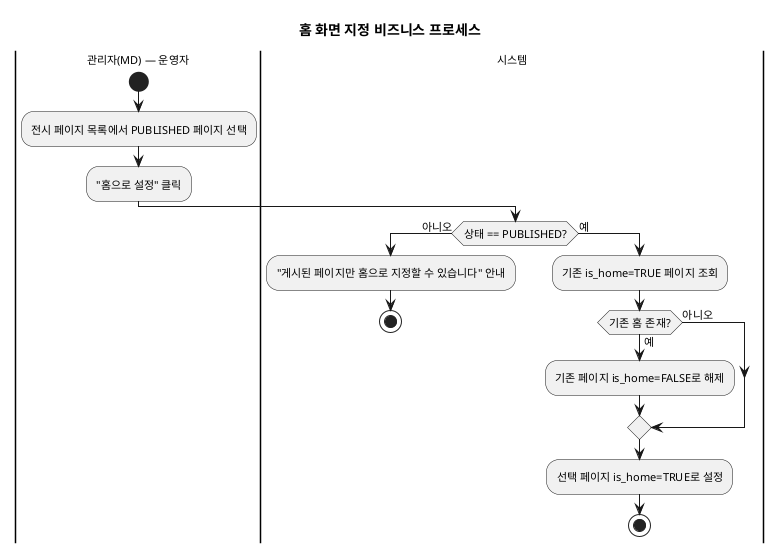
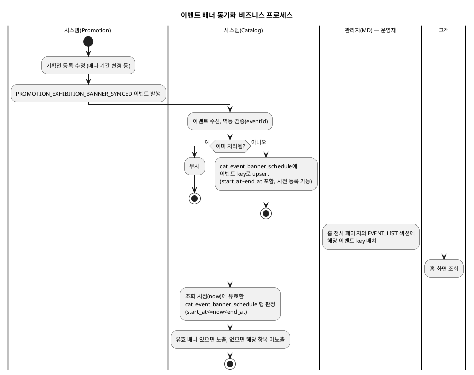
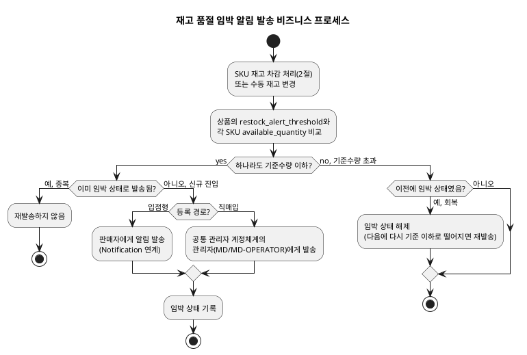
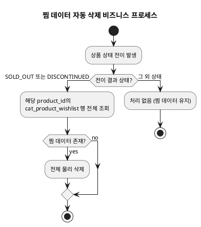
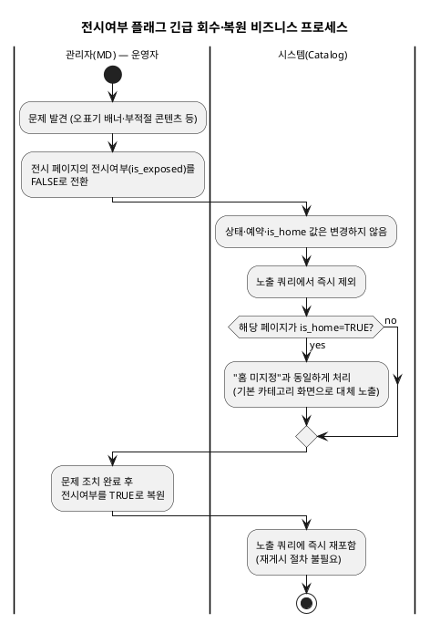

# 비즈니스 프로세스 — Catalog

> **단계**: 구조설계
> **문서범위**: Domain
> **문서종류**: Design
>
> **작성 목적**: 상태머신(⑩)의 전이를 액티비티 흐름으로 확장하여, "누가 어떤 순서로 업무를 수행하는가"를 시각화한다.
> **흐름 내 위치**: ⑩ 상태머신 → **⑪ 비즈니스 프로세스** → ⑫ 이벤트 플로우
> **작성 주체**: 시니어 개발자 + AI 협업 (기획자·현업 검토·확인)

| 항목 | 내용 |
|---|---|
| ID | DESIGN-BP-CATALOG-001 |
| 상태 | **Draft** |
| 작성일 | 2026-08-21 |
| 갱신일 | 2026-11-06 |

> **2026-10-26 갱신**: `DH-상태머신/catalog.md`(직매입/입점형 분기 반영)·`DD-EARS기능요구/
> catalog.md`(REQ-CAT-001~051)를 기준으로 갱신했다. 구버전은 입점형 심사 프로세스만 있고
> 직매입 경로가 없었고, 재고 자동전환이 "SKU 합산" 기준으로만 서술돼 대안A(발생원인 무관·
> MD확인불필요)가 명확하지 않았다. 출시일 노출 게이트(C안) 프로세스를 신규 추가했다. 용어는
> "판매자"로 통일했다(C2 3관점 원칙).
>
> **2026-11-06 재동기화**: DBA 번호 재정비(2026-11-04)에 맞춰 전체 "DBA §x.x" 인용을
> 갱신하고, 신규 프로세스 3건(재고 품절임박 알림 발송, 찜 데이터 자동 삭제, 전시여부
> 플래그에 의한 긴급 회수·대체노출)을 추가했다.

---

## 1. 상품등록·심사 프로세스

> **직매입/입점형 분기**: `is_direct_sourced` 값에 따라 심사 게이트 유무가 갈린다(DH 1절,
> DBA §1.5.1). 분기점에서 경로가 나뉘고 직매입은 즉시 종료된다.

```plantuml
@startuml
skinparam backgroundColor transparent
skinparam defaultFontSize 11
title 상품등록·심사 비즈니스 프로세스

|관리자(MD) — 직매입등록자|
start
if (등록 경로?) then (직매입)
  :직매입 상품 정보 입력\n(name, category, price, image);
  :등록 완료;
  :상태: DRAFT → ON_SALE\n(심사 게이트 생략);
  stop
else (입점형)
endif

|판매자|
if (일반 등록 또는 복제/대량등록?) then (복제)
  :본인 상품 선택 후 복제 요청;
  :가격·재고·판매자상품코드 제외한\n전체 항목 복사 (이미지는 원본 참조);
  :신규 productId·skuId·상품번호 발급;
  :상태: DRAFT (등록 경로 그대로 재적용);
else (대량등록)
  :엑셀 업로드\n(기본정보+옵션/SKU);
  :행 단위로 DRAFT 상품 일괄 생성;
else (일반)
  :상품 초안 작성\n(name, category, price, image);
  :상태: DRAFT;
endif

if (필수 필드 충족?) then (yes)
  :심사 요청;
  :상태: REVIEW_REQUESTED;
else (no)
  :필수 필드 미충족 안내;
  stop
endif

|관리자(MD) — 심사자|
:심사 착수;
:상태: UNDER_REVIEW;

if (상품 적합?) then (승인)
  :심사 승인;
  :상태: ON_SALE;
  :ProductApproved 이벤트 발행;
  stop
else (반려)
  :반려 사유 작성;
  :상태: REJECTED;
  :reject_count +1, rejected_at 갱신;
  :판매자 알림 발송;

  if (동일 사유 3회 이상 반복?) then (yes)
    :입점 심사팀 에스컬레이션;
  else (no)
  endif
endif

|판매자|
:반려 사유 확인;

if (30일 이내 수정?) then (yes)
  :상품 수정;
  :상태: DRAFT;
  backward :심사 요청;
else (30일 초과)
  |시스템(배치)|
  :재제출 기한 만료 감지;
  :상품 자동 삭제;
  stop
endif

@enduml
```

---

## 2. 재고 선점 프로세스 (동기)



---

## 3. 재고 복원·자동전환 프로세스 (대안A, 비동기)

> **대안A 핵심**: 재고 복원의 **발생 원인과 무관하게** 재고 1 이상이면 MD 확인 없이 자동
> ON_SALE 전환한다(DBA §1.10, REQ-CAT-022). 발생 원인 3가지(주문취소·반품교환확정·판매자
> 재고신규등록)를 하나의 플로우로 통합 표현한다 — 분기는 원인 기록(change_type)에만 있고,
> 전환 로직 자체는 공통이다.



---

## 4. 출시일 노출 게이트 프로세스 (C안)

> `release_date`는 상품 상태를 바꾸지 않는다 — 조회 쿼리 시점에 `now`와 비교해 필터링만
> 한다(DBA §2.4 C안, REQ-CAT-033~034). 별도 배치나 이벤트가 없다는 점이 핵심이라, 이
> 프로세스는 "조회 시점 판정"이라는 하나의 결정 지점만 가진다. **상세 페이지 직접 접근
> (딥링크)도 동일 필터를 적용한다**(DBA §2.4에서 확정, 아래 다이어그램에 반영).



---

## 5. 전시페이지 게시 프로세스



---

## 6. 홈 화면 지정 프로세스



---

## 7. 이벤트 배너 동기화 프로세스

> **전제**: 이 프로세스는 Promotion이 기획전 등록·수정·취소 시 이벤트를 발행한다는 가정
> 위에 있다. 실제 발행 여부는 **[Human Review]** — DBA §6 Human Review #11~12 참조.



---

## 8. 재고 품절 임박 알림 발송 프로세스 (2026-11-06 신설)

> 재입고 알림(3절)과 반대 방향 — 품절 **전** 내부 운영자(판매자·관리자)에게 보내는 예방용
> 알림이다(DBA §1.10).



---

## 9. 찜 데이터 자동 삭제 프로세스 (2026-11-06 신설)

> 찜하기(DBA §1.14)는 상품 노출 상태와 강하게 결합돼 있어, 상품 상태 전이(1절·2절·3절)의
> 부수효과로 트리거된다 — 별도의 독립된 업무 프로세스가 아니라 "상태 전이에 매달린 액션"
> 이라는 점을 명시하기 위해 별도 절로 뽑아둔다.



---

## 10. 전시여부 플래그 긴급 회수·복원 프로세스 (2026-11-06 신설)

> §2.10 "긴급 게시·회수" — 전시 페이지 상태 전이(5절)와 독립적인 축이다. 상태를 전혀
> 건드리지 않고 노출 쿼리 필터만 토글한다는 점이 5절과의 핵심 차이다.



---

## 근거

> **원칙**: 구조설계 단계 산출물은 AS-IS 정책서를 직접 인용하지 않는다. `DH-상태머신/
> catalog.md`·`DD-EARS기능요구/catalog.md`가 1차 근거이며, `DBA-도메인정책서/catalog.md`로
> 정책 맥락을 보강한다.

| 항목 | 출처 |
|---|---|
| 상태 전이 | `deliverables/S2-구조설계/DH-상태머신/catalog.md` |
| 직매입/입점형 분기 흐름, 복제·대량등록 | DD REQ-CAT-001~007·056~057, DBA §1.5.1~§1.5.3 |
| 심사 반려·재제출·에스컬레이션 | DD REQ-CAT-006~009, DBA §1.6 |
| 재고 선점·판매량 집계 | DD REQ-CAT-020·023, DBA §1.10·§2.6 |
| 재고 복원·자동전환(대안A) | DD REQ-CAT-021~022·024~025, DBA §1.10 |
| 재고 품절임박 알림 | DD REQ-CAT-058~059, DBA §1.10(2026-11-06 신설) |
| 출시일 노출 게이트(C안, 딥링크 포함) | DD REQ-CAT-033~034, DBA §2.4 |
| 재입고 알림 | DD REQ-CAT-032 |
| 찜 데이터 자동 삭제 | DD REQ-CAT-062, DBA §1.14(2026-11-06 신설) |
| 전시 예약 게시 | DD REQ-CAT-038~043, DBA §2.7.1·§2.10 |
| 홈 화면 지정 | DD REQ-CAT-052, DBA §2.7.2 |
| 전시여부 플래그 긴급 회수·복원 | DD REQ-CAT-068, DBA §2.10(2026-11-06 신설) |
| 이벤트 배너 동기화 | DD REQ-CAT-054~055, DBA §2.8.2 — **[Human Review] Promotion 실제 이벤트 발행 여부 미확인** |
