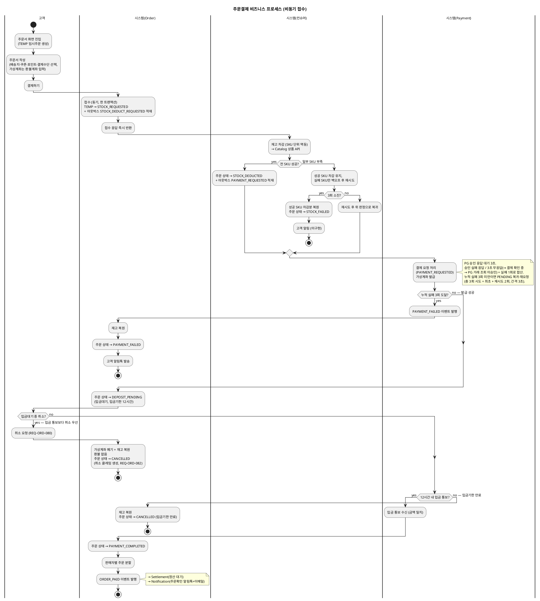
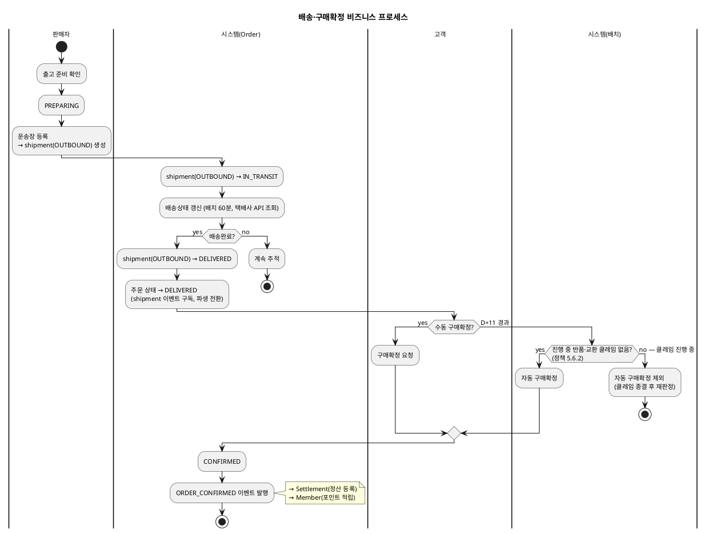
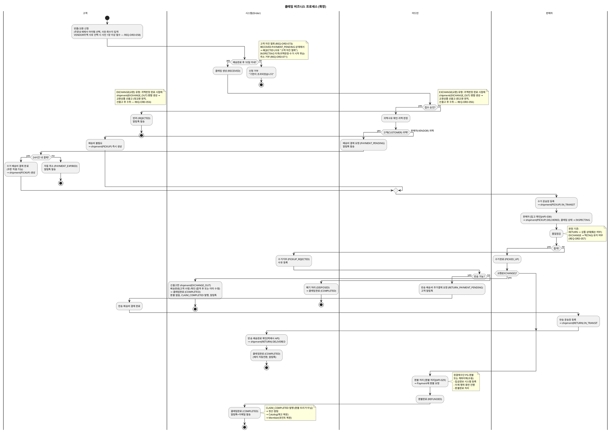

# 비즈니스 프로세스 — Order

> **단계**: 구조설계
> **문서범위**: Domain
> **문서종류**: Design
>
> **작성 목적**: 상태머신(DH)의 전이를 액티비티 흐름으로 확장하여, "누가 어떤 순서로 업무를 수행하는가"를 시각화한다.
> **흐름 내 위치**: DF ERD → **DG 비즈니스 프로세스** → DH 상태머신 → DI 이벤트 플로우
> **작성 주체**: 시니어 개발자 + AI 협업 (기획자·현업 검토·확인)
> **갱신일**: 2026-10-29
---

## 1. 주문결제 프로세스

> v3 (2026-10-29 현행화): 비동기 접수 모델로 교체 — 결제하기는 접수만 동기(TEMP→STOCK_REQUESTED + 아웃박스 같은 트랜잭션), 재고차감·결제요청은 컨슈머가 비동기 처리, 가상계좌 발급 후 입금대기(DEPOSIT_PENDING)에서 입금 통보·12시간 만료·고객 취소(취소 우선)로 분기. 상태머신(DH) v7·REQ-ORD-008·012·013·014·077~080 기준.



> 취소 확정된 주문에 입금 통보가 뒤늦게 도착하면 PAYMENT_COMPLETED로 바꾸지 않고 입금액을 저장된 환불계좌로 자동 환불한다(LATE_DEPOSIT, REQ-PAY-030). 카드·간편결제 등 인증형 수단의 PAYMENT_AUTH_PENDING 흐름은 안(DH 참조)이며 이 다이어그램은 가상계좌(프로토타입 범위) 기준이다. 입금 통보·만료·고객 취소·PAYMENT_FAILED 처리는 프로토타입 미구현.

### [폐기] 이력 — 동기 접수 모델 (2026-10-29 이전)

> 아래 구 모델은 폐기됐다: `TEMP→ORDER_RECEIVED→PAYMENT_PENDING`, 결제하기 중 Catalog 동기 재고 선점 호출, 재고 부족 시 즉시 `STOCK_FAILED`, 승인 실패 1회에 즉시 `PAYMENT_FAILED`. 현행은 위 다이어그램(DH v7)을 따른다.

---

## 2. 배송·구매확정 프로세스

> v2 (2026-08-20 현행화): 배송 실행(IN_DELIVERY)을 `ord_shipment`(OUTBOUND)로 분리 — 상태머신(DH) v6



---

## 3. 취소 프로세스

> v2 (2026-08-20 현행화): CS 예외취소가 PREPARING까지만 가능함을 명시(송장 등록 후·배송 시작 이후는 CS도 취소 불가, 상태머신(DH) 금지전이)

```plantuml
@startuml
skinparam backgroundColor transparent
skinparam defaultFontSize 11
title 주문 취소 비즈니스 프로세스

|고객 / CS|
start
:취소 요청;

|시스템(Order)|
if (PAYMENT_COMPLETED 또는 DEPOSIT_PENDING(입금대기) 상태?) then (yes)
  :고객 단순 취소 허용;
  note right: 입금대기는 가상계좌 폐기 + 재고 복원, 환불 없음
  :CANCELLED\n(취소 클레임 생성, REQ-ORD-082);
  :ORDER_CANCELLED 이벤트 발행;
  note right: → Payment(환불)\n→ Catalog(재고 복원)\n→ Member(포인트 복원)
  stop
else (PREPARING 상태?) then (yes)
  if (CS 예외 취소 + 출고 shipment 송장 미등록?) then (yes)
    :CS 예외 취소 처리;
    :CANCELLED\n(취소 클레임 생성, channel=CS, REQ-ORD-082);
    :ORDER_CANCELLED 이벤트 발행;
    note right: → Payment(환불)\n→ Catalog(재고 복원)
    stop
  else (no)
    :취소 거부\n고객: "고객센터로 문의해주세요"\n송장 등록 후: "배송완료 후 반품을 이용해주세요";
    stop
  endif
else (DELIVERED 이후 — 배송 시작됨)
  :취소 거부(CS도 불가)\n"배송 시작 후에는 취소할 수 없습니다.\n반품 신청으로 처리해주세요";
  stop
endif

@enduml
```

---

## 4. 클레임(반품/교환) 프로세스

> v2 (2026-08-12 현행화): 12상태 확장 반영 (배송비 결제→수거→품질점검→합격/거부→환불/폐기/반송)
> v3 (2026-08-20 현행화): 14상태 반영 — 반송 배송비결제 대기(RETURN_PAYMENT_PENDING)·반송배송완료(RETURN_DELIVERED) 상태 보강
> v4 (2026-08-20 현행화): 교환(EXCHANGE) "맞교환" 원칙 반영 — PICKUP 진입 시 교환상품 선출고, 품질점검 판정 기준을 EXCHANGE는 택(TAG) 유지 여부로 명시
> v6 (2026-10-29 현행화): INSPECTING 진입 시점을 "수거 shipment(PICKUP) 입고 확인 시"로 명시(REQ-ORD-031·032, 귀책 판정 직후 아님), 고객 자진 철회(REQ-ORD-073)·INSPECTING 이후 취소 거부(REQ-ORD-071) 분기 추가.
> v5 (2026-08-20 현행화): 배송 실행(PICKUP/RETURN_SHIPPING/RETURN_DELIVERED)을 `ord_shipment`로 분리(상태머신(DH) v6) — 11상태로 축소. 수거·반송 배송은 shipment 하위 흐름으로 표시. VENDOR귀책 신청 시 사진 1장 필수(REQ-ORD-058) 반영.



---

## 근거

| 항목 | 출처 |
|---|---|
| 상태 전이 | `../DH-상태머신/order.md` |
| 액터·업무 흐름 | `../DC-상위유스케이스/order.md` |
| 도메인 간 호출 | `DB-도메인정의서.md` §4 관계도 |
| 업무 규칙 | REQ-ORD-015 (D+11), REQ-ORD-019 (취소 제한), REQ-ORD-030 (반품 10일), REQ-ORD-058 (VENDOR귀책 사진 필수) |
| 배송 실행 분리(ord_shipment) | REQ-ORD-059~062 |
| 비동기 접수·재고차감·가상계좌 발급·입금대기 | REQ-ORD-008·012·013·014·077·078·079 |
| 입금대기 취소·구매확정 후 어드민 접수·취소 클레임 | REQ-ORD-080·081·082 |
| 클레임 자진 철회·INSPECTING 진입 시점 | REQ-ORD-071·073, REQ-ORD-031·032 |
| 자동 구매확정 제외(진행 중 클레임) | 정책서 5.6.2 |
