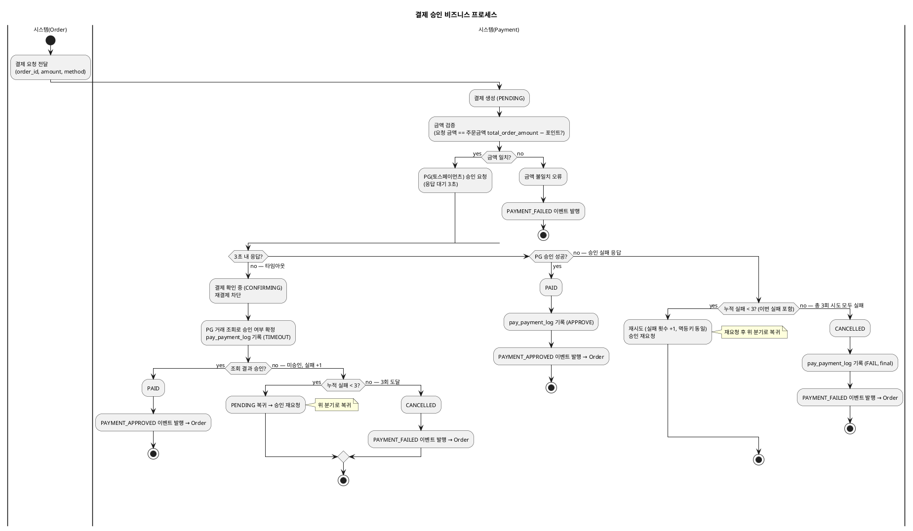
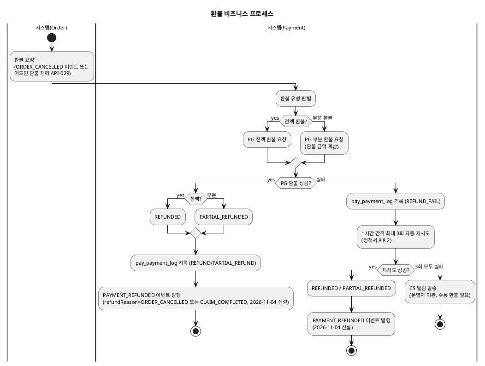
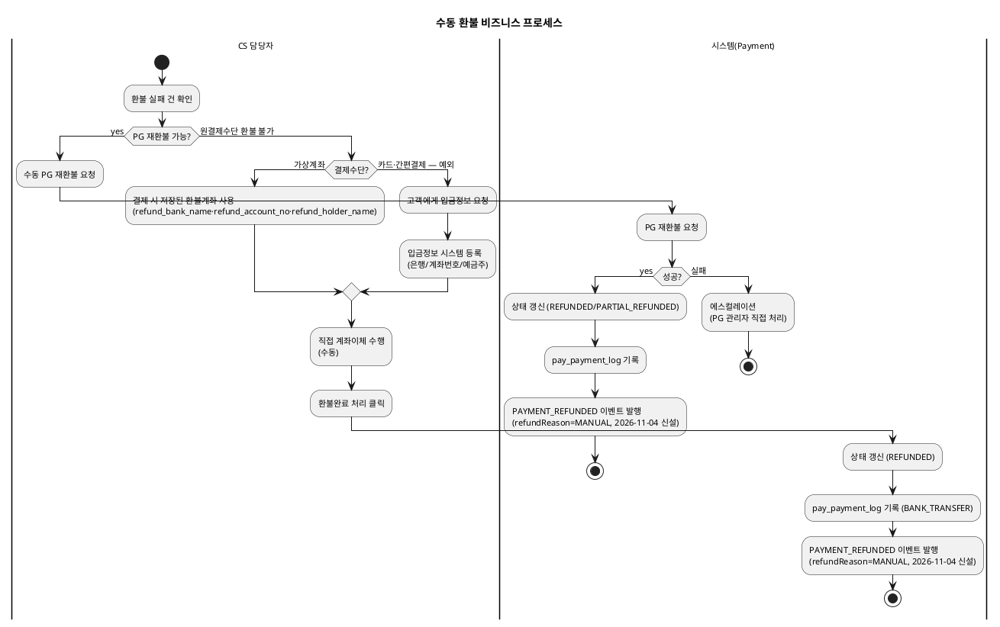
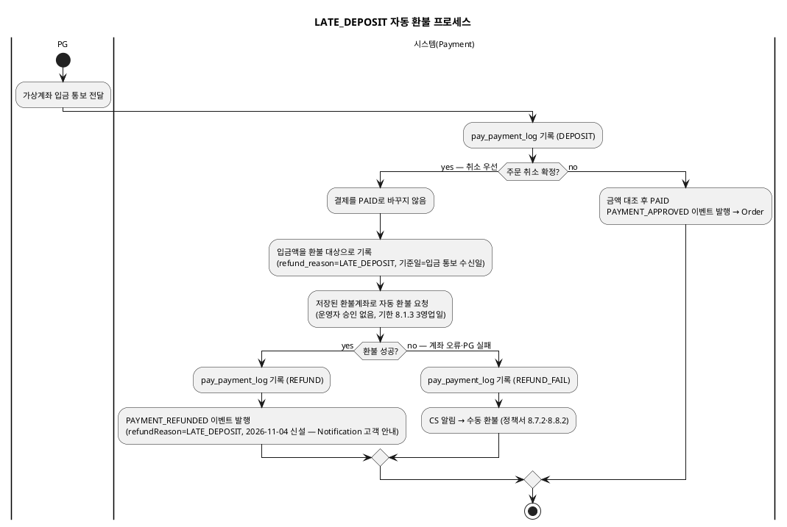
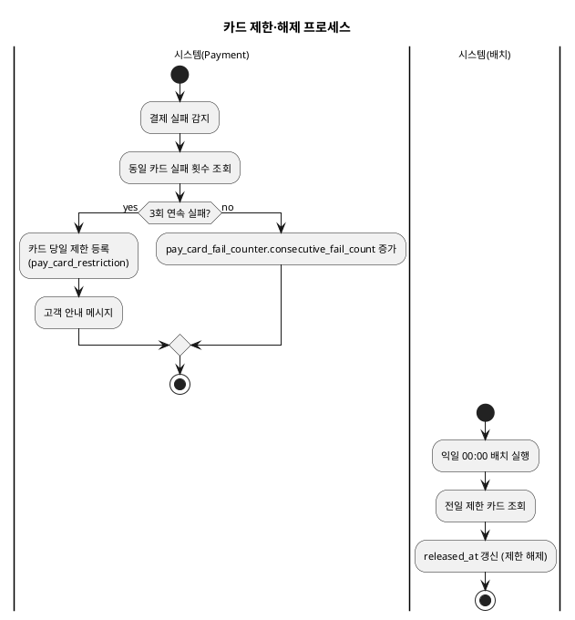

# 비즈니스 프로세스 — Payment

> **단계**: 구조설계
> **문서범위**: Domain
> **문서종류**: Design
>
> **작성 목적**: 상태머신(DH)의 전이를 액티비티 흐름으로 확장하여, "누가 어떤 순서로 업무를 수행하는가"를 시각화한다.
> **흐름 내 위치**: DF ERD → **DG 비즈니스 프로세스** → DH 상태머신 → DI 이벤트 플로우
> **작성 주체**: 시니어 개발자 + AI 협업 (기획자·현업 검토·확인)

| 항목 | 내용 |
|---|---|
| ID | DESIGN-BP-PAYMENT-001 |
| 상태 | **Finalized** |
| 작성일 | 2026-08-11 |
| 갱신일 | 2026-10-29 |

---

## 1. 결제 승인 프로세스

> **타임아웃(2026-10-29 개정)**: 승인 응답이 3초 안에 오지 않으면 즉시 재요청하지 않고 "결제 확인 중"으로 두고 PG 거래 조회로 확정한다(정책서 4.5.2). 확인 전 재결제는 차단한다. 조회 결과 미승인이면 **실패 1회로 계산**하고, 실패 응답과 합산한 누적 실패가 3회 미만이면 재요청, 3회면 CANCELLED다.
> **승인 실패 응답 재시도**: 승인 실패 응답은 최초 시도 포함 총 3회 시도(재시도 최대 2회) 후 CANCELLED로 **확정**했다(2026-10-29, REQ-PAY-003·004, 정책서 9.6.1 정정). 재시도 간격은 **3초 고정**이다(2026-10-29 확정, 옛 지수 백오프 1초→2초→4초는 폐기). 3초 무응답은 조회로 미승인이 확정된 뒤에 같은 간격으로 재요청한다.

---

## 2. 환불 프로세스

> **환불 트리거·실패 처리(2026-11-03 확정)**: 환불은 ① 주문 취소(ORDER_CANCELLED 수신 시 자동) ② 클레임(반품) 환불(**어드민 [환불 처리](API-029)만** 트리거) ③ LATE_DEPOSIT(자동)으로만 시작한다. CLAIM_COMPLETED는 정산·알림·재고복원·포인트 이벤트일 뿐 Payment가 이 이벤트로 환불하지 않는다(REQ-PAY-009). 환불 실패는 정책서 8.8.2(1시간 간격 최대 3회 자동 재시도 후 운영자 이관)가 정본(설계안)이며, 현행 구현은 즉시 실패·보상 1회·운영팀 이관(정책서 8.1.4, 구현 이력)이다.
> **PAYMENT_REFUNDED 발행(2026-11-04 신설)**: 환불이 실제로 성공(최초 성공 또는 재시도 성공)했을 때만 발행하고, 3회 재시도 후 운영자 이관되는 실패 건은 발행하지 않는다(수동 환불로 최종 성공한 시점에 발행, §3 수동 환불 프로세스 참조). 상세 스키마는 이벤트플로우(DI payment.md) `PAYMENT_REFUNDED`.

---

## 3. 수동 환불 프로세스

---

## 3-1. 입금 통보·취소 경합 자동 환불 프로세스 (LATE_DEPOSIT, 2026-10-29)

---

## 4. 카드 제한·해제 프로세스

---

## 근거

| 항목 | 출처 |
|---|---|
| 상태 전이 | `../DH-상태머신/payment.md` |
| 결제 흐름 | `../DC-상위유스케이스/payment.md` 결제 실행 업무그룹 |
| 재시도 규칙 | REQ-PAY-003 (총 3회 시도), REQ-PAY-005·029 (승인 응답 대기 3초, 결제 확인 중) |
| 금액 검증 | REQ-PAY-007 |
| 카드 제한 | REQ-PAY-018, REQ-PAY-019 |
| 환불 정책 | REQ-PAY-008~013 |
| 신규 REQ-PAY-023~031 추적 | 023 카드 연속 실패 카운터(§4), 024 환불 산식(§2), 025~028 복합결제·주문금액 검증(§1), 029 결제 확인 중(§1), 030 LATE_DEPOSIT 자동 환불(§3-1), 031 환불계좌(§3 가상계좌 수동 환불) |
| PAYMENT_REFUNDED 발행 지점(2026-11-04 신설) | 이벤트플로우(DI payment.md·readme.md), DP-클래스설계/payment.md `PaymentEventPublisher.publishPaymentRefunded` — §2·§3·§3-1의 환불 성공 분기에 발행 단계 추가 |
