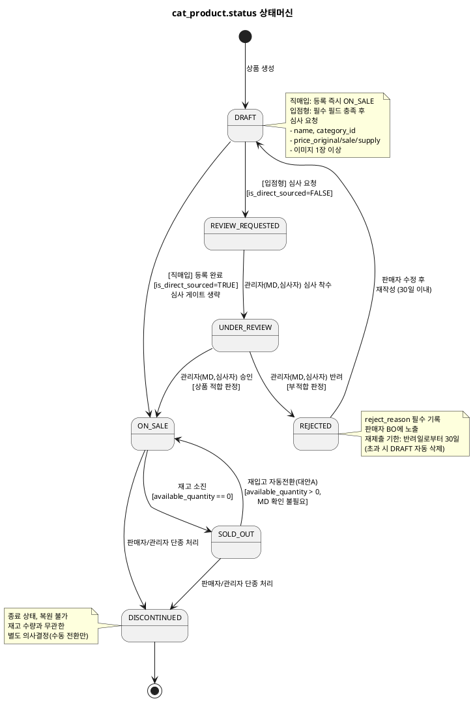
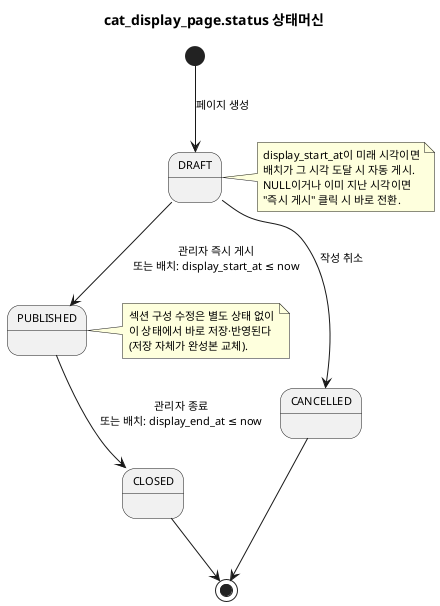

# 상태머신 — Catalog

> **단계**: 구조설계
> **문서범위**: Domain
> **문서종류**: Design
>
> **작성 목적**: ERD(⑨)의 status 컬럼에서 허용 상태와 전이 규칙을 정의한다.
> **흐름 내 위치**: ⑨ ERD → **⑩ 상태머신** → ⑪ 비즈니스 프로세스 → ⑫ 이벤트 플로우
> **작성 주체**: 시니어 개발자 + AI 협업 (기획자·현업 검토·확인)

| 항목 | 내용 |
|---|---|
| ID | DESIGN-SM-CATALOG-001 |
| 상태 | **Draft** |
| 작성일 | 2026-08-21 |
| 갱신일 | 2026-11-06 |

> **2026-10-26 갱신**: `DF-도메인모델ERD/catalog.md`(전면 재작성, `is_direct_sourced` 플래그
> 도입)·`DD-EARS기능요구/catalog.md`(REQ-CAT-001~051)를 기준으로 직매입/입점형 분기와 재고
> 자동전환(대안A)을 반영했다. 구버전은 "DRAFT→ON_SALE 심사 없이 불가"를 전역 금지 전이로
> 뒀으나, 직매입 경로(`is_direct_sourced=TRUE`)는 정책상 이 전이가 **허용**되어야 하므로
> 가드 조건을 분기별로 재정의했다.
>
> **2026-11-06 재동기화**: DBA가 2026-11-04에 Part I/II/III 구조로 재정비되면서 번호가 바뀐
> 것을 전체 반영하고, 그 사이 DBA에 신설된 정책을 전이 액션에 추가했다 — ① `cat_product`가
> `SOLD_OUT`/`DISCONTINUED`로 전환될 때 `cat_product_wishlist` 삭제 액션(DBA §1.14) 반영,
> ② `cat_display_page.is_exposed`(전시여부, DBA §2.10)는 상태 전이가 아니라 상태와 별개인
> 조회 쿼리 필터 축이라는 점을 명시(혼동 방지를 위해 "상태 아님" 섹션 신설).

---

## 1. cat_product.status 상태머신

> **경로 분기**: `is_direct_sourced` 값에 따라 상태 전이 경로가 다르다(DF 개념구분 참조).
> `REVIEW_REQUESTED`·`UNDER_REVIEW`·`REJECTED` 3개 상태는 `is_direct_sourced=FALSE`(입점형)
> 전용이며, 직매입(`TRUE`)은 이 3개 상태를 거치지 않는다.

### 상태 목록

| 상태 | 설명 | 진입 조건 |
|---|---|---|
| DRAFT | 초안 (작성 중) | 상품 생성 시 / 입점형 반려 후 재작성 |
| REVIEW_REQUESTED | 심사 요청됨 (판매자→MD, 입점형 전용) | 판매자 심사 요청 |
| UNDER_REVIEW | 심사 중 (MD 검토 진행, 입점형 전용) | 관리자(MD, 심사자) 심사 착수 |
| ON_SALE | 판매 중 (고객 노출) | 직매입 등록 즉시 / 입점형 심사 승인 / 재입고 |
| SOLD_OUT | 품절 (재고 소진) | available_quantity == 0 |
| DISCONTINUED | 단종 (영구 판매 중단) | 판매자/관리자 단종 처리 |
| REJECTED | 심사 반려 (수정 필요, 입점형 전용) | 관리자(MD, 심사자) 반려 처리 |

### 전이 다이어그램

### 전이 규칙 상세

| From | To | 트리거 | 가드 (조건) | 액션 (부수효과) |
|---|---|---|---|---|
| DRAFT | ON_SALE | 관리자(MD, 직매입등록자) 등록 완료 | `is_direct_sourced = TRUE` | 심사 게이트 없이 즉시 전환 |
| DRAFT | REVIEW_REQUESTED | 판매자 심사 요청 | `is_direct_sourced = FALSE`, name·category_id·price_original/sale/supply·이미지 ≥ 1장 | ProductCreated 이벤트 (최초 등록 시) |
| REVIEW_REQUESTED | UNDER_REVIEW | 관리자(MD, 심사자) 심사 착수 | — | 심사 담당자 할당 |
| UNDER_REVIEW | ON_SALE | 관리자(MD, 심사자) 승인 | 상품 적합 판정 | ProductApproved 이벤트 발행 |
| UNDER_REVIEW | REJECTED | 관리자(MD, 심사자) 반려 | 부적합 판정 | reject_reason 기록, reject_count +1, rejected_at 갱신, 판매자 알림 |
| REJECTED | DRAFT | 판매자 수정 저장 | 반려일로부터 30일 이내 | reject_reason 유지(이력), 재작성 허용 |
| REJECTED | (자동삭제) | 배치: 재제출 기한 만료 | `now - rejected_at > 30일` AND `status = REJECTED` 유지 | 상품 자동 삭제 (REQ-CAT-008) |
| ON_SALE | SOLD_OUT | 재고 차감 결과 | available_quantity == 0 (모든 SKU) | StockChanged 이벤트 발행, `cat_product_wishlist` 전체 삭제(DBA §1.14, REQ-CAT-062 — 재입고돼도 복원하지 않으며 고객이 다시 찜해야 함) |
| SOLD_OUT | ON_SALE | 재입고 자동전환(대안A) | available_quantity > 0 (1개 이상 SKU), **발생 원인(주문취소·반품교환확정·판매자재고신규등록) 무관, MD 확인 불필요** | StockChanged 이벤트 발행, cat_restock_subscription PENDING 건 NOTIFIED 전환 |
| ON_SALE | DISCONTINUED | 판매자/관리자 단종 | — (재고 수량과 무관한 수동 의사결정) | 전시 페이지·노출 쿼리에서 제외, `cat_product_wishlist` 전체 삭제(DBA §1.14, REQ-CAT-062) |
| SOLD_OUT | DISCONTINUED | 판매자/관리자 단종 | — | 전시 페이지·노출 쿼리에서 제외, `cat_product_wishlist` 전체 삭제(DBA §1.14, REQ-CAT-062) |

### 금지 전이

| From | To | 사유 | EARS 근거 |
|---|---|---|---|
| DRAFT | ON_SALE (입점형) | `is_direct_sourced=FALSE`인 상품은 심사 없이 판매 불가 | REQ-CAT-002~005: 입점형 심사 프로세스 필수 |
| DRAFT | SOLD_OUT | 미승인 상태에서 재고 개념 없음 | 논리적 불가 |
| REVIEW_REQUESTED | ON_SALE | MD 심사 착수 단계 생략 불가 | REQ-CAT-004: 심사 착수 필수 |
| REJECTED | ON_SALE | 반려 후 바로 판매 불가 (재심사 필수) | REQ-CAT-007: DRAFT 경유 필수 |
| DISCONTINUED | 모든 상태 | 종료 상태, 복원 불가 | 운영 정책: 영구 판매 중단 |
| ON_SALE/SOLD_OUT | DRAFT | 이미 승인된 상품 초안 회귀 불가 | 운영 정책 |
| ON_SALE/SOLD_OUT | UNDER_REVIEW | 이미 판매 중 상품 재심사 불가 | 운영 정책 |
| SOLD_OUT | ON_SALE (MD 승인 경유) | 재입고는 대안A에 따라 **자동** 전환이며 MD 승인 단계를 거치지 않음 | DBA §1.10(대안A), REQ-CAT-022 — AS-IS "담당자 확인 후 수동전환"에서 변경된 부분이라 금지 전이로 명시 |

### 상태가 아닌 것: cat_product의 보조 플래그

> 아래 값들은 `status`와 별개의 컬럼이며, 상태 전이 규칙의 대상이 아니다. 조회 쿼리 필터
> 또는 상품 단위 설정값으로만 동작한다(DBA가 §2.4 출시일 게이트 이후 일관되게 쓰는
> "상태는 그대로 두고 조회 쿼리에서만 필터링" 패턴).

| 컬럼 | 성격 | 참조 |
|---|---|---|
| `release_date` | 노출 게이트 — `release_date > now`인 동안 목록·검색·전시·상세 조회에서 제외 | DBA §2.4(C안) |
| `max_order_quantity` | 1회 주문 최대수량 — Order가 주문 시점에 검증(상태 전이 아님) | DBA §1.8 |
| `restock_alert_threshold` | 재고 품절임박 알림 기준수량 — 알림 트리거 조건값 | DBA §1.10 |

---

## 2. cat_display_page.status 상태머신

> **2026-11-09 단순화**: 기존 7개 상태(DRAFT·DRAFT_EDIT·PUBLISHED·SCHEDULED·RESERVED·CLOSED·
> CANCELLED)를 4개로 줄였다. 섹션 구성을 전부 채운 뒤 저장하면 그 자체가 완성본이 되는
> 구조라, "게시 중인 내용과 분리된 수정용 사본"(DRAFT_EDIT)이 실제로는 동작할 수 없는
> 모델이었다(별도 행을 만들면 `slug` 전역 유니크 제약과 충돌하고, 원본과 연결할 FK도 없었음).
> "예약"(SCHEDULED)은 상태가 아니라 `display_start_at` 필드 유무로, "종료 후 보관"(RESERVED)은
> 재사용이 필요하면 상품처럼 **페이지 복제**로 푸는 쪽이 더 단순하다고 판단해 제거했다.

### 상태 목록

| 상태 | 설명 | 진입 조건 |
|---|---|---|
| DRAFT | 대기 — 작성 중이거나 게시 예약(`display_start_at`)이 걸려 있는 상태 | 페이지 생성 시 |
| PUBLISHED | 진행 — 고객 화면 노출 중 (섹션 수정은 상태 전이 없이 이 상태에서 직접 반영) | 관리자 즉시 게시 / 배치가 `display_start_at` 도달 감지 |
| CLOSED | 종료 — 영구 종료, 재활성화 불가 | 관리자 종료 처리 / 배치가 `display_end_at` 도달 감지 |
| CANCELLED | 취소 — 게시 전에 폐기 (대기 상태에서만 가능) | 관리자 취소 처리 |

### 전이 다이어그램

### 전이 규칙 상세

| From | To | 트리거 | 가드 (조건) | 액션 (부수효과) |
|---|---|---|---|---|
| DRAFT | PUBLISHED | 관리자 즉시 게시 | 섹션 1개 이상 | published_at 기록 |
| DRAFT | PUBLISHED | 배치: display_start_at ≤ now | 섹션 1개 이상 | published_at 기록 |
| DRAFT | CANCELLED | 관리자 취소 | — | — |
| PUBLISHED | CLOSED | 관리자 종료 | — | closed_at 기록, `is_home=TRUE`였다면 FALSE로 자동 해제(REQ-CAT-052) |
| PUBLISHED | CLOSED | 배치: display_end_at ≤ now | — | closed_at 기록, `is_home=TRUE`였다면 FALSE로 자동 해제(REQ-CAT-052) |

> PUBLISHED 상태에서의 섹션·제목·`display_start_at`/`display_end_at` 수정은 상태 전이가
> 아니라 일반 업데이트다(가드·액션 없음, 단순 저장).

### 금지 전이

| From | To | 사유 | EARS 근거 |
|---|---|---|---|
| CLOSED | 모든 상태 | 종료 후 재활성화 불가 | 운영 정책 |
| CANCELLED | 모든 상태 | 취소 후 복원 불가 | 운영 정책 |
| DRAFT | CLOSED | 미게시 상태에서 종료 개념 없음 | 논리적 불가 |
| PUBLISHED | CANCELLED | 이미 노출된 페이지는 "취소"가 아니라 "종료"로 처리 | 운영 정책 — 취소는 게시 전 폐기만 의미 |
| PUBLISHED 외 모든 상태 | `is_home=TRUE` 설정 | 홈 지정은 PUBLISHED 상태에서만 허용 | REQ-CAT-052, DBA §2.7.2 |

### 상태가 아닌 것: cat_display_page의 보조 플래그

> **`is_exposed`(전시여부)는 상태가 아니다.** DRAFT↔PUBLISHED↔CLOSED 등 위 상태 전이는
> 그대로 두고, 노출 쿼리에서만 `status=PUBLISHED AND is_exposed=TRUE` 조건으로 필터링한다
> (DBA §2.10 — 2.4 출시일 게이트와 동일한 "상태 전이 없는 긴급 회수" 패턴). 그래서 이 값은
> 위 전이 다이어그램·금지 전이 표의 대상이 아니며, 단순 boolean 토글(TRUE↔FALSE)만 있다.

| 토글 | 트리거 | 효과 |
|---|---|---|
| TRUE → FALSE | 운영자 긴급 회수 | 상태·예약·`is_home` 값은 그대로 두고 노출 쿼리에서만 즉시 제외. `is_home=TRUE`인 페이지면 "홈 미지정"과 동일하게 기본 카테고리 화면으로 대체 노출 |
| FALSE → TRUE | 운영자 복원 | 노출 쿼리에 즉시 재포함 (상태 전이 없이 복원되므로 재게시 절차 불필요) |

---

## Bolt 분할 후보 (상태 전이 기반)

| Bolt 후보 | 상태 전이 | 예상 규모 |
|---|---|---|
| 상품 초안 등록 | →DRAFT | 반나절 |
| 심사 요청·착수 | DRAFT→REVIEW_REQUESTED→UNDER_REVIEW | 반나절 |
| 심사 승인·반려 | UNDER_REVIEW→ON_SALE / →REJECTED | 반나절 |
| 재고 선점·복원 | ON_SALE↔SOLD_OUT 연동 | 1일 |
| 상품 단종 | →DISCONTINUED | 반나절 |
| 전시 페이지 생성·게시 | DRAFT→PUBLISHED(즉시/배치) | 1일 |
| 전시 페이지 수정(진행 중 직접 수정)·종료 | PUBLISHED 직접 수정, →CLOSED(즉시/배치) | 반나절 |
| 전시여부 플래그(긴급 회수) | is_exposed TRUE↔FALSE (상태 전이 아님) | 반나절 |

---

## 근거

> **원칙**: 구조설계 단계 산출물은 AS-IS 정책서를 직접 인용하지 않는다. `DF-도메인모델ERD/
> catalog.md`·`DD-EARS기능요구/catalog.md`가 1차 근거이며, `DBA-도메인정책서/catalog.md`로
> 정책 맥락을 보강한다.

| 항목 | 출처 |
|---|---|
| 상태 목록 (product), `is_direct_sourced` 플래그 | `deliverables/S2-구조설계/DF-도메인모델ERD/catalog.md` cat_product |
| 상태 목록 (display_page) | `deliverables/S2-구조설계/DF-도메인모델ERD/catalog.md` cat_display_page |
| 직매입/입점형 분기 전이 | `deliverables/S2-구조설계/DD-EARS기능요구/catalog.md` REQ-CAT-001~007, `DBA-도메인정책서/catalog.md` §1.5.1·§1.9 |
| 심사 정책(반려·재제출·에스컬레이션) | DD REQ-CAT-006~009, DBA §1.6 |
| 재고 자동전환(대안A) | DD REQ-CAT-021~022, DBA §1.10 |
| 단종 처리(수동 전환만, 찜 데이터 삭제) | DD REQ-CAT-015·062, DBA §1.9·§1.11·§1.14 |
| 전시 페이지 상태·전시기간(display_start_at/display_end_at) | DD REQ-CAT-038~043, DBA §2.7.1·§2.10(2026-11-09 4상태 단순화) |
| 홈 지정(`is_home`)과 상태 전이 상호작용 | DD REQ-CAT-052, DBA §2.7.2 — PUBLISHED 상태에서만 지정 가능, 다른 상태로 전이 시 자동 해제 |
| 전시여부(`is_exposed`) 플래그 — 상태 아님 | DD REQ-CAT-068, DBA §2.10(2026-11-06 신설) |
| Bolt 분할 기준 | 방법론 부록 A (전이 1개 = Bolt 1개) |
