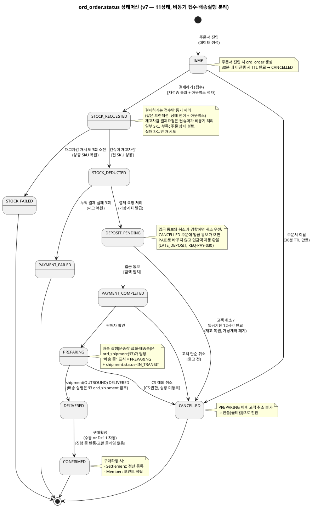
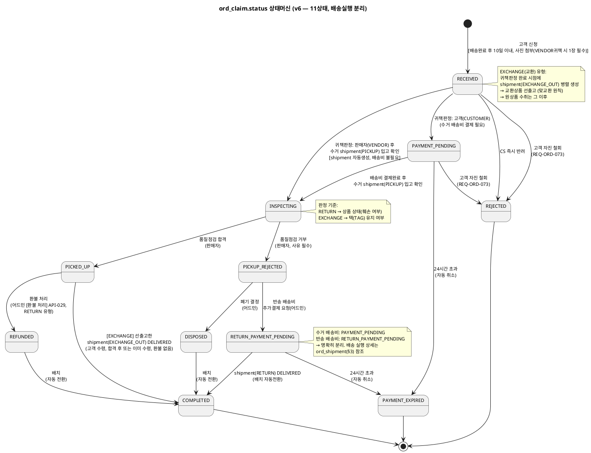
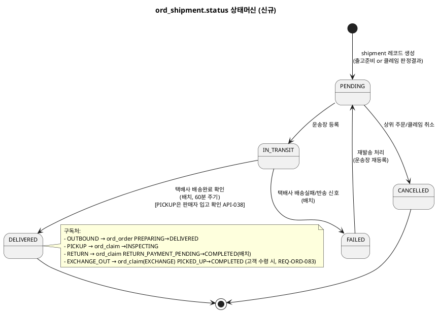

# 상태머신 — Order

> **단계**: 구조설계 / Domain / Design
> **작성 목적**: ERD(DF)의 status 컬럼에서 허용 상태와 전이 규칙을 정의한다.
> **흐름 내 위치**: DF ERD → DG 비즈니스 프로세스 → **DH 상태머신** → DI 이벤트 플로우
> **작성 주체**: 시니어 개발자 + AI 협업 (기획자·현업 검토·확인)
> **갱신일**: 2026-10-29

---

## 1. ord_order.status 상태머신

> **v7 (2026-10-29 현행화)**: 폐기된 동기 접수 모델(`ORDER_RECEIVED`·`PAYMENT_PENDING`, 동기 재고 선점)을 제거하고 비동기 접수 모델(결제하기=접수만 동기, 재고차감·결제요청은 컨슈머가 비동기 처리)로 본문을 개정했다. 종전 하단 "구현 현행화 (2026-10-26)" 블록은 이 절에 통합했다. 상태는 10상태 → **11상태**(`ORDER_RECEIVED`·`PAYMENT_PENDING` 삭제, `STOCK_REQUESTED`·`STOCK_DEDUCTED`·`DEPOSIT_PENDING` 추가).
>
> **v6 (2026-08-20 현행화)**: 배송 실행(IN_DELIVERY)을 `ord_shipment`(§3)로 분리. order.status는 "고객·판매자·CS가 판단·결정하는 지점"만 표현하며, "배송 중" 표시는 `PREPARING + shipment(OUTBOUND).status=IN_TRANSIT` 조인으로 화면에서 계산한다.
>
> **상태 체계 적용 범위**: 플랫폼주문(`ord_platform_order`)·판매자주문(`ord_order`)·주문상품은 이 상태값 집합을 공유하며 함께 전이한다(DF 2계층 구조). 주문서 진입~결제 확정 구간(TEMP~PAYMENT_COMPLETED, 실패·취소)은 플랫폼주문 단위로 전이하고, PREPARING 이후(출고·배송·구매확정)는 판매자주문 단위로 전이한다. 클레임은 §2 별도 상태 체계(`ord_claim.status`)이므로 플랫폼주문/판매자주문 체계와 구분한다. [확인 필요: 플랫폼주문의 PREPARING 이후 대표 상태 집계 규칙(판매자별 상태가 다를 때)은 DF·정책서에 명시가 없다]

### 상태 목록

| 상태 | 설명 | 진입 조건 |
|---|---|---|
| TEMP | 임시주문 생성 (주문서 진입) | 주문서 화면 진입 시 데이터 생성 |
| STOCK_REQUESTED | 접수 완료 (재고차감 요청 적재, 처리 대기) | 고객 결제하기 — 쿠폰·포인트 재검증 통과 후 아웃박스 `STOCK_DEDUCT_REQUESTED`를 같은 트랜잭션에 적재 (REQ-ORD-008·012) |
| STOCK_DEDUCTED | 재고 차감 완료 (결제 요청 대기) | 컨슈머가 전 SKU 재고 차감 성공 → 아웃박스 `PAYMENT_REQUESTED` 적재 (REQ-ORD-078) |
| DEPOSIT_PENDING | 입금 대기 (가상계좌 발급 완료) | `PAYMENT_REQUESTED` 처리 — Payment가 가상계좌 발급 (REQ-ORD-077). 입금기한 발급 후 12시간 |
| PAYMENT_COMPLETED | 결제 완료 | 가상계좌 입금 통보(금액 일치) 또는 PG 승인(PAYMENT_APPROVED) (REQ-ORD-013) |
| PREPARING | 출고 준비~배송 중 | 판매자 확인 (배송실행 상세는 ord_shipment 참조) |
| DELIVERED | 배송 완료 | shipment(OUTBOUND) DELIVERED (파생) |
| CONFIRMED | 구매 확정 | 고객 수동 or 배송완료 후 D+11 자동 |
| CANCELLED | 취소 | 고객 취소(입금대기·결제완료) · CS 예외 취소(PREPARING) · 입금기한 만료 · 임시주문 TTL 만료 |
| PAYMENT_FAILED | 결제 실패 | Payment의 누적 실패 3회 도달(최초 시도 포함 총 3회 시도: 승인 실패 응답 또는 3초 무응답 후 거래 조회 미승인) → PAYMENT_FAILED 이벤트 수신 |
| STOCK_FAILED | 재고 부족 실패 | 재고차감 재시도 3회 소진(`give-up`) — 성공 SKU 차감분 복원 후 전환 (REQ-ORD-079) |

> 인증형 결제수단(카드·간편결제·계좌이체)용 `PAYMENT_AUTH_PENDING`(결제 인증 대기)은 **안(2026-10-26)** 이며 11상태에 포함하지 않는다. Order는 Payment가 돌려주는 정규화 상태(`nextAction`)만 사용한다(DP-클래스설계/payment.md "인증·승인 2단계와 채널·PG 확장").

### 전이 다이어그램

### 전이 규칙 상세

| From | To | 트리거 | 가드 (조건) | 액션 (부수효과) | 액터 | 화면 기능 |
|---|---|---|---|---|---|---|
| [*] | TEMP | 주문서 진입 (장바구니 "주문하기") | — | ord_order 생성 | 고객 | 주문서 화면 진입 |
| TEMP | STOCK_REQUESTED | 고객 결제하기 (REQ-ORD-008·012) | 주문서 유효성·쿠폰·포인트 재검증 통과, 필수 정보(배송지·결제수단·약관) 충족 | 아웃박스 `STOCK_DEDUCT_REQUESTED` 적재(같은 트랜잭션), 접수 응답 즉시 반환 | 고객 | 주문서 [결제하기] 버튼 |
| TEMP | CANCELLED | 주문서 이탈 (TTL 30분) | — | 임시 데이터 정리 | 시스템(배치) | 없음 |
| STOCK_REQUESTED | STOCK_DEDUCTED | 컨슈머 → 상품 API `deductStock` 전 SKU 성공 (REQ-ORD-078) | `cat_stock_deduction` request_id 멱등 | 아웃박스 `PAYMENT_REQUESTED` 적재 | 시스템(컨슈머) | 없음 |
| STOCK_REQUESTED | STOCK_FAILED | 재고차감 재시도(백오프) 3회 소진 `give-up` (REQ-ORD-079) | 일부 SKU 부족은 성공 SKU 차감 유지·실패 SKU만 재시도 | 성공 SKU 차감분 `restoreStock` 복원, 고객 알림(미구현) | 시스템(컨슈머) | 없음 |
| STOCK_DEDUCTED | DEPOSIT_PENDING | `PAYMENT_REQUESTED` 처리 (REQ-ORD-077) | Payment 가상계좌 발급 성공 | 입금기한(12시간) 기록 | 시스템(컨슈머) | 없음 |
| STOCK_DEDUCTED | PAYMENT_FAILED | PAYMENT_FAILED 이벤트 (REQ-ORD-014) | Payment 누적 실패 3회 도달 (승인 실패 응답·3초 무응답 후 조회 미승인 합산, 최초 시도 포함 총 3회 시도) | 재고 복원, 고객 알림 | 시스템 | 없음 |
| DEPOSIT_PENDING | PAYMENT_COMPLETED | 가상계좌 입금 통보 (REQ-ORD-013) | 입금액·결제금액 일치, 취소 확정 주문이 아닐 것 | 주문확인 알림톡+이메일, 판매자별 주문 분할·ORDER_PAID 발행 | 시스템 | 없음 (PG 콜백) |
| DEPOSIT_PENDING | CANCELLED | 고객 취소 요청 (REQ-ORD-018·080) | 입금 통보 미반영. 입금 통보와 경합하면 **취소 우선** | 가상계좌 폐기, 재고 복원(`restoreStock`), 환불 없음, 취소 클레임 생성(REQ-ORD-082) | 고객 | 주문상세 [주문취소] 버튼 |
| DEPOSIT_PENDING | CANCELLED | 입금기한 12시간 만료 (REQ-ORD-014, 정책서 payment.md 4.4.1) | 기한 내 입금 통보 없음 | 가상계좌 만료 처리, 재고 복원, 고객 알림 | 시스템(배치) | 없음 |
| PAYMENT_COMPLETED | PREPARING | 판매자 확인 | — | — | 판매자 | 주문상세 [출고 처리] 버튼 |
| PAYMENT_COMPLETED | CANCELLED | 고객 취소 요청 (REQ-ORD-018) | 출고 전 상태 | PG 환불 요청, 재고 복원, 취소 클레임 생성(REQ-ORD-082) | 고객 | 주문상세 [주문취소] 버튼 |
| PREPARING | CANCELLED | CS 예외 취소 요청 (REQ-ORD-017) | CS 담당자 권한 **+ 출고 shipment(OUTBOUND)가 PENDING(송장 미등록)일 때만**(2026-10-29 확정, 송장 등록 후는 409 `CANCEL_NOT_ALLOWED`) | PG 환불 요청, 재고 복원, 취소 클레임 생성(channel=CS, REQ-ORD-082) | CS 담당자 | 주문상세 CS탭 [예외취소] 버튼 |
| PREPARING | DELIVERED | shipment(OUTBOUND) DELIVERED | shipment 상태 전이 구독 | D+11 자동확정 타이머 시작, 고객 알림톡 | 시스템 | 없음 (§3 이벤트 구독, 파생 전환) |
| DELIVERED | CONFIRMED | 고객 수동 or D+11 배치 | **진행 중 반품·교환 클레임이 없을 것(정책 5.6.2)** — 진행 중 건은 자동 구매확정에서 제외 | 정산 등록 이벤트, 포인트 적립 이벤트 | 고객/시스템(배치) | 주문상세 [구매확정] 버튼 / D+11 배치 |

> 입금 통보가 **취소 확정(CANCELLED) 주문**에 도착하면 상태를 PAYMENT_COMPLETED로 바꾸지 않고, 입금액을 저장된 환불계좌로 운영자 승인 없이 자동 환불한다(사유 LATE_DEPOSIT, 기준일=입금 통보 수신일, 정책서 8.1.3 3영업일; REQ-PAY-030, AC-PAY-035).

> **구현 현황 (2026-10-26 구현, 2026-10-29 갱신)**: TEMP→STOCK_REQUESTED→STOCK_DEDUCTED→DEPOSIT_PENDING, STOCK_FAILED(차감분 복원) 전이와 `ord_status_history` 기록(사유 포함)은 프로토타입에 구현돼 있다. 플랫폼주문·vendor 주문·주문상품 상태가 함께 전이한다. **프로토타입 미구현**: 입금 통보(PAYMENT_COMPLETED)·TTL 만료·입금기한 만료·PAYMENT_FAILED·고객 취소(DEPOSIT_PENDING→CANCELLED API 없음)·취소 클레임 생성. 일부 SKU만 재고 부족이면 성공 SKU 차감은 유지된 채 실패 SKU만 재시도한다(`cat_stock_deduction` 멱등 키). 상세: S3 DL order.md §6, DM order.md §4-1.

### 금지 전이

| From | To | 사유 | EARS 근거 |
|---|---|---|---|
| CONFIRMED | CANCELLED | 구매확정 후 취소 불가. 구매확정 후 하자·오배송(VENDOR 귀책) 반품·교환은 고객 모바일 접수 없이 **어드민에서만** 클레임(RECEIVED)으로 접수할 수 있다(상태는 CONFIRMED 유지, REQ-ORD-081, 2026-10-29) | REQ-ORD-019, REQ-ORD-081 |
| PREPARING 이후(DELIVERED 등) | CANCELLED | 배송 시작 후 **고객** 취소 불가 (반품 신청 안내). CS 예외취소도 PREPARING(송장 등록 전)까지만 허용 | REQ-ORD-019 |
| PREPARING | CANCELLED (고객) | 준비중(송장 등록 전)은 시스템상 고객 취소·취소요청 절차가 없다. 고객센터 유선 요청 → 어드민 수작업 확인 후 CS 예외 취소 | REQ-ORD-017, REQ-ORD-019 |
| PAYMENT_FAILED | 모든 상태 | 종료 상태 (재주문 필요) | — |
| STOCK_FAILED | 모든 상태 | 종료 상태 (재주문 필요) | — |
| CANCELLED | 모든 상태 | 종료 상태. 취소 확정 후 입금 통보는 상태를 바꾸지 않고 자동 환불(LATE_DEPOSIT) | REQ-PAY-030 |

---

## 2. ord_claim.status 상태머신

> **v3 (2026-08-12 현행화)**: 반송 배송비결제 대기/반송배송완료 상태 추가 (12상태 → 14상태).
> **v4 (2026-08-20 현행화)**: 교환(EXCHANGE)은 "맞교환" 원칙 — PICKUP 진입 시 교환상품을 선출고(선출고 후 수취)하며, INSPECTING 판정 기준은 택(TAG) 유지 여부로 한다(REQ-ORD-056/057 참고).
> **v6 (2026-08-20 현행화)**: 배송 실행 3상태(PICKUP/RETURN_SHIPPING/RETURN_DELIVERED)를 `ord_shipment`(§3)로 분리 — 14상태→11상태. claim.status는 "고객·판매자·CS가 판단·결정하는 지점"만 표현한다(INSPECTING은 판매자의 실제 판정 행위라 유지). responsibility는 CUSTOMER/VENDOR 2종으로 단순화(PLATFORM 제거). 반품 접수 시 VENDOR 귀책 사유는 사진 최소 1장 필수(REQ-ORD-058).

### 상태 목록

| 상태 | 설명 | 진입 조건 | 수행 주체 |
|---|---|---|---|
| RECEIVED | 접수됨 | 고객 반품/교환 신청 | 고객 |
| PAYMENT_PENDING | 수거 배송비 결제 대기~수거 진행 중 | 고객(CUSTOMER) 귀책 확정 시 | 고객 |
| PAYMENT_EXPIRED | 결제 만료 (자동 취소) | 24시간 초과 | 배치 |
| INSPECTING | 품질점검 진행 중 | 수거 shipment(PICKUP) 입고 확인(DELIVERED) 시 — 귀책(고객·판매자) 무관, 파생 전환(REQ-ORD-032) | 판매자 |
| PICKED_UP | 수거완료 (품질점검 합격) | 합격 판정 | 판매자 |
| PICKUP_REJECTED | 수거거부 (품질점검 불합격) | 불합격 판정 + 사유 등록 | 판매자 |
| REFUNDED | 환불 완료 | 어드민 환불 처리 | 어드민 |
| RETURN_PAYMENT_PENDING | 반송 배송비 결제 대기~반송 진행 중 | 어드민 반송결제 요청 | 고객 |
| DISPOSED | 폐기 처리 | 어드민 폐기 결정 | 어드민 |
| COMPLETED | 클레임 전체 완료 | 환불완료 or 반송배송완료(shipment) or 폐기 후 자동, 교환은 합격(PICKED_UP) 판정과 선출고한 EXCHANGE_OUT 배송완료(고객 수령)가 모두 충족될 때(순서 무관) | 배치/시스템 |
| REJECTED | 접수 단계 반려 | CS 반려 확정 | 어드민 |

### 전이 다이어그램

### 전이 규칙 상세

| From | To | 트리거 | 가드 (조건) | 액션 (부수효과) | 액터 | 화면 기능 |
|---|---|---|---|---|---|---|
| [*] | RECEIVED | 반품/교환 신청 | VENDOR 귀책 사유 선택 시 사진 1장 이상(REQ-ORD-058) | — | 고객 | 신청 폼 제출 |
| [*] | RECEIVED | **취소 처리(CANCEL 유형, 2026-10-29)** — 고객 직접 취소 또는 어드민 예외 취소와 같은 트랜잭션 | 귀책 판정·사진·수거 없음(responsibility 비움) | 취소 클레임 생성(channel=SELF/CS, REQ-ORD-082) | 고객 또는 CS 담당자 | 주문 취소 처리 |
| RECEIVED | PAYMENT_PENDING | 귀책 판정(CUSTOMER) | 고객 귀책 사유 확인 | 수거 배송비 결제 알림톡 발송 | CS 담당자 | 클레임상세 [귀책판정: 고객귀책] |
| RECEIVED | INSPECTING | shipment(PICKUP) 입고 확인(DELIVERED) — 선행: 귀책 판정(VENDOR)·shipment(PICKUP) 생성(REQ-ORD-031·032) | 판매자 귀책으로 판정 완료(판정 시점에는 RECEIVED 유지). **INSPECTING 진입 시점은 "수거 shipment 입고 확인 시"**(REQ-ORD-032) | 귀책 판정 시 수거 즉시 시작, shipment(PICKUP)/EXCHANGE시 shipment(EXCHANGE_OUT) 생성(REQ-ORD-056) | CS 담당자 + 판매자 | [귀책판정: 판매자귀책] → 판매자 [수거정보입력] → [입고확인] |
| RECEIVED | REJECTED | CS 즉시 반려 | 사유 필수 | 고객 알림톡 | CS 담당자 | [반려] + 사유입력 |
| RECEIVED | REJECTED | 고객 자진 취소(철회) (REQ-ORD-073) | 클레임이 INSPECTING 이전(RECEIVED) | 사유를 "고객 자진 철회"로 기록 | 고객 | 내 클레임 [신청 취소] |
| RECEIVED | REFUNDED | **취소 환불 요청(CANCEL 유형)** | 환불 금액이 있는 취소(결제완료·예외 취소) | PG 환불 요청(REQ-PAY-013) | 시스템 | 없음 |
| RECEIVED | COMPLETED | **환불 없는 취소(CANCEL 유형)** | 입금대기 취소(가상계좌 폐기·재고 복원) | 클레임 완료 | 시스템 | 없음 |
| PAYMENT_PENDING | INSPECTING | 배송비 결제 + shipment(PICKUP) 입고 확인(판매자 API-038) | PG 결제 성공 | 수거 시작, EXCHANGE시 shipment(EXCHANGE_OUT) 생성(REQ-ORD-056) | 고객 + 판매자 | [배송비 결제하기] → 판매자 [수거정보입력] → [입고확인] |
| PAYMENT_PENDING | REJECTED | 고객 자진 취소(철회) (REQ-ORD-073) | 수거 배송비 결제 대기 중(INSPECTING 이전) | 사유를 "고객 자진 철회"로 기록 | 고객 | 내 클레임 [신청 취소] |
| PAYMENT_PENDING | PAYMENT_EXPIRED | 24시간 초과 | 미결제 | 클레임 자동 취소, 알림톡 | 시스템(배치) | 없음 |
| INSPECTING | PICKED_UP | 품질점검 합격 | 상품 상태 양호(RETURN) / 택(TAG) 유지(EXCHANGE, REQ-ORD-057) | — | 판매자 | 클레임상세 [합격] 버튼 |
| INSPECTING | PICKUP_REJECTED | 품질점검 거부 | 사유 필수. 상품 훼손(RETURN) / 택 제거·훼손(EXCHANGE, REQ-ORD-057) | 어드민 판정 대기 | 판매자 | 클레임상세 [거부] 버튼 |
| PICKED_UP | REFUNDED | 환불 처리 (RETURN 유형) | — | 어드민 [환불 처리](API-029)가 Payment에 환불 요청(PG 환불 또는 계좌이체). 클레임 환불의 유일한 트리거 | CS 담당자 | [환불 처리] 버튼 |
| PICKED_UP | COMPLETED | 교환(EXCHANGE): 선출고한 shipment(EXCHANGE_OUT)가 DELIVERED(고객 수령) — 수령이 합격보다 먼저여도 합격 판정 후 다음 배치에서 전환(REQ-ORD-083) | 합격(PICKED_UP) 상태, 환불 없음 | 클레임 완료 알림톡, CLAIM_COMPLETED 발행(정산·알림·재고복원·포인트복원 이벤트, 환불 트리거 아님) | 시스템 | 없음 (EXCHANGE_OUT 배송완료 파생 전환) |
| PICKUP_REJECTED | DISPOSED | 폐기 결정 | 반송 불가 판단 | 고객 알림톡 | CS 담당자 | [폐기 처리] 버튼 |
| PICKUP_REJECTED | RETURN_PAYMENT_PENDING | 반송 배송비 요청 | — | 고객에게 결제 알림톡 | CS 담당자 | [반송 배송비 추가결제 요청] 버튼 |
| RETURN_PAYMENT_PENDING | COMPLETED | 결제 + shipment(RETURN) DELIVERED | PG 결제 성공 | 반송 배송 완료 후 클레임 완료 알림톡 | 고객 + 판매자 + 시스템(배치) | [반송 배송비 결제] → 판매자 [반송운송장등록] → 배치 자동전환 |
| RETURN_PAYMENT_PENDING | PAYMENT_EXPIRED | 24시간 초과 | 미결제 | 클레임 자동 취소, 알림톡 | 시스템(배치) | 없음 |
| REFUNDED | COMPLETED | 배치 자동 전환 | — | 클레임 완료 알림톡, CLAIM_COMPLETED 발행(정산·알림·재고복원·포인트복원 이벤트, 환불 트리거 아님) | 시스템(배치) | 없음 |
| DISPOSED | COMPLETED | 배치 자동 전환 | — | — | 시스템(배치) | 없음 |

### 금지 전이

| From | To | 사유 |
|---|---|---|
| COMPLETED | 모든 상태 | 종료 상태 (신규 클레임 생성 필요) |
| REJECTED | 모든 상태 | 종료 상태 |
| PAYMENT_EXPIRED | 모든 상태 | 종료 상태 (재신청 필요) |
| INSPECTING 이후 | REJECTED (고객 자진 취소) | 귀책판정·수거 시작 이후 고객 자진 취소 불가 — 주문 취소와 동일 원칙(REQ-ORD-071) |
| PICKED_UP | PICKUP_REJECTED | 합격 확정 후 거부 불가 |
| PICKUP_REJECTED | PICKED_UP | 거부 확정 후 합격 불가 |

---

## 3. ord_shipment.status 상태머신 (신규 v6 — 배송 실행 전용, order/claim 공용)

> 배송 실행(택배사가 실제로 물건을 이동시키는 구간)을 order.status·claim.status에서 분리한 신규 엔티티. `shipment_type`: OUTBOUND(주문출고)/PICKUP(클레임수거)/RETURN(클레임반송)/EXCHANGE_OUT(교환선출고).

### 상태 목록

| 상태 | 설명 | 진입 조건 |
|---|---|---|
| PENDING | 운송장 미등록 | shipment 레코드 생성 |
| IN_TRANSIT | 운송장 등록, 이동 중 | 운송장 등록 |
| DELIVERED | 배송완료 | 택배사 배송완료 확인 (배치). 단 PICKUP(수거)은 판매자 [입고 확인](API-038) |
| FAILED | 배송실패/반송 | 택배사 배송실패 신호 (배치) |
| CANCELLED | 상위 주문/클레임 취소로 배송 취소 | 상위 취소 이벤트 |

### 전이 다이어그램

### 전이 규칙 상세

| From | To | 트리거 | 액터 | 화면 기능 |
|---|---|---|---|---|
| [*] | PENDING | shipment 생성 | 시스템 | 없음 (주문 PREPARING 진입 / 클레임 귀책판정·반송결제완료 시 자동 생성) |
| PENDING | IN_TRANSIT | 운송장 등록 | 판매자 | 배송관리 [운송장 등록] / 클레임상세 [수거정보입력]·[반송운송장등록]·[교환선출고 운송장등록] |
| PENDING | CANCELLED | 상위 주문/클레임 취소 | 시스템 | 없음 (주문취소·클레임반려 이벤트 구독) |
| IN_TRANSIT | DELIVERED | 택배사 배송완료 확인 (PICKUP 수거 shipment는 판매자 [입고 확인](API-038) 액션, 배치 아님) | 시스템(배치) / 판매자(PICKUP) | 없음 (REQ-ORD-060) / 클레임상세 [입고확인] (REQ-ORD-045) |
| IN_TRANSIT | FAILED | 택배사 배송실패/반송 신호 | 시스템(배치) | 없음 (CS 알림 발송, REQ-ORD-061) |
| FAILED | PENDING | 재발송 처리 | 판매자/CS 담당자 | 배송관리 [재발송 처리] *(신규, REQ-ORD-062)* |

### 금지 전이

| From | To | 사유 |
|---|---|---|
| DELIVERED | 모든 상태 | 종료 상태 |
| CANCELLED | 모든 상태 | 종료 상태 |

---

## Bolt 분할 후보 (상태 전이 기반)

> **[이력]** 이 표는 폐기된 상태명(`ORDER_RECEIVED`·`PAYMENT_PENDING` 등)과 "상태 전이 1개 = Bolt 1개 후보" 기준으로 작성한 이력이며 분할 제안이 아니다. 현행 Bolt 구성은 WBS 부록 A(`../WBS-상세설계/order.md`)를 따른다. Bolt 구성은 휴먼이 정한다.

| Bolt 후보 | 상태 전이 | 예상 규모 |
|---|---|---|
| 장바구니 | — (독립 CRUD + 옵션변경) | 반나절 |
| 주문서 생성 (임시주문) | [*]→TEMP | 반나절 |
| 주문접수·재고선점 | TEMP→ORDER_RECEIVED→PAYMENT_PENDING | 1일 |
| 결제 완료 처리 | PAYMENT_PENDING→PAYMENT_COMPLETED | 반나절 |
| 결제 실패·재고 부족 처리 | PAYMENT_PENDING→PAYMENT_FAILED, ORDER_RECEIVED→STOCK_FAILED | 반나절 |
| 고객 취소 | PAYMENT_COMPLETED→CANCELLED | 반나절 |
| 출고 처리 | PAYMENT_COMPLETED→PREPARING (+ shipment(OUTBOUND) 생성) | 1일 |
| 배송 실행 (order/claim 공용, 신규) | shipment: PENDING→IN_TRANSIT→DELIVERED/FAILED | 1일 |
| 배송 완료 | PREPARING→DELIVERED (shipment 파생) | 반나절 |
| 구매 확정 | DELIVERED→CONFIRMED | 반나절 |
| 반품/교환 신청 | [*]→RECEIVED | 반나절 |
| 클레임 귀책판정·배송비 결제 | RECEIVED→PAYMENT_PENDING / RECEIVED→INSPECTING(판매자귀책) | 반나절 |
| 품질점검 (판매자) | INSPECTING→PICKED_UP/PICKUP_REJECTED | 1일 |
| 환불 처리 (어드민) | PICKED_UP→REFUNDED→COMPLETED | 반나절 |
| 폐기·반송 판정 (어드민) | PICKUP_REJECTED→DISPOSED→COMPLETED, PICKUP_REJECTED→RETURN_PAYMENT_PENDING→COMPLETED(+ shipment(RETURN)) | 1일 |
| 주문서 쿠폰·포인트 적용 (#16, 2026-10-26 추가) | TEMP 유지 (금액·할인 갱신) | 반나절 |
| 재고 차감 처리 — 컨슈머 (#17, 추가) | STOCK_REQUESTED→STOCK_DEDUCTED / STOCK_FAILED | 1일 |
| PG 결제요청 처리 — 컨슈머 (#18, 추가) | STOCK_DEDUCTED→DEPOSIT_PENDING | 반나절 |
| 임시주문 정리 — 배치 (#19, 추가) | TEMP→CANCELLED (TTL 30분) | 반나절 |
| 주문 상태이력 기록·조회 (#20, 추가) | 상태전이 기록 (횡단) | 반나절 |
| 컨슈머 운영 (#21, 추가) | — (운영 기능) | 1일 |
| 입금기한 만료 처리 — 배치 (#22, 추가) | DEPOSIT_PENDING→CANCELLED(만료) | 반나절 |

---

## 근거

| 항목 | 출처 |
|---|---|
| 상태 목록 | `../DF-도메인모델ERD/order.md` ord_order.status, ord_claim.status, ord_shipment.status |
| 전이 규칙 | `../DD-EARS기능요구/order.md` Event-driven/Unwanted 패턴 |
| 금지 전이 | REQ-ORD-017, REQ-ORD-019 |
| D+11 자동확정 | REQ-ORD-015 |
| 반품 10일 기한 | REQ-ORD-030 |
| 교환(맞교환) 선출고·택유지 판정 | REQ-ORD-056, REQ-ORD-057 |
| 반품 접수 사진 필수(VENDOR귀책) | REQ-ORD-058 |
| 배송 실행 분리(ord_shipment) | REQ-ORD-059~062 |
| 클레임 자진 취소·INSPECTING 이후 취소 거부 | REQ-ORD-071·073 |
| 입금대기 취소·구매확정 후 어드민 접수·취소 클레임 | REQ-ORD-080·081·082 |
| 비동기 접수·재고차감·가상계좌 발급 | REQ-ORD-008·012·077·078·079 |
| 구매확정 제외(진행 중 클레임) | 정책서 5.6.2 |
| Bolt 분할 기준 (이력) | 방법론 부록 A (전이 1개 = Bolt 1개) — 현행 Bolt는 WBS 부록 A |

---

## 구현 현행화 (2026-10-26) — 플랫폼주문 결제 확정 구간

> 2026-10-29: 이 블록의 상태 체계·전이표·다이어그램은 §1 본문에 통합했다(본문이 현행). 구현 차이는 §1 "구현 현황" 블록에 둔다. 남은 별도 참고 사항은 다음과 같다.

- **(안, 2026-10-26) 인증 대기**: 카드·간편결제·계좌이체처럼 사용자 인증이 필요한 수단은 `STOCK_DEDUCTED → PAYMENT_AUTH_PENDING → (승인) PAYMENT_COMPLETED`로 전이하고, 인증 만료·이탈 시 재고 복원 후 실패 처리한다. 가상계좌는 `STOCK_DEDUCTED → DEPOSIT_PENDING → PAYMENT_COMPLETED`. Order는 Payment가 돌려주는 정규화 상태(`nextAction`)만 사용한다(상세: DP-클래스설계/payment.md "인증·승인 2단계와 채널·PG 확장").
