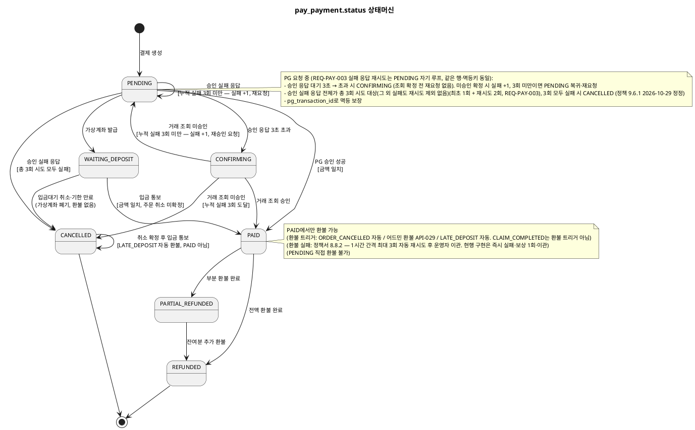

# 상태머신 — Payment

> **단계**: 구조설계
> **문서범위**: Domain
> **문서종류**: Design
>
> **작성 목적**: ERD(DF)의 status 컬럼에서 허용 상태와 전이 규칙을 정의한다.
> **흐름 내 위치**: DF ERD → DG 비즈니스 프로세스 → **DH 상태머신** → DI 이벤트 플로우
> **작성 주체**: 시니어 개발자 + AI 협업 (기획자·현업 검토·확인)

| 항목 | 내용 |
|---|---|
| ID | DESIGN-SM-PAYMENT-001 |
| 상태 | **Finalized** |
| 작성일 | 2026-08-11 |
| 갱신일 | 2026-10-29 |

---

## pay_payment.status 상태머신

### 상태 목록

| 상태 | 설명 | 진입 조건 |
|---|---|---|
| PENDING | 결제 대기 (PG 요청 전 또는 요청 중) | 결제 생성 시 |
| WAITING_DEPOSIT | 가상계좌 입금대기 (VIRTUAL_ACCOUNT 행만. 가상계좌 발급 후 입금 통보 전, 입금 기한 12시간, 정책서 4.4.1) | 가상계좌 발급 (2026-10-29 상태 목록 정리, 구현은 `WAITING_DEPOSIT` 사용) |
| CONFIRMING | 결제 확인 중 (승인 응답 3초 초과, PG 거래 조회로 확정 대기, 재결제 차단) | PG 승인 응답 3초 초과 (정책서 4.5.2, 2026-10-29 신설·미구현) |
| PAID | 결제 완료 (PG 승인 성공 또는 가상계좌 입금 통보 확인). 구현·복합결제 문구의 `COMPLETED`는 PAID와 같은 상태를 가리키는 표기로, 설계 enum은 PAID로 통일한다 | PG 승인 응답, 입금 통보(금액 일치) |
| CANCELLED | 결제 취소 (PG 실패, 입금대기 취소·입금 기한 만료, 또는 전액 환불). 종료 상태이나 취소 확정 후 도착한 입금액의 환불은 별도 경로(자동 환불, 사유 `LATE_DEPOSIT`)로 처리한다 | 실패/취소 처리 |
| REFUNDED | 전액 환불 완료 | 전액 환불 성공 |
| PARTIAL_REFUNDED | 부분 환불 완료 | 부분 환불 성공 |

### 전이 다이어그램

### 전이 규칙 상세

| From | To | 트리거 | 가드 (조건) | 액션 (부수효과) |
|---|---|---|---|---|
| PENDING | PAID | PG 승인 성공 응답 | 금액 일치 (REQ-PAY-007) | PAYMENT_APPROVED 이벤트 발행 → Order |
| PENDING | CANCELLED | PG 승인 총 3회 시도(최초 1회 + 재시도 2회)가 모두 실패(REQ-PAY-003·004, 정책 9.6.1). 누적 실패 3회 도달 | — | PAYMENT_FAILED 이벤트 발행 → Order |
| PENDING | PENDING | PG 승인 실패 응답 | 누적 실패 3회 미만 | 실패 횟수 +1, 3초 뒤 같은 행 재요청(멱등키 동일, `pay_payment_log` 기록, `pay_group_no` 불변) (REQ-PAY-003) |
| PENDING | CONFIRMING | PG 승인 응답 3초 초과 | — | 재결제 차단, PG 거래 조회 예약 (REQ-PAY-005) |
| PENDING | WAITING_DEPOSIT | 가상계좌 발급 성공 | VIRTUAL_ACCOUNT 행 | 입금 기한(12시간)·가상계좌 번호 저장, 주문 DEPOSIT_PENDING (정책서 4.4.1) |
| WAITING_DEPOSIT | PAID | PG 입금 통보 | 입금액 일치, 취소 미확정 | PAYMENT_APPROVED 이벤트 발행 → Order (정책서 4.4.2) |
| WAITING_DEPOSIT | CANCELLED | 입금대기 취소(고객, REQ-ORD-080) 또는 입금 기한 만료 | — | 가상계좌 폐기, 환불 없음, 재고 복원은 Order |
| CANCELLED | CANCELLED | 취소 확정 주문에 입금 통보 도착(경합 포함, 취소 우선) | 취소 확정 | PAID로 바꾸지 않음. 입금액을 저장된 환불계좌로 운영자 승인 없이 자동 환불(사유 `LATE_DEPOSIT`, 기준일=입금 통보 수신일, 3영업일), `pay_payment_log` 기록 (REQ-PAY-030) |
| CONFIRMING | PAID | PG 거래 조회 결과 승인 | 금액 일치 | PAYMENT_APPROVED 이벤트 발행 → Order (REQ-PAY-029) |
| CONFIRMING | PENDING | PG 거래 조회 결과 미승인 | 누적 실패 3회 미만 | 실패 횟수 +1, 승인 재요청 (REQ-PAY-029) |
| CONFIRMING | CANCELLED | PG 거래 조회 결과 미승인 | 누적 실패 3회 도달 | PAYMENT_FAILED 이벤트 발행 → Order (REQ-PAY-029) |
| PAID | REFUNDED | ORDER_CANCELLED 이벤트 수신 → PG 부분 승인 취소(전액 금액 지정) 성공 | 환불액 == 원결제액 | 환불 완료 로그 기록. 부분 승인 취소가 되지 않으면 수작업(운영자 이관)으로 진행 |
| PAID | PARTIAL_REFUNDED | 어드민 [환불 처리](API-029) 요청 → PG 부분 환불 성공 | 환불액 < 원결제액 | 환불 완료 로그 기록 |
| PAID | REFUNDED | 어드민 [환불 처리](API-029) 요청 → PG 전액 환불 성공 (전체 클레임) | 환불액 == 원결제액 | 환불 완료 로그 기록 |
| PARTIAL_REFUNDED | PARTIAL_REFUNDED | 추가 어드민 [환불 처리](API-029) 요청 → 부분 환불 | 누적 환불액 < 원결제액 | 환불 완료 로그 기록 |
| PARTIAL_REFUNDED | REFUNDED | 잔여분 추가 환불 성공 | 누적 환불액 == 원결제액 | 최종 환불 완료 |

### 금지 전이

| From | To | 사유 | EARS 근거 |
|---|---|---|---|
| PENDING | REFUNDED/PARTIAL_REFUNDED | 미결제 상태에서 환불 불가 | 논리적 불가 |
| REFUNDED | 모든 상태 | 종료 상태 | — |
| CANCELLED | 모든 상태 | 종료 상태(결제 상태는 바뀌지 않는다. 취소 후 입금액 환불은 상태 전이가 아닌 별도 자동 환불 경로) | REQ-PAY-030 |
| PAID | PENDING | 역행 불가 | — |
| CONFIRMING | 신규 결제 생성 | 확인 전 재결제 차단(중복 승인 방지). 거래 조회 미승인 확정 후의 PENDING 복귀는 시스템 재요청이며 허용 | REQ-PAY-005 |
| CONFIRMING | REFUNDED/PARTIAL_REFUNDED | 승인 확정 전 환불 불가 | 논리적 불가 |

---

## 복합결제 상태 규칙 (2026-10-27)

- 상태는 `pay_payment` 행(결제수단별) 단위로 관리한다. 복합결제는 같은 `pay_group_no`의 행들이 각자 전이한다(예: 가상계좌 행 `WAITING_DEPOSIT`, 포인트 행 `PAID`).
- 주문(플랫폼주문) 결제 완료는 **같은 pay_group_no의 모든 행이 승인(PAID)** 되었을 때만 판정한다. 일부 행만 승인되고 다른 행이 실패하면 승인된 행을 보상(취소·포인트 환원)한 뒤 그룹 실패로 처리한다 — **확인 필요**(프로토타입은 Mock이라 항상 성공, 보상 미구현).
- **재시도 단위(2026-10-29 확정)**: 승인 실패·무응답에 따른 자동 재시도(총 3회 시도)는 **같은 행**을 `PENDING`으로 되돌려 재요청한다(멱등키 동일, 시도 횟수는 `pay_payment_log`에 기록). 고객이 `CANCELLED`·실패로 끝난 결제를 다시 결제 요청하면 **새 `pay_group_no`** 행들을 생성하며 이전 그룹의 행은 이력으로 남긴다.

## Bolt 분할 후보 (상태 전이 기반)

| Bolt 후보 | 상태 전이 | 예상 규모 |
|---|---|---|
| 결제 승인 | PENDING→PAID | 1일 |
| 결제 실패 | PENDING→CANCELLED | 반나절 |
| 전액 환불 | PAID→REFUNDED | 반나절 |
| 부분 환불 | PAID→PARTIAL_REFUNDED | 반나절 |
| 결제수단 관리 | — (독립 CRUD) | 반나절 |
| 카드 제한/해제 | — (보안 배치) | 반나절 |

---

## 근거

| 항목 | 출처 |
|---|---|
| 상태 목록 | `../DF-도메인모델ERD/payment.md` pay_payment.status |
| 전이 규칙 | `../DD-EARS기능요구/payment.md` REQ-PAY-001~013 |
| 금액 일치 검증 | REQ-PAY-007 |
| 총 3회 시도 | REQ-PAY-003 |
| 승인 응답 대기 3초 → 결제 확인 중 | REQ-PAY-005·029, 정책서 payment.md 4.5.2 |
| 가상계좌 입금대기·입금 통보·LATE_DEPOSIT 자동 환불·환불계좌 | REQ-PAY-023~031 (023·024 카드 카운터·환불 산식은 전이와 무관, 025~028 복합결제, 029 결제 확인 중, 030 LATE_DEPOSIT, 031 환불계좌), 정책서 payment.md 4.4.1·4.4.2·8.7.1 |
| 원결제 수단 환불 | REQ-PAY-013 |
| Bolt 분할 기준 | 방법론 부록 A (전이 1개 = Bolt 1개) |
