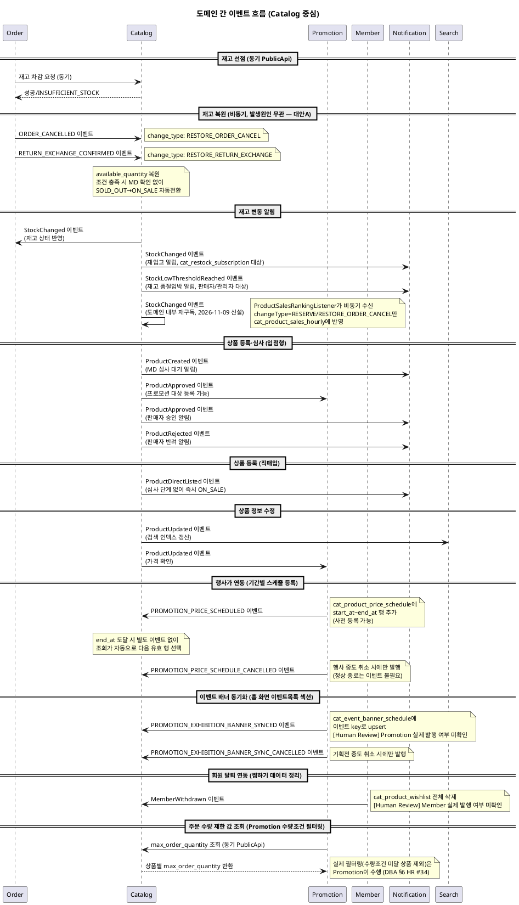

# 이벤트 플로우 — Catalog

> **단계**: 구조설계
> **문서범위**: Domain 간
> **문서종류**: Design
>
> **작성 목적**: Catalog 도메인이 발행·수신하는 비동기 이벤트 계약을 정의한다.
> **흐름 내 위치**: ⑪ 비즈니스 프로세스 → **⑫ 이벤트 플로우** → Bolt 분할
> **작성 주체**: 시니어 개발자 + AI 협업 (아키텍트 검토)

| 항목 | 내용 |
|---|---|
| ID | DESIGN-EVENT-CATALOG-001 |
| 상태 | **Draft** |
| 작성일 | 2026-08-21 |
| 갱신일 | 2026-11-06 |

> **범위**: Catalog 도메인과 Order·Promotion·Member·Notification 간 이벤트.
>
> **2026-10-26 전면 재작성**: `DG-비즈니스프로세스/catalog.md`·`DD-EARS기능요구/catalog.md`
> (REQ-CAT-001~051)·`DBA-도메인정책서/catalog.md`를 기준으로 갱신했다. 아래 두 가지가
> 핵심 변경이다.
>
> 1. **`RatingUpdated` 이벤트 삭제**: 구버전은 "Review → Catalog"로 avg_rating·review_count를
>    갱신한다고 했으나, 평점·리뷰는 Community 도메인 책임이고 Catalog가 보유할 근거가 없다
>    (DD "폐기한 기존 REQ" 참조, DF "폐기한 기존 컬럼" §avg_rating/review_count와 동일 사유).
> 2. **`DISPLAY_PRICE_CHANGED` → `PROMOTION_PRICE_SCHEDULED`/`PROMOTION_PRICE_SCHEDULE_CANCELLED`로
>    교체**: 당초 DBA §1.7.4·DD REQ-CAT-050~051에서 "Promotion이 `price_sale` 필드를 직접
>    갱신"하는 방식으로 확정했으나, **2026-10-26 추가 변경**: 판매가를 마스터 컬럼이 아닌
>    기간별 스케줄 테이블(`cat_product_price_schedule`)로 분리하면서, 이벤트도 "필드 값을
>    즉시 바꾼다"가 아니라 "미래 기간을 가진 스케줄 행을 등록/취소한다"로 바뀌었다(사용자
>    피드백 — price_sale 직접 갱신은 "정시각 정확히 반영"이 배치·네트워크 지연에 취약했음).
>    행사 종료 시의 "복원"은 별도 이벤트가 필요 없다 — `end_at` 도달 시 조회가 자동으로
>    다음 유효 행을 선택하기 때문이다.
>
> **2026-11-06 재동기화**: DBA 번호 재정비(2026-11-04)에 맞춰 전체 "DBA §x.x" 인용을
> 갱신하고, 신규 이벤트 2건(`StockLowThresholdReached` 발행, `MemberWithdrawn` 수신)을
> 추가했다. 리뷰 Part III(DBA §3) 관련 이벤트(`ReviewCreated`/`ReviewDeleted`/`ReviewBlinded`)
> 는 Member·Promotion이 수신해 포인트를 지급·회수하는 구조(DBA §3.6)이나, 리뷰 자체의
> 이벤트 계약은 Part III 전용 이벤트 플로우로 분리할지 여부가 미정이라 이 문서에는 아직
> 포함하지 않았다 — Human Review에 추가.

---

## 이벤트 카탈로그

| 이벤트명 | 방향 | 발행 도메인 | 수신 도메인 | 트리거 | 수신 액션 |
|---|---|---|---|---|---|
| ProductCreated | 발행 | Catalog | Notification* | [입점형] 상품 초안 작성·심사 요청 (복제등록으로 생성된 DRAFT도 이후 심사요청 시 동일) | MD에게 심사 대기 알림 |
| ProductApproved | 발행 | Catalog | Promotion*, Notification* | [입점형] 심사 승인 | 프로모션 대상 등록 가능, 판매자 승인 알림 |
| ProductDirectListed | 발행 | Catalog | Notification* | [직매입] 등록 완료 (DRAFT→ON_SALE 즉시전환) | 운영 로그 기록 (심사 단계 없음) |
| ProductRejected | 발행 | Catalog | Notification* | [입점형] 심사 반려 | 판매자에게 반려 사유 알림 |
| ProductUpdated | 발행 | Catalog | Search*, Promotion* | 상품 정보 수정 | 검색 인덱스 갱신, 프로모션 가격 확인 |
| StockChanged | 발행 | Catalog | Order, Notification* | 재고 변동 (선점/복원/신규등록) | Order: 재고 상태 반영, 재입고 알림 |
| StockLowThresholdReached | 발행 | Catalog | Notification* | 상품의 SKU 중 하나라도 `available_quantity`가 `restock_alert_threshold` 이하로 떨어짐(DBA §1.10, 2026-11-06 신설) | 입점형은 판매자, 직매입은 공통 관리자 계정체계의 관리자에게 임박 알림 발송. 임박 상태 유지 중 중복 발행하지 않음 |
| StockReleaseRequested | 수신 | Order | Catalog | 주문 생성 시 재고 차감 요청 | 동기 PublicApi (재고 선점) |
| ORDER_CANCELLED | 수신 | Order | Catalog | 주문 취소 확정 | 재고 복원 (change_type: RESTORE_ORDER_CANCEL), 조건 충족 시 자동 ON_SALE 전환 |
| RETURN_EXCHANGE_CONFIRMED | 수신 | Order | Catalog | 반품·교환 확정 | 재고 복원 (change_type: RESTORE_RETURN_EXCHANGE), 조건 충족 시 자동 ON_SALE 전환 |
| PROMOTION_PRICE_SCHEDULED | 수신 | Promotion | Catalog | 행사 등록 (사전 등록 가능, 시작은 미래) | `cat_product_price_schedule`에 `source_type=PROMOTION_EVENT`, start_at~end_at·source_event_id로 행 추가 (DBA §1.7.2·§1.7.4, REQ-CAT-050) |
| PROMOTION_PRICE_SCHEDULE_CANCELLED | 수신 | Promotion | Catalog | 행사 중도 취소 (정상 종료는 end_at 도달로 자동 처리, 이벤트 불필요) | 해당 `source_event_id`의 스케줄 행을 삭제하거나 `end_at=now`로 조정 |
| PROMOTION_EXHIBITION_BANNER_SYNCED | 수신 | Promotion | Catalog | 기획전 등록·수정(배너·기간 변경 등) | `cat_event_banner_schedule`에 이벤트 key로 행 upsert (DBA §2.8.2, REQ-CAT-054) — **[Human Review] Promotion 실제 발행 여부 미확인** |
| PROMOTION_EXHIBITION_BANNER_SYNC_CANCELLED | 수신 | Promotion | Catalog | 기획전 중도 취소 (정상 종료는 end_at 도달로 자동 처리) | 해당 이벤트 key의 `cat_event_banner_schedule` 행을 `end_at=now`로 종료 (DBA §2.8.2, REQ-CAT-055) — **[Human Review] Promotion 실제 발행 여부 미확인** |
| MemberWithdrawn | 수신 | Member | Catalog | 회원 탈퇴 확정 (2026-11-06 신설) | 해당 `member_id`의 `cat_product_wishlist` 행 전체 삭제 (DBA §1.14, REQ-CAT-062) — **[Human Review] Member 실제 발행 여부 미확인**. PGM 등록: `DQ-프로그램목록/catalog.md` CSM-CAT-008(2026-11-09 소급 반영) |

> `*` 표시: 2~4차 파트 착수 시 수신측 구현. 이벤트 스키마는 본 문서에서 확정.
> **삭제된 이벤트**: `RatingUpdated`(Review→Catalog, 근거 자기모순으로 폐기), `DISPLAY_PRICE_CHANGED`
> (별도 노출가 필드 폐기로 대체) — 사유는 상단 안내 참조.
> **2026-10-26 재교체**: `PROMOTION_PRICE_APPLIED`/`PROMOTION_PRICE_RESTORED`(price_sale
> 직접 갱신 전제)도 판매가 저장 구조 변경에 따라 `PROMOTION_PRICE_SCHEDULED`/
> `PROMOTION_PRICE_SCHEDULE_CANCELLED`로 교체했다. 행사 "종료"는 더 이상 이벤트가 아니라
> 스케줄 행의 `end_at` 경과로 조회 시점에 자동 처리된다.
> **찜하기(cat_product_wishlist)는 상품 상태 전이(SOLD_OUT/DISCONTINUED)의 내부 부수효과로
> 삭제되며, 이는 Catalog 내부 처리라 별도 이벤트를 발행하지 않는다** — 다른 도메인이 "이
> 상품의 찜이 삭제됐다"를 알아야 할 이유가 없다고 판단했다(2026-11-06).

### 도메인 내부 이벤트 (Catalog 자체 구독, 2026-11-09 신설)

> 위 표는 전부 **도메인 간**(Catalog↔Order/Promotion/Member) 이벤트다. 아래는 Catalog가
> 이미 발행하는 이벤트를 **자기 자신이 비동기로 다시 구독**하는 유일한 사례로, 상품 랭킹
> 집계(DBA §1.17)를 위해 신설했다 — 핵심 재고 트랜잭션과 랭킹 집계 쓰기를 분리하기 위한
> 목적이다(사용자 확인, 2026-11-09).

| 이벤트명 | 발행자 | 내부 구독자 | 트리거 | 구독 액션 |
|---|---|---|---|---|
| StockChanged | Catalog(`StockService`) | Catalog(`ProductSalesRankingListener`, 신규) | 재고 변동(선점/복원/신규등록) — 위 표와 동일한 이벤트, 구독자만 추가 | `changeType`이 `RESERVE`·`RESTORE_ORDER_CANCEL`이면 `cat_product_sales_hourly` 버킷 갱신(+/-), `RESTORE_RETURN_EXCHANGE`·`RESTOCK_VENDOR`는 무시 |

> 전파 경로·Outbox·멱등 보장은 외부 도메인 구독과 동일한 메커니즘(`CatalogEventPublisher`
> 발행 → `ProcessedEventRepository`로 중복 처리 방지)을 그대로 쓴다. "도메인 간 vs 내부"는
> 수신자가 다른 Bounded Context냐 자기 자신이냐의 차이일 뿐, 전송 보장 수준은 동일하다.

> **PGM 등록(2026-11-09)**: `DQ-프로그램목록/catalog.md`는 "컨슈머(CSM)"의 분류 기준을
> "도메인 간"이 아니라 "비동기 처리 여부"로 재정의해, 위 처리를 **CSM-CAT-007**(발행
> 도메인=수신 도메인=Catalog)로 등록했다 — 이 문서(DI)의 이벤트 카탈로그 표는 여전히
> "도메인 간" 이벤트만 다루므로 본 서브섹션을 별도로 유지하되, PGM 추적은 DQ CSM 표를
> 1차 출처로 본다.

---

## 이벤트 흐름 다이어그램



---

## 이벤트 스키마

### ProductCreated

```json
{
  "eventType": "ProductCreated",
  "eventId": "evt-ulid-201",
  "timestamp": "2026-09-28T10:00:00Z",
  "payload": {
    "productId": "prod-ulid-001",
    "name": "러닝화 에어맥스",
    "summary": "에어쿠셔닝 러닝화",
    "tags": "러닝화,에어쿠션,나이키",
    "vendorId": "vendor-001",
    "categoryId": "cat-001",
    "isDirectSourced": false,
    "status": "REVIEW_REQUESTED"
  }
}
```

> `summary`·`tags`는 2026-11-09 소급 반영(DBA §1.3.1·§1.3.3·§1.3.4) — Search가 최초 색인
> 시점부터 두 필드를 받을 수 있도록 ProductCreated에도 포함한다.

### ProductDirectListed

```json
{
  "eventType": "ProductDirectListed",
  "eventId": "evt-ulid-205",
  "timestamp": "2026-09-28T10:00:00Z",
  "payload": {
    "productId": "prod-ulid-002",
    "name": "자사 PB 보충제",
    "isDirectSourced": true,
    "listedBy": "admin-direct-001",
    "status": "ON_SALE"
  }
}
```

### ProductApproved

```json
{
  "eventType": "ProductApproved",
  "eventId": "evt-ulid-202",
  "timestamp": "2026-09-28T14:00:00Z",
  "payload": {
    "productId": "prod-ulid-001",
    "name": "러닝화 에어맥스",
    "vendorId": "vendor-001",
    "categoryId": "cat-001",
    "priceSale": 89000,
    "approvedBy": "admin-review-001"
  }
}
```

### ProductRejected

```json
{
  "eventType": "ProductRejected",
  "eventId": "evt-ulid-206",
  "timestamp": "2026-09-28T14:10:00Z",
  "payload": {
    "productId": "prod-ulid-001",
    "vendorId": "vendor-001",
    "rejectReason": "필수 인증 서류 누락",
    "rejectCount": 1,
    "rejectedAt": "2026-09-28T14:10:00Z",
    "resubmitDeadline": "2026-10-28T14:10:00Z",
    "rejectedBy": "admin-review-001"
  }
}
```

### ProductUpdated

```json
{
  "eventType": "ProductUpdated",
  "eventId": "evt-ulid-203",
  "timestamp": "2026-09-28T16:00:00Z",
  "payload": {
    "productId": "prod-ulid-001",
    "changedFields": ["price_sale", "description", "release_date", "summary", "tags"],
    "priceSale": 79000,
    "releaseDate": "2026-10-15",
    "summary": "에어쿠셔닝 러닝화",
    "tags": "러닝화,에어쿠션,나이키",
    "updatedBy": "vendor-001"
  }
}
```

> `summary`·`tags`가 `changedFields`에 포함되면 Search가 색인을 갱신한다(2026-11-09 소급
> 반영). 옵션값 이미지(`cat_product_option_value.image_url`)는 `cat_product` 소속 필드가
> 아니라 이 이벤트로 전파하지 않는다 — 옵션값 조회는 상품 상세 API(§19·§29)로 직접 조회.

### StockChanged

```json
{
  "eventType": "StockChanged",
  "eventId": "evt-ulid-204",
  "timestamp": "2026-09-28T10:05:00Z",
  "payload": {
    "productId": "prod-ulid-001",
    "skuId": "sku-ulid-001",
    "changeType": "RESERVE",
    "changeQuantity": -2,
    "afterAvailable": 8,
    "afterStock": 10,
    "reasonRef": "order-ulid-001"
  }
}
```

### StockLowThresholdReached (2026-11-06 신설)

```json
{
  "eventType": "StockLowThresholdReached",
  "eventId": "evt-ulid-207",
  "timestamp": "2026-11-06T10:05:00Z",
  "payload": {
    "productId": "prod-ulid-001",
    "vendorId": "vendor-001",
    "isDirectSourced": false,
    "thresholdQuantity": 5,
    "skuBreakdown": [
      { "skuId": "sku-ulid-001", "availableQuantity": 3 }
    ]
  }
}
```

> 발행 조건: 상품에 속한 SKU 중 하나라도 `available_quantity`가 `restock_alert_threshold`
> 이하로 떨어진 시점. 임박 상태가 유지되는 동안은 재발행하지 않고, 회복 후 재하락 시에만
> 다시 발행한다(DBA §1.10). `isDirectSourced` 값으로 수신측(Notification)이 판매자 또는
> 공통 관리자 계정체계 중 어디로 보낼지 분기한다.

### ORDER_CANCELLED (수신)

```json
{
  "eventType": "ORDER_CANCELLED",
  "eventId": "evt-ulid-301",
  "timestamp": "2026-09-28T12:00:00Z",
  "payload": {
    "orderId": "ord-ulid-001",
    "items": [
      {
        "skuId": "sku-ulid-001",
        "quantity": 2
      }
    ],
    "cancelReason": "CUSTOMER_REQUEST"
  }
}
```

### RETURN_EXCHANGE_CONFIRMED (수신)

```json
{
  "eventType": "RETURN_EXCHANGE_CONFIRMED",
  "eventId": "evt-ulid-302",
  "timestamp": "2026-09-28T13:00:00Z",
  "payload": {
    "orderId": "ord-ulid-002",
    "items": [
      {
        "skuId": "sku-ulid-005",
        "quantity": 1
      }
    ],
    "confirmType": "RETURN"
  }
}
```

### PROMOTION_PRICE_SCHEDULED (수신)

```json
{
  "eventType": "PROMOTION_PRICE_SCHEDULED",
  "eventId": "evt-ulid-401",
  "timestamp": "2026-09-28T09:00:00Z",
  "payload": {
    "productId": "prod-ulid-001",
    "sourceEventId": "prm-event-ulid-010",
    "sourceType": "PROMOTION_EVENT",
    "price": 69000,
    "startAt": "2026-10-01T00:00:00Z",
    "endAt": "2026-10-07T23:59:59Z"
  }
}
```

> 사전 등록 가능 — `startAt`이 미래 시각이어도 즉시 수신·저장하며, 실제 가격 전환은
> 조회 쿼리가 `now`와 비교하는 시점에 일어난다(별도 배치 불필요).

### PROMOTION_PRICE_SCHEDULE_CANCELLED (수신)

```json
{
  "eventType": "PROMOTION_PRICE_SCHEDULE_CANCELLED",
  "eventId": "evt-ulid-402",
  "timestamp": "2026-09-29T00:00:00Z",
  "payload": {
    "productId": "prod-ulid-001",
    "sourceEventId": "prm-event-ulid-010",
    "reason": "VENDOR_REQUESTED_CANCEL"
  }
}
```

> 행사 중도 취소 시에만 발행된다. 정상적인 행사 종료는 `endAt` 경과로 조회 시점에
> 자동 처리되므로 별도 이벤트가 없다.

### PROMOTION_EXHIBITION_BANNER_SYNCED (수신)

```json
{
  "eventType": "PROMOTION_EXHIBITION_BANNER_SYNCED",
  "eventId": "evt-ulid-501",
  "timestamp": "2026-09-28T09:00:00Z",
  "payload": {
    "sourceEventId": "prm-exhibition-ulid-020",
    "bannerImageUrl": "https://cdn.../exhibition-020-banner.jpg",
    "title": "가을 러닝 기획전",
    "linkTarget": "prm-exhibition-ulid-020",
    "startAt": "2026-10-01T00:00:00Z",
    "endAt": "2026-10-31T23:59:59Z"
  }
}
```

> **[Human Review]** 이 이벤트는 Promotion이 실제로 발행하는지 확인되지 않았다 — 가격
> 스케줄(PROMOTION_PRICE_SCHEDULED)과 동일한 패턴으로 Catalog 쪽에서 가정한 스키마다.
> `sourceEventId`가 가리키는 대상이 `prm_exhibition.id`인지도 Promotion 측 확인이 필요하다.

### PROMOTION_EXHIBITION_BANNER_SYNC_CANCELLED (수신)

```json
{
  "eventType": "PROMOTION_EXHIBITION_BANNER_SYNC_CANCELLED",
  "eventId": "evt-ulid-502",
  "timestamp": "2026-09-29T00:00:00Z",
  "payload": {
    "sourceEventId": "prm-exhibition-ulid-020",
    "reason": "EXHIBITION_CANCELLED"
  }
}
```

### MemberWithdrawn (수신, 2026-11-06 신설)

```json
{
  "eventType": "MemberWithdrawn",
  "eventId": "evt-ulid-601",
  "timestamp": "2026-11-06T11:00:00Z",
  "payload": {
    "memberId": "member-ulid-001",
    "withdrawnAt": "2026-11-06T11:00:00Z"
  }
}
```

> **[Human Review]** Member가 회원 탈퇴 시 실제로 이 이벤트(또는 동등한 이벤트)를
> 발행하는지 work-scope(Catalog 한정)상 확인 불가. 수신 시 해당 `memberId`의
> `cat_product_wishlist` 행을 전체 삭제한다(DBA §1.14, DBA §6 Human Review #35).

---

## 동기 vs 비동기 판단

| 호출 | 방식 | 사유 |
|---|---|---|
| Order → Catalog (재고 차감) | **동기** (PublicApi) | 결제 전 즉시 재고 확보 필수 (UX 대기) |
| Order → Catalog (재고 확인) | **동기** (PublicApi) | 장바구니/결제 진입 시 즉시 검증 |
| Order → Catalog (상품 정보 조회) | **동기** (PublicApi) | 주문서 구성 시 즉시 필요 |
| Order → Catalog (주문 취소 시 재고 복원) | **비동기** (이벤트) | 후속 처리, 즉시 응답 불필요 |
| Order → Catalog (반품·교환 확정 시 재고 복원) | **비동기** (이벤트) | 후속 처리, 즉시 응답 불필요 |
| Catalog → Order (StockChanged) | **비동기** (이벤트) | 재고 변동 후속 알림 |
| Catalog → Catalog (StockChanged, 상품 랭킹 집계, 2026-11-09 신설) | **비동기** (도메인 내부 재구독) | 재고 트랜잭션과 랭킹 집계 쓰기를 분리해 핵심 주문 경로의 성능·안정성을 보호 (DBA §1.17) |
| Catalog → Notification (ProductCreated/Approved/Rejected/DirectListed/StockLowThresholdReached) | **비동기** (이벤트) | 알림은 후속 처리 |
| Catalog → Search (ProductUpdated) | **비동기** (이벤트) | 검색 인덱스 갱신은 후속 처리 |
| Promotion → Catalog (PROMOTION_PRICE_SCHEDULED/CANCELLED) | **비동기** (이벤트) | 스케줄 등록/취소는 사전에 처리되고 실제 가격 전환은 조회 시점 판정이라, 이벤트 자체의 지연은 더 이상 가격 정확성에 영향 없음 (DBA §1.7.2·§1.7.4) |
| Promotion → Catalog (PROMOTION_EXHIBITION_BANNER_SYNCED/CANCELLED) | **비동기** (이벤트) | 동기화 캐시 upsert는 즉시 응답이 필요 없고, 실제 배너 노출은 홈 화면 조회 시점 판정이라 이벤트 지연이 노출 정확성에 영향 없음 (DBA §2.8.2) |
| Member → Catalog (MemberWithdrawn) | **비동기** (이벤트) | 탈퇴 후속 정리, 즉시 응답 불필요 |
| Catalog → Promotion (상품-행사 그룹핑 속성 조회) | **동기** (PublicApi) | Promotion이 그룹 판정 시 즉시 필요 (REQ-CAT-049) |
| Catalog → Promotion (주문 수량 제한 값 조회) | **동기** (PublicApi) | Promotion이 수량조건 대상 상품을 등록·조회하는 시점에 즉시 필요 (REQ-CAT-060) |
| Catalog/BFF → Promotion (상품 상세 실시간 할인가) | **동기** (PublicApi) | 상세 화면 진입 시 즉시 할인가 필요 (UX 대기, DBA §2.8.1) |

---

## 이벤트 운영 규칙

| 규칙 | 설명 |
|---|---|
| Outbox 패턴 | 이벤트는 AFTER_COMMIT으로 Outbox 테이블에 기록 후 Consumer가 처리 |
| 멱등 보장 | 수신 측은 `eventId`로 중복 처리 방지 |
| 이벤트 스키마 버전 | 필드 추가는 허용, 삭제는 금지 (하위 호환) |
| 발행자는 수신자를 모름 | 이벤트 발행 시 수신 도메인을 하드코딩하지 않음 |
| 재시도 정책 | 수신 실패 시 최대 3회 재시도 (지수 백오프), 이후 DLQ |
| 순서 보장 | 동일 productId/skuId에 대한 이벤트는 순서 보장 (파티션 키) |
| 재고 이벤트 우선순위 | StockChanged는 재고 차감/복원 트랜잭션 커밋 후 즉시 발행 |
| 도메인 내부 재구독 허용(2026-11-09 신설) | 발행자가 자신이 이미 발행한 이벤트를 다시 구독하는 것도 허용한다 — 핵심 트랜잭션(재고)과 부가 집계(랭킹)의 장애·지연을 격리하는 목적이면, 같은 도메인 안이라도 Outbox+비동기 구독 패턴을 쓴다 |

---

## Human Review

| # | 항목 | 사유 |
|---|---|---|
| 1 | ~~`PROMOTION_PRICE_APPLIED`/`RESTORED`와 화면별 할인노출(DD REQ-CAT-035)의 동시성~~ | **완화(2026-10-26)** — price_sale 직접 갱신을 폐기하고 기간별 스케줄 조회 방식으로 바꾸면서 캐시 지연 쟁점 자체가 해소됨. 신규 쟁점은 #3 참조 |
| 2 | 반품·교환 확정 이벤트명(`RETURN_EXCHANGE_CONFIRMED`)의 실제 Order 도메인 이벤트명 일치 여부 | Order 측 이벤트 명세(`DI-이벤트플로우/order.md`)와 상호 확인 필요 — 현재는 Catalog 측에서 가정한 이름 |
| 3 | `cat_product_price_schedule` 기간 중복 시 `PROMOTION_PRICE_SCHEDULED` 수신 처리 | 동일 상품에 기간이 겹치는 스케줄 요청이 오면 그대로 추가 저장할지, 중복 체크 후 거부할지 미확정 — Promotion 도메인 정책 소관(DBA §1.7.2 Human Review, DF Human Review #6과 동일 쟁점) |
| 4 | **[Promotion 관련]** `PROMOTION_EXHIBITION_BANNER_SYNCED`/`SYNC_CANCELLED`의 Promotion 측 실제 발행 여부 | 사용자 확인(2026-11-06) — 이 두 이벤트는 Catalog 쪽에서 가정한 스키마이며, Promotion이 기획전 등록·수정·취소 시 실제로 이런 이벤트를 발행하는지 work-scope(Catalog 한정)상 이 세션에서 확인 불가. Promotion 담당자 확인 필요. 동일 쟁점이 DBA §6 Human Review #11~12, DF Human Review #7~8, DD Human Review #7에도 기록됨 |
| 5 | **[Promotion 관련]** `sourceEventId`가 가리키는 Promotion 엔티티 확정 | `prm_exhibition.id`로 가정했으나 Promotion 측 공식 확인 필요 — 배너이미지 필드가 Promotion DF에 없다는 점도 함께 확인 필요 |
| 6 | **[Member 관련]** `MemberWithdrawn`의 Member 측 실제 발행 여부 | DBA §1.14·§6 Human Review #35와 동일 쟁점 — work-scope(Catalog 한정)상 Member가 탈퇴 시 이 이벤트(또는 동등한 이벤트)를 실제로 발행하는지 확인 불가 |
| 7 | Part III(리뷰) 이벤트(`ReviewCreated`/`ReviewDeleted`/`ReviewBlinded`)를 이 문서에 포함할지 | DBA §3.6에서 Member·Promotion이 이 이벤트를 구독해 포인트를 지급·회수하는 구조가 확정됐으나, 리뷰 전용 이벤트 카탈로그를 이 문서(상품·전시 중심)에 통합할지 별도 섹션/별도 문서로 분리할지 미정 |

---

## 근거

> **원칙**: 구조설계 단계 산출물은 AS-IS 정책서를 직접 인용하지 않는다. `DG-비즈니스프로세스/
> catalog.md`·`DD-EARS기능요구/catalog.md`가 1차 근거이며, `DBA-도메인정책서/catalog.md`로
> 정책 맥락을 보강한다.

| 항목 | 출처 |
|---|---|
| 이벤트 목록 | `deliverables/S2-구조설계/DG-비즈니스프로세스/catalog.md` 이벤트 발행 지점 |
| 발행/수신 관계 | `deliverables/S1-범위정의/DB-도메인정의서.md` §3(Catalog) "의존"·"이벤트" 행 |
| Outbox 패턴 | `deliverables/S1-범위정의/D9-컴포넌트.md` 배포 구조·도메인 간 통신 방식 |
| 동기/비동기 판단 | 응답 즉시성 요구 여부 (UX 대기 vs 후속 처리) |
| 재고 선점·복원·자동전환(대안A)·판매량 집계 | DD REQ-CAT-020~025, DBA §1.10·§2.6 |
| 재고 품절임박 알림(`StockLowThresholdReached`) | DD REQ-CAT-058~059, DBA §1.10(2026-11-06 신설) |
| 상품 랭킹 집계의 도메인 내부 재구독(`StockChanged`→`ProductSalesRankingListener`) | DD REQ-CAT-074, DBA §1.17(2026-11-09 신설) |
| 상품 등록·심사(직매입/입점형) | DD REQ-CAT-001~009, DBA §1.5·§1.6 |
| Promotion 가격 연동 (기간별 스케줄 등록/취소) | DD REQ-CAT-049~051, DBA §1.7.2·§1.7.4 |
| 이벤트 배너 동기화 (기획전 배너 캐시) | 사용자 확인(2026-10-26) — DD REQ-CAT-054~055, DBA §2.8.2. Promotion 발행 여부는 Human Review |
| 주문 수량 제한 값 제공 | DD REQ-CAT-060, DBA §1.8(2026-11-06 신설) |
| 회원 탈퇴 연동(`MemberWithdrawn`) | DD REQ-CAT-062, DBA §1.14(2026-11-06 신설) — Member 발행 여부는 Human Review |
| 삭제된 이벤트 사유 (RatingUpdated·DISPLAY_PRICE_CHANGED) | `deliverables/S2-구조설계/DD-EARS기능요구/catalog.md` "폐기한 기존 REQ" 섹션, `deliverables/S2-구조설계/DF-도메인모델ERD/catalog.md` "폐기한 기존 컬럼" 섹션 |
| ProductCreated·ProductUpdated의 `summary`·`tags` 필드 추가 | DD REQ-CAT-079, DBA §1.3.1·§1.3.3·§1.3.4(기존 정책, 2026-11-09 소급 반영) — Search 색인 대상 확장 |
