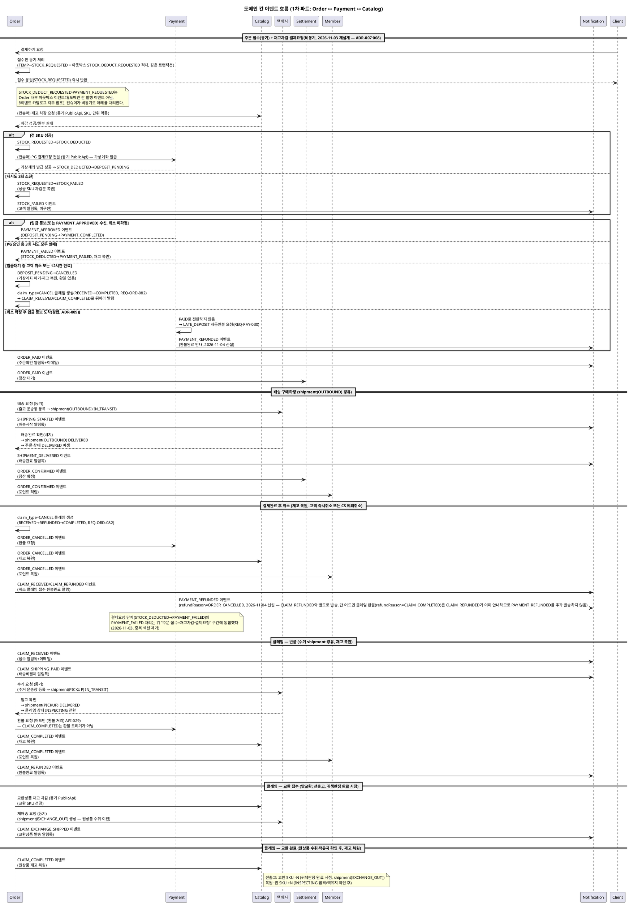

# 이벤트 플로우 — Order ↔ Payment

> **단계**: 구조설계
> **문서범위**: Domain 간
> **문서종류**: Design
>
> **작성 목적**: 도메인 간 비동기 이벤트 계약을 정의한다.
> **흐름 내 위치**: DG 비즈니스 프로세스 → **DI 이벤트 플로우** → Bolt 분할
> **작성 주체**: 시니어 개발자 + AI 협업 (아키텍트 검토)

| 항목 | 내용 |
|---|---|
| ID | DESIGN-EVENT-001 |
| 상태 | **Finalized** |
| 작성일 | 2026-08-11 |
| 갱신일 | 2026-11-03 |

> **범위**: 1차 파트(Order + Payment) 간 이벤트. Catalog·Settlement·Member·Notification 연동은 해당 도메인 착수 시 보완.
> **v2 (2026-08-20 현행화)**: 교환(EXCHANGE) 맞교환 원칙 반영 — 재배송·교환 SKU 차감을 CLAIM_COMPLETED(완료 시점)에서 PICKUP 진입(선출고) 시점으로 이동, CLAIM_EXCHANGE_SHIPPED 이벤트 신설.
> **v3 (2026-08-20 현행화)**: 배송 실행(택배사 이동 구간)을 order/claim 공용 `ord_shipment`로 분리(상태머신DG v6). SHIPPING_STARTED/DELIVERY_COMPLETED/CLAIM_EXCHANGE_SHIPPED의 트리거를 shipment 상태 전이 기준으로 재정의. claim.status에서 PICKUP이 제거됨에 따라 "PICKUP 진입 시점" 표현을 "귀책판정 완료 시점"으로 정정.
> **v4 (2026-08-24 동기화)**: DM-시퀀스/order §19가 실제로 발행하는 이벤트명은 `DELIVERY_COMPLETED`가 아니라 `SHIPMENT_DELIVERED`(60분 배치가 `shipment(OUTBOUND)` DELIVERED 확인 시 발행) — 동일 트리거 지점의 이름 변경이므로 카탈로그를 이 이름으로 정정한다(신규 이벤트 아님). DM §17-1이 발행하는 `CLAIM_PAYMENT_EXPIRED`(배송비 24시간 미결제 자동취소)는 카탈로그에 없던 신규 이벤트라 추가한다.
> **v5 (2026-11-03 비동기 재설계 반영)**: ADR-007·008·009(비동기 접수, 결제확인중, 취소우선·LATE_DEPOSIT)와 REQ-ORD-080~086·REQ-PAY-029~031이 2026-10-29~11-03에 확정됐으나 이 카탈로그·흐름도는 "동기 재고 선점 + 동기 결제 요청" 전제로 멈춰 있었다. 이번 갱신에서 ① "재고 선점"을 "재고 차감"(이미 §구현현행화에 반영된 2026-10-26 내용)으로 용어를 카탈로그·흐름도에도 맞추고, ② `STOCK_REQUESTED`→`STOCK_DEDUCTED`→`DEPOSIT_PENDING` 비동기 구간은 Order 내부 아웃박스 처리이며 **도메인 간 발행 이벤트가 아님**을 명시하고, ③ 취소 클레임(`claim_type=CANCEL`, REQ-ORD-082)·구매확정 후 어드민 접수(REQ-ORD-081)·교환 종료(REQ-ORD-083)는 **기존 이벤트(`CLAIM_RECEIVED`/`CLAIM_REFUNDED`/`CLAIM_COMPLETED`)를 그대로 쓰며 신규 이벤트가 아님**을 각주로 밝히고, ④ `LATE_DEPOSIT` 자동환불(REQ-PAY-030)은 **현재 어떤 도메인에도 발행되는 전용 이벤트가 없다**는 공백을 Human Review로 남겼다(v6에서 해소).
> **v6 (2026-11-04 결정)**: v5 ④의 Human Review 공백을 `PAYMENT_REFUNDED`(Payment 발행, 신규) 신설로 해소했다 — 환불 4경로(주문취소 자동/어드민 클레임환불/LATE_DEPOSIT/CS 수동) 공통 이벤트. `RefundReason`은 DP-클래스설계/payment.md의 기존 enum을 그대로 재사용했다(신규 식별자 추가 없음). 발행측 배선은 `PaymentEventPublisher.publishPaymentRefunded`·`RefundService`(DP), 스키마는 [payment.md](payment.md) 참조.

---

발행 도메인 기준으로 정리되어 있습니다. 이 문서(readme)는 도메인 전체를 아우르는
이벤트 카탈로그·흐름 다이어그램·공통 규칙을 담고, 이벤트별 상세 스키마는 발행
도메인 파일에 있습니다.

| 구분 | 파일 |
|---|---|
| Order가 발행하는 이벤트 (15종) | [order.md](order.md) |
| Payment가 발행하는 이벤트 (3종: PAYMENT_APPROVED, PAYMENT_FAILED, PAYMENT_REFUNDED — 2026-11-04 신설) | [payment.md](payment.md) |

---

## 이벤트 카탈로그

| 이벤트명 | 발행 도메인 | 수신 도메인 | 트리거 | 수신 액션 |
|---|---|---|---|---|
| PAYMENT_APPROVED | Payment | Order | PG 승인 성공 또는 가상계좌 입금 통보(금액 일치) | 주문 상태 `DEPOSIT_PENDING`(또는 결제인증대기, 안) → `PAYMENT_COMPLETED` (2026-11-03 정정: 재고는 이미 `STOCK_DEDUCTED` 단계에서 차감 완료된 상태이므로 "재고 선점 확정" 액션은 없음 — 아래 §비동기 재설계 참조) |
| PAYMENT_FAILED | Payment | Order | PG 승인 총 3회 시도 모두 실패 또는 거래조회 미승인 3회 누적(REQ-PAY-003·004·029) | 주문 상태 `STOCK_DEDUCTED` → `PAYMENT_FAILED`, 차감된 재고 복원(2026-11-03 정정: 종전 "재고 복원"은 맞으나 전이 전 상태는 `STOCK_DEDUCTED`다, 구 `PAYMENT_PENDING` 아님) |
| STOCK_FAILED | Order | Notification* | 재고 차감 재시도 3회 소진(`STOCK_REQUESTED`→`STOCK_FAILED`, REQ-ORD-079) | 고객 알림톡 발송 ("재고 부족으로 주문 취소") — 2026-11-03 정정: "재고 선점 실패"가 아니라 비동기 차감 재시도 소진 |
| ORDER_PAID | Order | Settlement*, Notification* | 결제완료 (PAYMENT_COMPLETED) | 정산 대기 등록, 주문확인 알림톡+이메일 |
| ORDER_CONFIRMED | Order | Settlement*, Member* | 구매확정 (CONFIRMED) | 정산 확정, 포인트 적립 |
| ORDER_CANCELLED | Order | Payment, Catalog*, Member* | 주문 취소 (CANCELLED) — 입금대기 고객취소(REQ-ORD-080)·결제완료 고객취소·CS 예외취소(REQ-ORD-017) 공통 | PG 환불(입금대기 취소는 환불 없음), 재고 복원, 포인트 복원. 같은 트랜잭션에서 생성되는 `claim_type=CANCEL` 취소 클레임(REQ-ORD-082)은 별도 이벤트가 아니라 아래 `CLAIM_RECEIVED`/`CLAIM_REFUNDED`/`CLAIM_COMPLETED`로 뒤따라 발행된다(2026-11-03 신규 각주) |
| CLAIM_COMPLETED | Order | Catalog*, Member*, Settlement*, Notification* | 클레임 완료 — 반품·교환(REQ-ORD-083)·**취소 클레임(`claim_type=CANCEL`) 완료 포함**(2026-11-03 신규 각주, RECEIVED→COMPLETED 또는 RECEIVED→REFUNDED→COMPLETED) | 재고 복원, 포인트 복원, 정산 차감(구매확정 후 클레임만, 교환·취소 제외 — 정책서 settlement 10.4.1, 2026-11-03), 완료 알림 (Payment 환불 트리거 아님 — 클레임 환불은 어드민 [환불 처리](API-029)가 요청, 2026-10-29) |
| CLAIM_RECEIVED | Order | Notification* | 클레임 접수 — 반품·교환 신청, **취소 클레임 생성(`claim_type=CANCEL`, REQ-ORD-082)**, **구매확정 후 어드민 대리 접수(`channel=CS`, REQ-ORD-081)** 포함(2026-11-03 신규 각주) | 고객 알림톡+이메일 ("클레임 접수 완료") |
| CLAIM_SHIPPING_PAID | Order | Notification* | 클레임 배송비 결제 완료 (수거) | 고객 알림톡+이메일 ("배송비 결제 완료, 수거 진행") |
| CLAIM_PAYMENT_EXPIRED | Order | Notification* | 클레임 배송비(수거/반송) 24시간 미결제 (배치 자동취소) | 고객 알림톡 ("배송비 미결제로 클레임 취소") |
| CLAIM_RETURN_SHIPPING_PAID | Order | Notification* | 클레임 반송 배송비 결제 완료 | 고객 알림톡+이메일 ("반송 배송비 결제 완료") |
| CLAIM_REFUNDED | Order | Notification* | 클레임 환불 완료 — 반품 외 **취소 클레임의 환불 완료**(결제완료 취소, REQ-ORD-082)도 포함(2026-11-03 신규 각주) | 고객 알림톡+이메일 ("환불 완료") |
| SHIPPING_STARTED | Order | Notification* | 운송장 등록 (shipment(OUTBOUND) PENDING→IN_TRANSIT) | 고객 알림톡 ("상품 발송, 송장번호") |
| SHIPMENT_DELIVERED | Order | Notification* | 배송완료 (shipment(OUTBOUND) IN_TRANSIT→DELIVERED, 60분 배치 확인) | 고객 알림톡 ("배송 완료, 구매확정 유도"); Order 도메인 내부적으로 order.status→DELIVERED 파생 전환(동일 도메인 내 구독, DI 범위 외) |
| CLAIM_DISPOSED | Order | Notification* | 클레임 폐기 처리 | 고객 알림톡 ("상품 폐기 처리됨") |
| CLAIM_RETURN_PAYMENT_REQUESTED | Order | Notification* | 반송 배송비 추가결제 요청 | 고객 알림톡 ("반송 배송비 결제 필요") |
| CLAIM_EXCHANGE_SHIPPED | Order | Catalog, Notification* | 교환 클레임 귀책판정 완료 (shipment(EXCHANGE_OUT) 생성, 선출고) | 교환 SKU 재고 차감, 고객 알림톡 ("교환상품 발송, 송장번호") |
| PAYMENT_REFUNDED | Payment | Notification* | 환불 4경로 중 하나 완료 — 주문취소 자동(`ORDER_CANCELLED` 수신), 어드민 클레임 환불(API-029), `LATE_DEPOSIT` 자동환불(REQ-PAY-030), CS 수동 재환불 | 고객 환불완료 안내(단, `refundReason=CLAIM_COMPLETED`는 Order의 `CLAIM_REFUNDED`가 이미 안내하므로 중복 발송하지 않음 — DI payment.md 참조). Settlement는 수신하지 않음(환불은 매출 미인식 금액의 반환). **2026-11-04 신설**(2026-11-03 Human Review 공백 해소, DP `PaymentEventPublisher.publishPaymentRefunded`) |

> `*` 표시: 2~4차 파트 착수 시 수신측 구현. 이벤트 발행은 1차에서 구현.
> **아웃박스 내부 처리와의 경계(2026-11-03)**: `STOCK_DEDUCT_REQUESTED`·`PAYMENT_REQUESTED`(DH 상태머신 v7의 `STOCK_REQUESTED`→`STOCK_DEDUCTED`→`DEPOSIT_PENDING` 구간)는 Order 자신의 비동기 처리를 위한 **내부 아웃박스 이벤트**이며 이 카탈로그가 다루는 **도메인 간 발행 이벤트가 아니다**(§구현 현행화 참조). PG 응답 대기 3초 초과 시의 `CONFIRMING`(결제 확인 중, REQ-PAY-005·029)과 `AMOUNT_MISMATCH` 거부(REQ-PAY-007)도 같은 이유로 이 카탈로그에 없다 — Payment 내부 상태이며 Order는 동기 응답(또는 상태 조회)으로만 결과를 안다.

---

## 이벤트 흐름 다이어그램



---

## 이벤트 스키마

> **Event Envelope 규격**: C5 이벤트설계컨벤션 §4 Event Contract를 따른다.
> 모든 이벤트는 아래 Envelope 구조를 공유하며, `payload`만 이벤트별로 다르다.

### Envelope 공통 구조

```json
{
  "eventId": "evt_01HXYZ...",       // ULID, 멱등키
  "eventType": "ORDER_PAID",        // UPPER_SNAKE_CASE
  "eventVersion": 1,                // 스키마 버전
  "occurredAt": "2026-08-11T10:00:00",  // 비즈니스 이벤트 발생 시각 (LocalDateTime, offset 없음)
  "producer": "order-service",      // 발행 서비스 식별자
  "correlationId": "cor_01HXYZ...", // 업무 흐름 추적 ID
  "payload": { ... }
}
```

| 필드 | 설명 | 비고 |
|------|------|------|
| eventId | 이벤트 고유 식별자 (ULID) | Consumer 멱등 처리용 |
| eventType | 이벤트명 | §이벤트 카탈로그 참조 |
| eventVersion | 스키마 버전 (1부터) | 필드 추가=유지, 삭제/변경=증가 |
| occurredAt | 비즈니스 발생 시각 (LocalDateTime, offset 없음) | 기존 `timestamp` → `occurredAt`으로 통일 |
| producer | 발행 서비스 | "order-service" / "payment-service" |
| correlationId | 동일 업무 흐름 공유 ID | 동일 주문의 이벤트 체인에서 공유 |
| payload | 이벤트별 데이터 | 아래 각 이벤트 참조 |

> 이벤트별 상세 스키마(payload)는 발행 도메인 기준으로 [order.md](order.md), [payment.md](payment.md)에 있습니다.

---

## 동기 vs 비동기 판단

| 호출 | 방식 | 사유 |
|---|---|---|
| 고객 → Order (결제하기) | **동기 접수만** (API 응답) | 접수 확정(TEMP→STOCK_REQUESTED)만 즉시 응답, 재고차감·PG 요청은 아래처럼 비동기로 분리(2026-11-03 정정: ADR-007, 구 "결제 요청=동기"는 폐기) |
| Order(컨슈머) → Catalog (재고 차감) | **동기 호출**(PublicApi), 단 **트리거는 비동기**(아웃박스 폴링) | 차감 자체는 즉시 응답을 받아 SKU별 성공/실패를 알아야 하지만, 호출 시점은 접수 응답과 분리된 컨슈머 처리다 |
| Order(컨슈머) → Payment (PG 결제요청·가상계좌 발급) | **동기 호출**(PublicApi), 단 **트리거는 비동기**(재고차감 성공 후 아웃박스 폴링) | 2026-11-03 정정: 종전 "즉시 결제 결과 필요"는 결제하기 접수 자체가 아니라 이 단계에만 해당하며, 고객 응답과는 분리되어 있다 |
| Payment → Order (결제완료/실패, PAYMENT_APPROVED·PAYMENT_FAILED) | **비동기** (이벤트, 미구현 — 현재는 가상계좌 입금 통보 웹훅이 트리거) | PG 콜백/입금통보 수신 후 후속 처리 |
| Payment → Notification (환불완료 통지, LATE_DEPOSIT 포함) | **비동기** (이벤트, `PAYMENT_REFUNDED`) | 2026-11-04 신설 — 2026-11-03 식별된 공백 해소. 후속 처리일 뿐 즉시 응답 불필요 |
| Order → Payment (환불) | **비동기** (이벤트) | 환불은 후속 처리, 즉시 응답 불필요 |
| Order → Settlement (정산) | **비동기** (이벤트) | 정산은 후속 처리 |
| Order → Notification (알림) | **비동기** (이벤트) | 알림은 후속 처리 |
| Order → 택배사 (배송/수거 요청) | **동기** (외부 API) | 운송장 등록 즉시 배송 요청 필요. 실패 시 재시도 or 수동 처리 |

---

## 이벤트 운영 규칙

| 규칙 | 설명 |
|---|---|
| Outbox 패턴 | 이벤트는 AFTER_COMMIT으로 Outbox 테이블에 기록 후 Consumer가 처리 |
| 멱등 보장 | 수신 측은 `eventId`로 중복 처리 방지 |
| 이벤트 스키마 버전 | 필드 추가는 허용, 삭제는 금지 (하위 호환) |
| 발행자는 수신자를 모름 | 이벤트 발행 시 수신 도메인을 하드코딩하지 않음 |
| 재시도 정책 | 수신 실패 시 최대 3회 재시도 (지수 백오프), 이후 DLQ |
| 순서 보장 | 동일 orderId에 대한 이벤트는 순서 보장 (파티션 키 = orderId) |

---

## 근거

| 항목 | 출처 |
|---|---|
| 이벤트 목록 | `DG-비즈니스프로세스/order.md`, `DG-비즈니스프로세스/payment.md` 이벤트 발행 지점 |
| SHIPMENT_DELIVERED 개명·CLAIM_PAYMENT_EXPIRED 추가 | `DM-시퀀스/order.md` §17-1, §19 (DI가 DM 최신 구현과 어긋나 있던 것을 동기화, C5 §8) |
| 발행/수신 관계 | `DB-도메인정의서.md` §4 도메인 간 관계 |
| Outbox 패턴 | `D9-컴포넌트.md` 배포 구조·도메인 간 통신 방식 |
| 동기/비동기 판단 | 응답 즉시성 요구 여부 (UX 대기 vs 후속 처리) |
| 이벤트 스키마 | EARS(DD) + 도메인 간 계약 합의 |

---

## 구현 현행화 (2026-10-26) — 브로커 없는 DB 아웃박스 방식

> 이 문서의 이벤트 카탈로그는 Kafka 등 메시지 브로커를 전제한 설계안이다. 프로토타입에서는 브로커 없이 **DB 아웃박스(`ord_outbox_event`) + 별도 컨슈머 앱(`runNshop-consumer`)** 으로 결제 확정 후속 처리를 구현했다.

| 설계 이벤트 | 현재 구현 | 비고 |
|---|---|---|
| 재고차감 요청(주문 → Catalog) | 아웃박스 `STOCK_DEDUCT_REQUESTED` → 컨슈머가 내부 API 호출 → 상품 API(`CatalogApi.deductStock`, SKU 단위 부분 재시도) | 재고 선점이 아니라 즉시 차감 |
| PG 결제 요청(주문 → Payment) | 아웃박스 `PAYMENT_REQUESTED`(재고차감 성공 후 컨슈머가 적재) → 내부 API → `PaymentApi.requestPayment` | PG 승인/실패 이벤트(`PAYMENT_APPROVED`/`PAYMENT_FAILED`)는 미구현 |
| `STOCK_FAILED` 발행(→ Notification) | 이벤트 발행 없음 — 주문 상태 `STOCK_FAILED` 전이와 상태 이력만 기록, 알림 미구현 | 재시도 소진 시 성공 SKU 차감분 복원 |

- 컨슈머는 이벤트 조회(`FOR UPDATE SKIP LOCKED` 점유, 다중 인스턴스 가능)·상태(DONE/재시도/FAILED, 백오프)·후속 이벤트 적재를 맡고, 업무 처리는 API 서버의 내부 API(`/api/internal/v1/order-events/process`, `.../give-up`) 호출로만 수행한다. 배치도 같은 구조로 구성할 예정이다.
- 구조 상세: S3 DM order.md §4-1, DP order.md, `.kiro/skills/backend-service-pattern/SKILL.md`.

## 구현 현행화 (2026-11-03) — 결제확인중·취소우선·취소 클레임까지 반영

> 위 2026-10-26 표 이후 ADR-008(CONFIRMING·거래조회)·ADR-009(취소우선·LATE_DEPOSIT)·REQ-ORD-080~086이 추가로 확정됐다. 이 절은 그 반영분을 모은다(설계안 다수, 2026-11-03 기준 대부분 미구현).

| 설계 이벤트/상태 | 현재 설계(안) | 도메인 간 발행 이벤트 여부 |
|---|---|---|
| `DEPOSIT_PENDING` (가상계좌 발급 완료, 입금대기) | Order 내부 상태. 입금 기한 12시간 | 아니오 — 내부 상태 전이 |
| `CONFIRMING` (결제 확인 중, 3초 무응답) | Payment 내부 상태, PG 거래 조회로 확정(REQ-PAY-005·029) | 아니오 — Payment 내부 상태, Order는 조회 응답으로만 안다 |
| `LATE_DEPOSIT` 자동환불 (취소 확정 후 입금 통보 경합, REQ-PAY-030) | Payment가 저장된 환불계좌로 운영자 승인 없이 자동 환불 요청 | **예 — `PAYMENT_REFUNDED`**(2026-11-04 신설, `refundReason=LATE_DEPOSIT`) |
| `claim_type=CANCEL` 취소 클레임 (REQ-ORD-082) | 고객 직접취소·CS 예외취소와 같은 트랜잭션에서 생성 | 아니오 — 신규 이벤트 없음. 기존 `CLAIM_RECEIVED`/`CLAIM_REFUNDED`/`CLAIM_COMPLETED`를 그대로 사용(claim_type 필드로 구분) |
| 구매확정 후 어드민 대리 접수 (REQ-ORD-081) | CS가 어드민에서 `channel=CS`로 클레임 생성 | 아니오 — `CLAIM_RECEIVED`를 그대로 사용 |
| 교환 종료 (REQ-ORD-083, PICKED_UP + EXCHANGE_OUT 배송완료 → COMPLETED) | 기존 `CLAIM_COMPLETED` 발행 시점만 확정(두 조건 중 늦은 시점) | 아니오 — 신규 이벤트 없음 |
| `AMOUNT_MISMATCH` (PG 인증금액 불일치, REQ-PAY-007) | Payment가 승인 요청 자체를 하지 않고 즉시 422 거부 | 아니오 — 동기 응답, 이벤트 아님 |

> **2026-11-04 결정 반영**: 위 Human Review 공백은 `PAYMENT_REFUNDED` 신설로 해소했다. Payment의 환불 4경로(전액취소/어드민클레임/LATE_DEPOSIT/수동) 전체가 공통으로 이 이벤트를 발행하며, 수신은 Notification만(Settlement는 환불을 매출 미인식분 반환으로 보아 수신하지 않음). 상세 스키마는 [payment.md](payment.md) `PAYMENT_REFUNDED`, 발행측 배선은 `DP-클래스설계/payment.md`의 `PaymentEventPublisher.publishPaymentRefunded`·`RefundService` 참조.
