# 세부 유스케이스 — Catalog 도메인

> 상위 문서: [readme.md](readme.md)
> **단계**: 상세설계 (S3) | **문서범위**: Bolt (Catalog) | **문서종류**: Design

---

## 1. [직매입] 상품 등록·즉시 판매 전환 Bolt

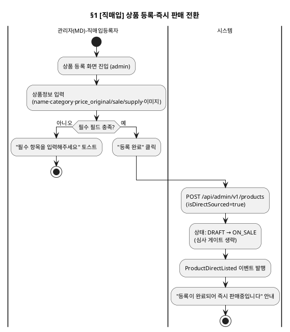

### 기본 흐름

| Step | 액터 | 행위 | 시스템 응답 | 비고 |
|---|---|---|---|---|
| 1 | 관리자(MD, 직매입등록자) | 상품 등록 화면 진입 | — | admin 전용 메뉴 |
| 2 | 관리자(MD, 직매입등록자) | 상품정보(name·category·가격3종·이미지) 입력 | — | |
| 3 | 관리자(MD, 직매입등록자) | "등록 완료" 클릭 | API: POST /api/admin/v1/products (isDirectSourced=true) | |
| 4 | 시스템 | — | 상태 DRAFT→ON_SALE 즉시 전환, ProductDirectListed 이벤트 발행 | 심사 게이트 생략 |

### 대안 흐름

| 조건 | Step 변경 | 결과 |
|---|---|---|
| 필수 필드 미충족 | Step 3에서 거부 | "필수 항목을 입력해주세요" 토스트, 등록 미완료 |

---

## 2. [입점형] 상품 초안 작성·심사 요청 Bolt

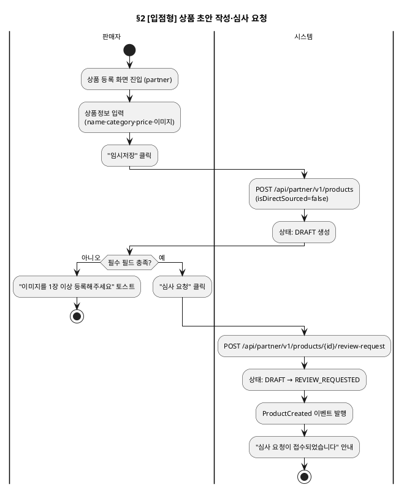

### 기본 흐름

| Step | 액터 | 행위 | 시스템 응답 | 비고 |
|---|---|---|---|---|
| 1 | 판매자 | 상품 등록 화면 진입 | — | partner 전용 메뉴 |
| 2 | 판매자 | 상품정보 입력, "임시저장" 클릭 | API: POST /api/partner/v1/products → DRAFT 생성 | |
| 3 | 판매자 | 필수 필드 충족 확인 후 "심사 요청" 클릭 | API: POST /api/partner/v1/products/{id}/review-request | |
| 4 | 시스템 | — | 상태 DRAFT→REVIEW_REQUESTED, ProductCreated 이벤트 발행 | |

### 대안 흐름

| 조건 | Step 변경 | 결과 |
|---|---|---|
| 이미지 0장 | Step 3에서 거부 | "이미지를 1장 이상 등록해주세요" 토스트, REVIEW_REQUESTED 전환 거부 |

---

## 3. [입점형] 심사 처리 Bolt (착수·승인·반려)

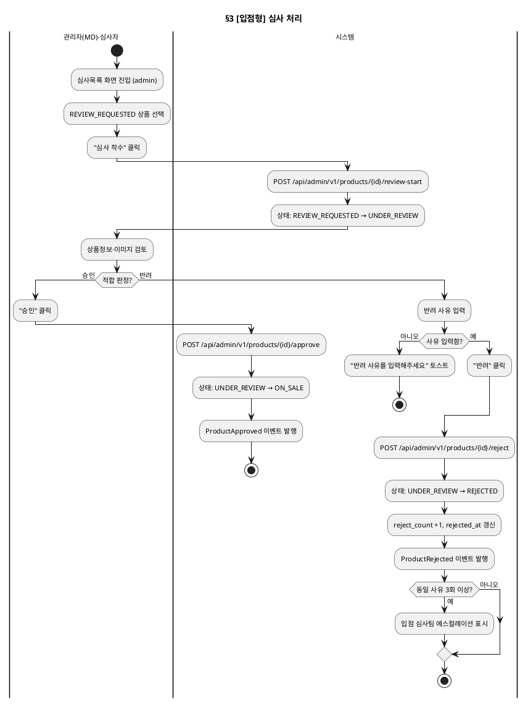

### 기본 흐름

| Step | 액터 | 행위 | 시스템 응답 | 비고 |
|---|---|---|---|---|
| 1 | 관리자(MD, 심사자) | 심사목록 화면에서 REVIEW_REQUESTED 상품 선택, "심사 착수" 클릭 | API: POST /api/admin/v1/products/{id}/review-start → UNDER_REVIEW 전환 | |
| 2 | 관리자(MD, 심사자) | 상품정보·이미지 검토 | — | |
| 3a | 관리자(MD, 심사자) | 적합 판정 시 "승인" 클릭 | API: POST /api/admin/v1/products/{id}/approve → ON_SALE 전환, ProductApproved 발행 | |
| 3b | 관리자(MD, 심사자) | 부적합 판정 시 반려 사유 입력 후 "반려" 클릭 | API: POST /api/admin/v1/products/{id}/reject → REJECTED 전환, reject_count 증가 | |

### 대안 흐름

| 조건 | Step 변경 | 결과 |
|---|---|---|
| 반려 사유 미입력 | Step 3b에서 거부 | "반려 사유를 입력해주세요" 토스트 |
| 동일 사유 3회 이상 반복 반려 | Step 3b 완료 후 | 입점 심사팀 에스컬레이션 대상으로 표시 |

---

## 4. [입점형] 반려 후 재작성·재제출기한 Bolt

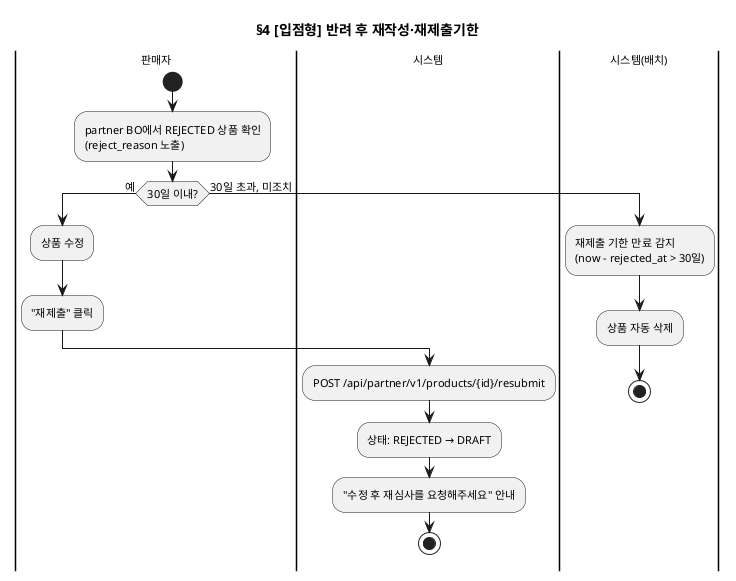

### 기본 흐름

| Step | 액터 | 행위 | 시스템 응답 | 비고 |
|---|---|---|---|---|
| 1 | 판매자 | partner BO에서 REJECTED 상품의 반려 사유 확인 | reject_reason 노출 | |
| 2 | 판매자 | 30일 이내 상품 수정 후 "재제출" 클릭 | API: POST /api/partner/v1/products/{id}/resubmit → DRAFT 전환 | §2 심사요청 Bolt로 재진입 |

### 대안 흐름

| 조건 | Step 변경 | 결과 |
|---|---|---|
| 반려일로부터 30일 초과, 재제출 없음 | Step 2 미실행 | 배치가 상품을 자동 삭제 |

---

## 5. 상품 기본정보·이미지·옵션 관리 Bolt

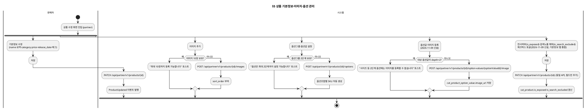

### 기본 흐름

| Step | 액터 | 행위 | 시스템 응답 | 비고 |
|---|---|---|---|---|
| 1 | 판매자 | 기본정보(이름·요약·카테고리·가격·출시일·태그) 수정 후 저장 | API: PATCH /api/partner/v1/products/{id} → ProductUpdated 발행 | 요약·태그는 2026-11-09 소급 반영(DBA §1.3.1·§1.3.3·§1.3.4 기존 정책) |
| 2 | 판매자 | 이미지 추가 | API: POST /api/partner/v1/products/{id}/images → sort_order 부여 | 최대 10장 |
| 3 | 판매자 | 옵션그룹·옵션값 설정 | API: POST /api/partner/v1/products/{id}/options → SKU 자동 생성 | 최대 2단계 |
| 4 | 판매자 | 옵션값(1단계) 이미지 등록 | API: POST /api/partner/v1/products/{id}/option-values/{optionValueId}/image → image_url 저장 | 2026-11-09 신설, depth=1 전용 |
| 5 | 판매자 | 전시여부·검색노출 제외 토글 후 저장 | API: PATCH /api/partner/v1/products/{id} → is_exposed·is_search_excluded 갱신 | 2026-11-09 신설 — SCR-A-C04-T6(전시 탭) 폐지, 기본정보 탭에 통합(미진항목 #3 해소) |

### 대안 흐름

| 조건 | Step 변경 | 결과 |
|---|---|---|
| 이미지 10장 보유 상태에서 추가 시도 | Step 2에서 거부 | "최대 10장까지 등록 가능합니다" 토스트 |
| 옵션그룹 2단계 보유 상태에서 3번째 추가 시도 | Step 3에서 거부 | "옵션은 최대 2단계까지 설정 가능합니다" 토스트 |
| depth=2 옵션값에 이미지 등록 시도 | Step 4에서 거부 | 422 OPTION_IMAGE_DEPTH_INVALID (2026-11-09 신설) |

---

## 6. 상품 단종 처리 Bolt

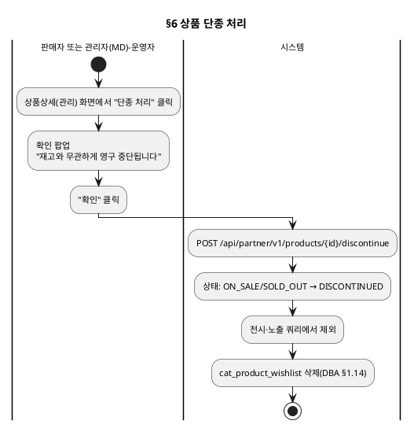

### 기본 흐름

| Step | 액터 | 행위 | 시스템 응답 | 비고 |
|---|---|---|---|---|
| 1 | 판매자/관리자(MD, 운영자) | 상품상세(관리) 화면에서 "단종 처리" 클릭, 확인 | API: POST /api/partner/v1/products/{id}/discontinue → DISCONTINUED 전환, 찜 데이터 전체 삭제 | 재고 수량과 무관한 수동 전환만 허용 |

---

## 7. 분류체계(카테고리·브랜드) 관리 Bolt

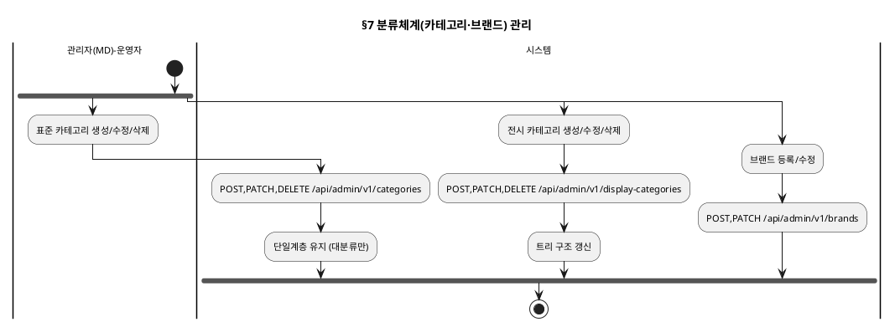

### 기본 흐름

| Step | 액터 | 행위 | 시스템 응답 | 비고 |
|---|---|---|---|---|
| 1 | 관리자(MD, 운영자) | 표준 카테고리 생성·수정·삭제 | API: /api/admin/v1/categories | 단일계층(대분류만) |
| 2 | 관리자(MD, 운영자) | 전시 카테고리 생성·수정·삭제 | API: /api/admin/v1/display-categories | 트리 구조 |
| 3 | 관리자(MD, 운영자) | 브랜드 등록·수정 | API: /api/admin/v1/brands | |
| 4 | 판매자/관리자(MD, 운영자) | 상품에 카테고리 1개 지정 | 다중 카테고리 불가, 기존 지정 시 교체 | REQ-CAT-017 |

---

## 8. 재고 관리·자동전환 Bolt

> **대안A 반영**: 재고 복원은 발생 원인(주문취소·반품교환확정·판매자재고신규등록)과 무관하게
> MD 확인 없이 자동 ON_SALE 전환된다(DBA §1.10). 재고 차감 시 `sold_quantity_total`도 함께
> 증가하며(§11 상품뱃지·정렬의 `sales_rank` 산정 기준), 재고 임박 기준수량 이하 여부 판정은
> §18(재고 품절 임박 알림 Bolt)로 분리했다.

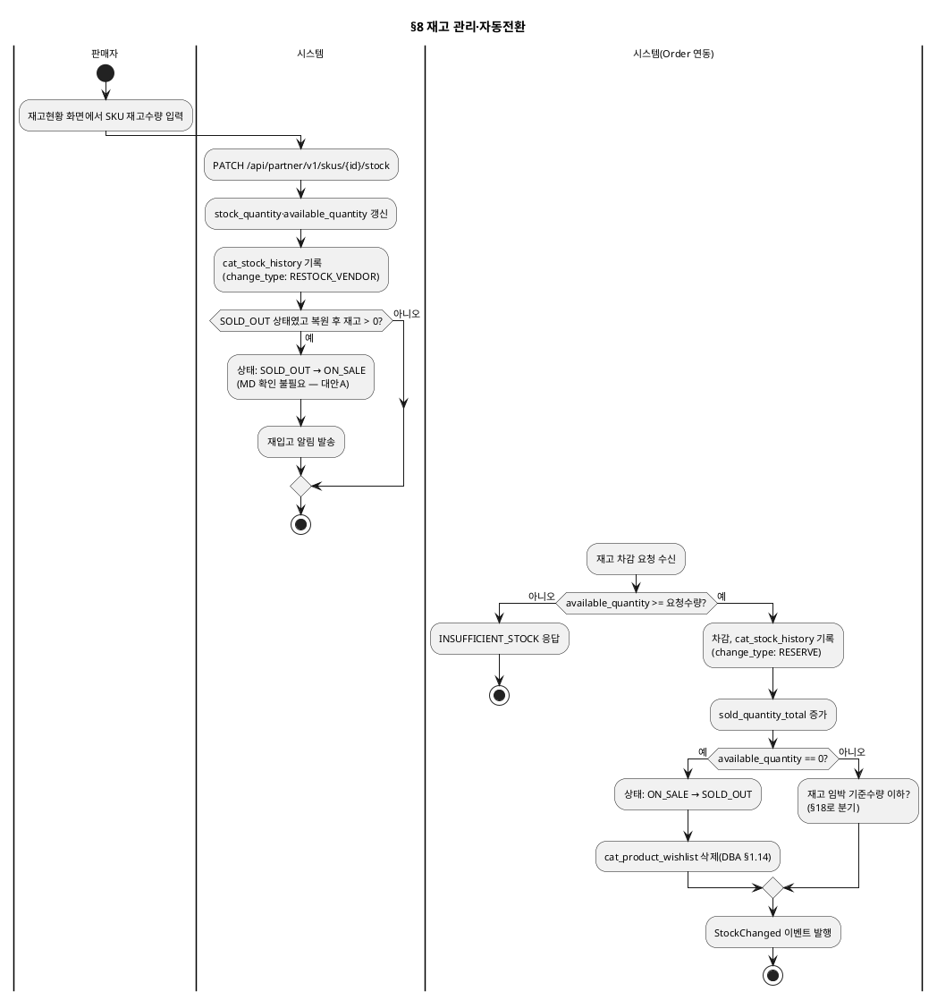

### 기본 흐름

| Step | 액터 | 행위 | 시스템 응답 | 비고 |
|---|---|---|---|---|
| 1 | 판매자 | 재고현황 화면에서 SKU 재고수량 입력 | API: PATCH /api/partner/v1/skus/{id}/stock → 재고 갱신, cat_stock_history 기록 | |
| 2 | 시스템 | SOLD_OUT 상품의 재고가 1 이상으로 복원되면 | 상태 SOLD_OUT→ON_SALE 자동 전환 (MD 확인 불필요), 재입고 알림 발송 | 대안A |
| 3 | 시스템(Order 연동) | Order가 재고 차감을 요청하면 | available_quantity 충분 시 차감, 0 되면 SOLD_OUT 자동 전환 | |

### 대안 흐름

| 조건 | Step 변경 | 결과 |
|---|---|---|
| available_quantity < 요청 수량 | Step 3에서 거부 | INSUFFICIENT_STOCK 응답, 재고 변동 없음 |
| 재고 복원이 주문취소/반품교환확정으로 발생 | Step 2와 동일 로직 | change_type만 RESTORE_ORDER_CANCEL/RESTORE_RETURN_EXCHANGE로 구분, 자동전환 로직은 동일 |

---

## 9. 가격 설정·변경 Bolt

> **2026-10-26 변경**: 판매가(price_sale)는 `cat_product` 컬럼이 아니라
> `cat_product_price_schedule`(기간별 스케줄)에 저장된다(DBA §1.7.2). 정가·공급가는
> 즉시 반영되지만, 판매가는 새 BASE 행을 추가하고 기존 BASE 행을 종료하는 방식으로 바뀐다.
> **주문 수량 제한**(`max_order_quantity`, 상품 단위, 선택 설정)은 이 Bolt와 별개인
> §19(주문 수량 제한 Bolt)에서 다룬다(DBA §1.8).

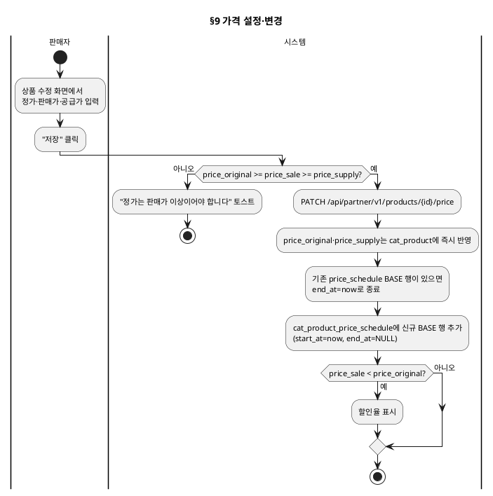

### 기본 흐름

| Step | 액터 | 행위 | 시스템 응답 | 비고 |
|---|---|---|---|---|
| 1 | 판매자 | 정가·판매가·공급가 입력 후 저장 | API: PATCH /api/partner/v1/products/{id}/price → 정가·공급가 즉시 반영, 판매가는 price_schedule 신규 행 추가 | |
| 2 | 시스템 | price_sale < price_original인 경우 | 할인율 함께 표시 | |

### 대안 흐름

| 조건 | Step 변경 | 결과 |
|---|---|---|
| price_original ≥ price_sale ≥ price_supply 위반 | Step 1에서 거부 | "정가는 판매가 이상이어야 합니다" 토스트, 저장 거부 (price_schedule 행도 추가되지 않음) |

---

## 10. 상품 목록·검색·상세 조회 Bolt (고객)

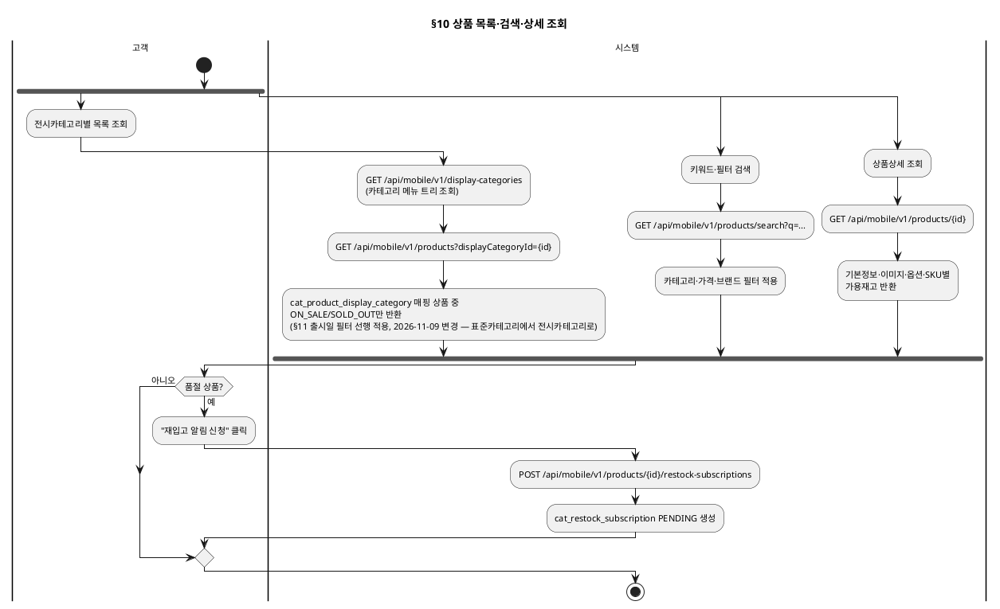

### 기본 흐름

| Step | 액터 | 행위 | 시스템 응답 | 비고 |
|---|---|---|---|---|
| 1 | 고객 | 전시카테고리별 목록 조회 | API: GET /api/mobile/v1/products?displayCategoryId={id} → ON_SALE/SOLD_OUT만 반환 (2026-11-09 변경, 舊 categoryId) | §11 필터 선행, 카테고리 메뉴는 GET /api/mobile/v1/display-categories로 구성 |
| 2 | 고객 | 키워드·필터 검색 | API: GET /api/mobile/v1/products/search → 전시카테고리·가격·브랜드 필터 적용 | |
| 3 | 고객 | 상품상세 조회 | API: GET /api/mobile/v1/products/{id} → 기본정보·이미지·옵션·SKU 가용재고 반환 | |
| 4 | 고객 | 품절 상품에 재입고 알림 신청 | API: POST /api/mobile/v1/products/{id}/restock-subscriptions → PENDING 생성 | |

---

## 11. 출시일 노출 필터링·화면별 할인노출·연관상품추천 Bolt (시스템 로직)

> 고객 행위가 아니라 §10 조회 결과에 시스템이 적용하는 로직이다. 별도 화면이 없고
> §10의 응답 가공 단계에 끼어든다.

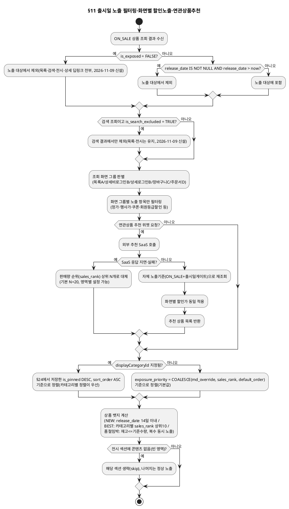

### 기본 흐름

| Step | 액터 | 행위 | 시스템 응답 | 비고 |
|---|---|---|---|---|
| 1 | 시스템 | §10 조회 결과에서 is_exposed=FALSE 또는 release_date > now인 상품 제외 | 노출 쿼리 필터, 상태 전이 없음 | is_exposed는 2026-11-09 신설(C안과 동일 패턴), 딥링크 포함 전면 차단 |
| 1-1 | 시스템 | 검색 조회(§18)에서 is_search_excluded=TRUE인 상품 추가 제외 | 목록·전시는 그대로 유지, 검색 결과에서만 제외 | 2026-11-09 신설 |
| 2 | 시스템 | 조회 화면 그룹(목록/상세/장바구니/주문서) 판별 | 그룹별 노출 항목만 필터링 | |
| 3 | 시스템 | 연관상품 추천 위젯 요청 시 | 외부 SaaS 호출 → 자체 노출기준 재조회·할인가 동일적용 후 반환 | |
| 4 | 시스템 | 상품 목록 노출 순서 산정 | displayCategoryId 지정 시 §24 `is_pinned DESC, sort_order ASC`, 아니면 `COALESCE(md_override, sales_rank, default_order)` | 2026-11-09 변경 — 카테고리별 정렬이 전역 MD Override보다 우선 |
| 5 | 시스템 | 상품 뱃지 산정 | NEW·BEST·품절임박 복수 동시 노출 | 2026-11-06 신설 |
| 6 | 시스템 | 전시 섹션 콘텐츠 비어있는 경우 | 해당 섹션만 생략, 나머지 섹션 정상 노출 | 2026-11-06 신설 |

### 대안 흐름

| 조건 | Step 변경 | 결과 |
|---|---|---|
| 연관상품 추천 SaaS 응답 지연·실패 | Step 3에서 대체 | 판매량 순위(sales_rank) 상위 N개(기본 20)로 대체 노출, 위젯을 숨기지 않음 |

---

## 12. 노출 우선순위(MD Override) 설정 Bolt

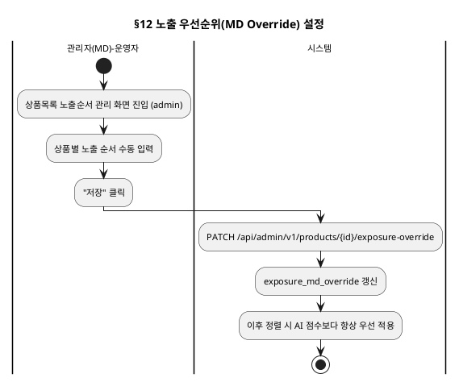

### 기본 흐름

| Step | 액터 | 행위 | 시스템 응답 | 비고 |
|---|---|---|---|---|
| 1 | 관리자(MD, 운영자) | 상품목록 노출순서 관리 화면에서 순서 수동 입력 | API: PATCH /api/admin/v1/products/{id}/exposure-override | |
| 2 | 시스템 | — | exposure_md_override 갱신, AI 점수보다 항상 우선 적용 | |

---

## 13. 전시 페이지 생성·게시·운영 Bolt

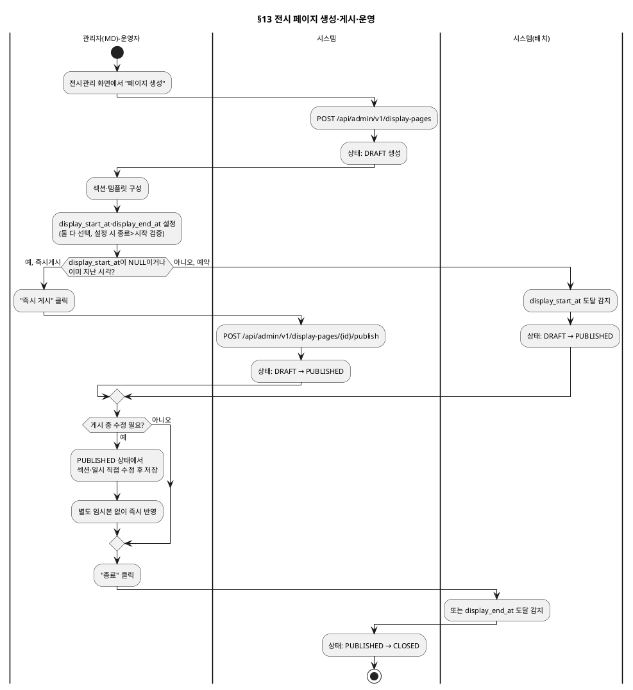

### 기본 흐름

| Step | 액터 | 행위 | 시스템 응답 | 비고 |
|---|---|---|---|---|
| 1 | 관리자(MD, 운영자) | 전시 페이지 생성, 섹션·템플릿·전시기간(display_start_at/display_end_at) 구성 | API: POST /api/admin/v1/display-pages → DRAFT | |
| 2a | 관리자(MD, 운영자) | 즉시 게시 (display_start_at NULL 또는 과거) | API: .../publish → PUBLISHED | |
| 2b | 시스템(배치) | display_start_at 도달 시 자동 게시 | 상태 DRAFT→PUBLISHED | |
| 3 | 관리자(MD, 운영자) | 게시 중 섹션·일시 직접 수정 | PUBLISHED 상태에서 즉시 반영(상태 전이 없음) | |
| 4 | 관리자(MD, 운영자) 또는 시스템(배치) | 종료 처리 또는 display_end_at 도달 | 상태 PUBLISHED→CLOSED | |

### 대안 흐름

| 조건 | Step 변경 | 결과 |
|---|---|---|
| display_end_at ≤ display_start_at로 설정 시도 | Step 1에서 거부 | "종료일시는 시작일시보다 이후여야 합니다" 안내 |

---

## 14. PublicApi·이벤트 연동 Bolt (Order·Promotion·Member)

> **2026-10-26 변경**: Promotion 연동 부분을 "price_sale 직접 갱신/복원"에서
> "cat_product_price_schedule 기간별 스케줄 등록/취소"로 교체했다(DBA §1.7.2·§1.7.4,
> DI 이벤트플로우 `PROMOTION_PRICE_SCHEDULED`/`PROMOTION_PRICE_SCHEDULE_CANCELLED`).
> API 경로도 실제 DL 확정 경로(`/api/internal/v1/*`)로 정정했다.
> **2026-11-06 추가**: Promotion의 주문수량제한(1+1 등) 필터링용 `max_order_quantity`
> 값 제공(DBA §1.8), Member의 회원탈퇴 이벤트 수신(`MemberWithdrawn`, DBA §1.14)을
> 반영했다.

```plantuml
@startuml
skinparam backgroundColor transparent
skinparam defaultFontSize 11
title §14 PublicApi·이벤트 연동 (Order·Promotion)

|시스템(Order)|
start

fork
  :상품 정보 조회 요청;
  |시스템(Catalog)|
  :GET /api/internal/v1/products/{id};
  :이름·가격(조회시점 유효 판매가)·상태·판매자 정보 반환;
fork again
  :재고 차감/확인 요청;
  |시스템(Catalog)|
  :POST /api/internal/v1/skus/{id}/reserve;
  :(§8과 동일 로직);
fork again
  :판매자 단위 배송 속성 요청;
  |시스템(Catalog)|
  :GET /api/internal/v1/products/{id}/vendor-shipping;
  :vendor_id 그룹핑 속성 반환;
end fork

|시스템(Order)|
:ORDER_CANCELLED / RETURN_EXCHANGE_CONFIRMED 이벤트 발행;
|시스템(Catalog)|
:재고 복원 (§8 자동전환 로직);

|시스템(Promotion)|
start
:상품-행사 그룹핑 속성 요청;
|시스템(Catalog)|
:GET /api/internal/v1/products/{id}/promotion-grouping;
:vendor_id·조회시점 유효 판매가 반환;

|시스템(Promotion)|
:PROMOTION_PRICE_SCHEDULED 이벤트 발행\n(행사 시작, start_at~end_at 사전 등록 가능);
|시스템(Catalog)|
:cat_product_price_schedule에\nPROMOTION_EVENT 행 추가;

note over 시스템(Catalog)
  행사 "종료"는 별도 이벤트 없이
  end_at 경과 시 조회가 자동으로
  다음 유효 행(BASE 등) 선택
end note

|시스템(Promotion)|
:PROMOTION_PRICE_SCHEDULE_CANCELLED 이벤트 발행\n(행사 중도 취소 시에만);
|시스템(Catalog)|
:해당 스케줄 행 end_at=now로 종료;

|시스템(Promotion)|
:수량조건(1+1 등) 대상 상품 조회 시\nmax_order_quantity 값 요청;
|시스템(Catalog)|
:GET /api/internal/v1/products/{id}/max-order-quantity;
:값 반환 (실제 필터링은 Promotion 수행);

|시스템(Member)|
:MemberWithdrawn 이벤트 발행;
|시스템(Catalog)|
:cat_product_wishlist에서\n해당 member_id 전체 삭제;
stop
@enduml
```

### 기본 흐름

| Step | 액터 | 행위 | 시스템 응답 | 비고 |
|---|---|---|---|---|
| 1 | 시스템(Order) | 상품 정보 조회 | API: GET /api/internal/v1/products/{id} | 동기 PublicApi |
| 2 | 시스템(Order) | 재고 차감/확인 요청 | §8 재고관리 Bolt와 동일 로직 | 동기 PublicApi |
| 3 | 시스템(Order) | 판매자 단위 배송 속성 요청 | API: GET .../vendor-shipping | 동기 PublicApi |
| 4 | 시스템(Order) | ORDER_CANCELLED/RETURN_EXCHANGE_CONFIRMED 이벤트 발행 | §8 자동전환 로직 적용 | 비동기 |
| 5 | 시스템(Promotion) | 상품-행사 그룹핑 속성 요청 | API: GET .../promotion-grouping | 동기 PublicApi |
| 6 | 시스템(Promotion) | PROMOTION_PRICE_SCHEDULED 이벤트 발행 | cat_product_price_schedule에 PROMOTION_EVENT 행 추가 (사전 등록 가능) | 비동기 |
| 7 | 시스템(Promotion) | PROMOTION_PRICE_SCHEDULE_CANCELLED 이벤트 발행 (중도 취소 시에만) | 해당 스케줄 행 종료 처리 | 비동기, 정상 종료는 이벤트 불필요 |
| 8 | 시스템(Promotion) | 수량조건(1+1 등) 대상 상품 조회 시 `max_order_quantity` 요청 | API: GET .../max-order-quantity → 값 반환 | 동기 PublicApi, 실제 필터링은 Promotion 수행(DBA §6 HR #34) |
| 9 | 시스템(Member) | 회원 탈퇴 시 `MemberWithdrawn` 이벤트 발행 | `cat_product_wishlist`에서 해당 member_id 행 전체 삭제 | 비동기, Member 실제 발행 여부는 DBA §6 HR #35. PGM: `DQ-프로그램목록/catalog.md` CSM-CAT-008(2026-11-09 소급 반영) |

---

## 15. 홈 화면 지정·조회 Bolt (2026-10-26 신설)

> DE-메뉴구조도/mobile.md "홈" 메뉴에 설계가 빠져 있던 공백을 메운다(사용자 피드백). admin이
> 홈을 지정하는 행위와 고객이 홈을 조회하는 행위를 하나의 Bolt로 묶는다 — 서로 다른 채널이지만
> 책임이 작고 밀접하게 연결돼 있다(전시페이지 Bolt §13의 연장선).

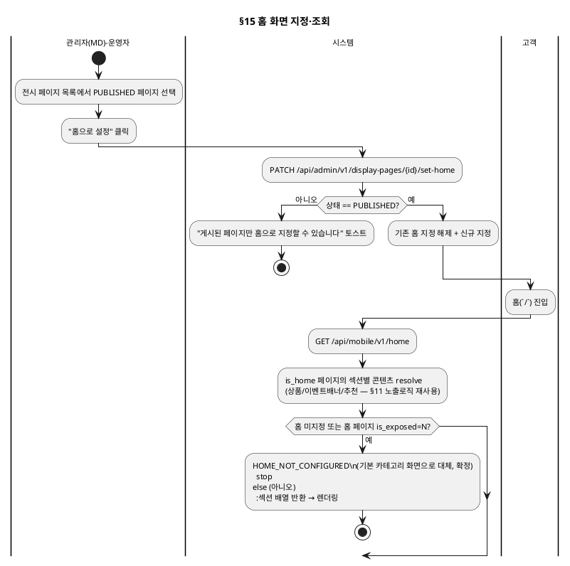

### 기본 흐름

| Step | 액터 | 행위 | 시스템 응답 | 비고 |
|---|---|---|---|---|
| 1 | 관리자(MD, 운영자) | PUBLISHED 페이지를 홈으로 설정 | API: PATCH .../set-home → 기존 홈 해제 후 신규 지정 | §13 전시페이지 화면에 액션만 추가, 별도 메뉴 없음 |
| 2 | 고객 | 홈(`/`) 진입 | API: GET /api/mobile/v1/home → 섹션별 콘텐츠 반환 | §11 노출로직(출시일게이트·화면별할인노출·추천) 재사용 |

### 대안 흐름

| 조건 | Step 변경 | 결과 |
|---|---|---|
| PUBLISHED가 아닌 페이지를 홈으로 지정 시도 | Step 1에서 거부 | INVALID_STATUS 토스트 |
| 홈 미지정 상태, 또는 홈 페이지가 전시여부(`is_exposed`)=N(긴급회수) 상태에서 고객이 접속 | Step 2에서 HOME_NOT_CONFIGURED | 기본 카테고리 화면으로 대체 — **확정(2026-11-06)**, DBA §2.10 전시여부 플래그 신설과 함께 해소 |
| EVENT_LIST 섹션의 eventKey가 동기화 캐시에 없음(동기화 지연·실패) | Step 2 응답에서 해당 배너만 제외 | 나머지 섹션은 정상 노출 |

---

## 16. 상품 복제 등록 Bolt (2026-11-06 신설)

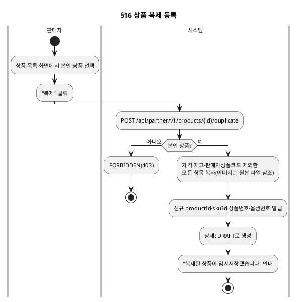

### 기본 흐름

| Step | 액터 | 행위 | 시스템 응답 | 비고 |
|---|---|---|---|---|
| 1 | 판매자 | 본인 상품 목록에서 "복제" 클릭 | API: POST /api/partner/v1/products/{id}/duplicate | §1 등록 경로로 재진입 가능한 DRAFT 생성 |
| 2 | 시스템 | — | 가격·재고·판매자상품코드 제외 전체 복사, 신규 식별자 발급, DRAFT 생성 | DBA §1.5.3 |

### 대안 흐름

| 조건 | Step 변경 | 결과 |
|---|---|---|
| 본인 상품이 아님 | Step 1에서 거부 | FORBIDDEN(403) |

---

## 17. 상품 대량등록(Bulk) Bolt (2026-11-06 소급 반영)

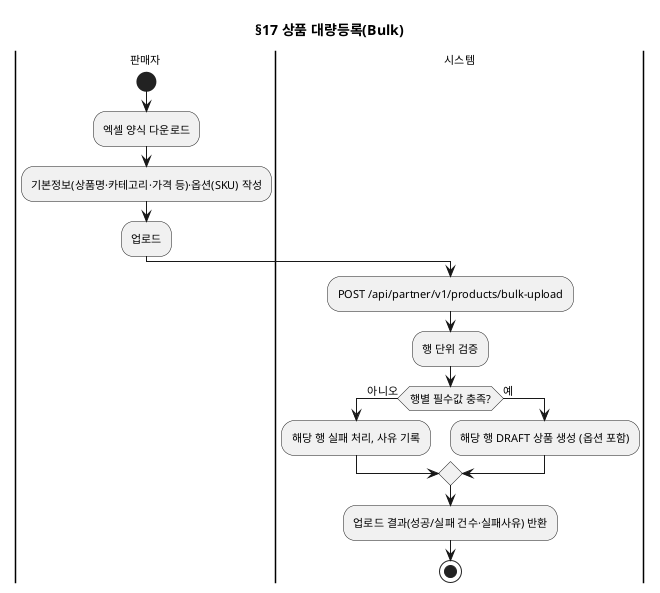

### 기본 흐름

| Step | 액터 | 행위 | 시스템 응답 | 비고 |
|---|---|---|---|---|
| 1 | 판매자 | 엑셀 양식에 기본정보·옵션(SKU) 작성 후 업로드 | API: POST /api/partner/v1/products/bulk-upload | DBA §1.5.2 |
| 2 | 시스템 | 행 단위 검증·생성 | 성공 행은 DRAFT 생성, 실패 행은 사유와 함께 결과에 포함 | 부분 성공 허용 |

---

## 18. 재고 품절 임박 알림 Bolt (2026-11-06 신설)

> §8(재고 관리)의 재고 차감·복원 트랜잭션에서 분기되는 알림 전용 흐름이다.

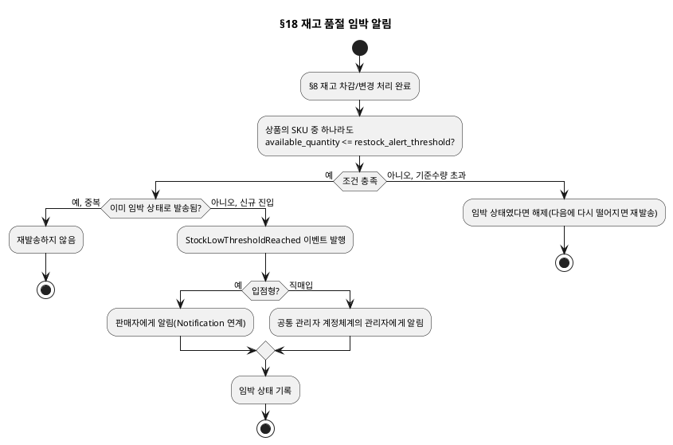

### 기본 흐름

| Step | 액터 | 행위 | 시스템 응답 | 비고 |
|---|---|---|---|---|
| 1 | 판매자 | 상품별 재고 임박 기준수량 설정(선택, 기본값 5) | PATCH /api/partner/v1/products/{id} (restockAlertThreshold) | DBA §1.10 |
| 2 | 시스템 | SKU 재고가 기준수량 이하로 떨어지면 | `StockLowThresholdReached` 이벤트 발행, 담당자에게 알림 | 입점형→판매자, 직매입→관리자 |

### 대안 흐름

| 조건 | Step 변경 | 결과 |
|---|---|---|
| 임박 상태 유지 중 재차 재고 변동 | Step 2에서 무시 | 중복 발송 방지, 기준값 초과 회복 후 재하락 시에만 재발송 |

---

## 19. 주문 수량 제한 설정 Bolt (2026-11-06 신설)

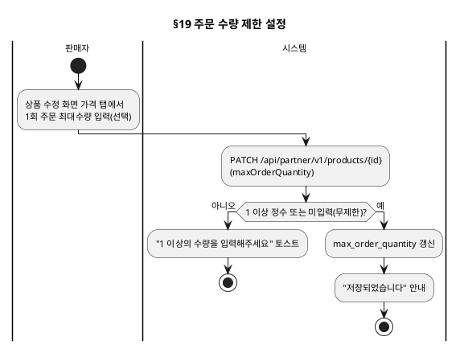

### 기본 흐름

| Step | 액터 | 행위 | 시스템 응답 | 비고 |
|---|---|---|---|---|
| 1 | 판매자 | 1회 주문 최대수량 입력(선택, 미입력 시 무제한) | API: PATCH /api/partner/v1/products/{id} | DBA §1.8. 상품에 속한 전체 SKU 합산 기준 |
| 2 | 시스템 | — | `max_order_quantity` 갱신 | 실제 검증은 Order가 주문 시점에 수행 |

---

## 20. 찜하기 등록·해제·자동삭제 Bolt (2026-11-06 신설)

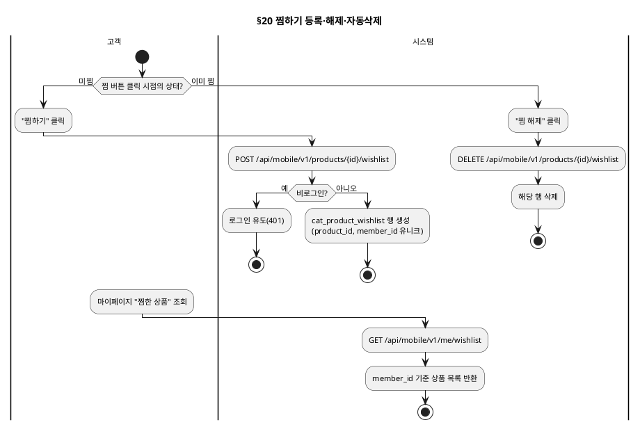

### 기본 흐름

| Step | 액터 | 행위 | 시스템 응답 | 비고 |
|---|---|---|---|---|
| 1 | 고객(로그인) | 상품 목록·상세에서 "찜하기"/"찜 해제" 클릭 | API: POST/DELETE .../wishlist | 상품당 1건, DBA §1.14 |
| 2 | 고객(로그인) | 마이페이지에서 찜한 상품 목록 조회 | API: GET /api/mobile/v1/me/wishlist | |

### 대안 흐름

| 조건 | Step 변경 | 결과 |
|---|---|---|
| 비로그인 상태에서 찜하기 시도 | Step 1에서 거부 | 401, 로그인 유도 |
| 상품이 SOLD_OUT/DISCONTINUED로 전환 | §6·§8과 연동 | 해당 상품의 찜 데이터 전체 삭제(재입고돼도 복원 안 함) |

---

## 21. SNS 공유·URL 복사 Bolt (2026-11-06 신설)

```plantuml
@startuml
skinparam backgroundColor transparent
skinparam defaultFontSize 11
title §21 SNS 공유·URL 복사

|고객|
start
:상품 상세 또는 전시 페이지에서\n"공유" 클릭;

|시스템|
:GET /api/mobile/v1/products/{id}/share\n(또는 /display-pages/{id}/share);
:공유 URL(canonical)·제목·대표이미지·요약설명 반환;

|고객|
:클라이언트가 OS 공유 시트 호출\n(카카오톡·URL복사 등);
stop
@enduml
```

### 기본 흐름

| Step | 액터 | 행위 | 시스템 응답 | 비고 |
|---|---|---|---|---|
| 1 | 고객 | 상품 상세·전시 페이지에서 "공유" 클릭 | API: GET .../share → 공유 메타데이터 반환 | 리워드 없음, 신규 필드 없음(기존 데이터 재사용) |
| 2 | 고객 | 클라이언트가 OS 공유 기능 호출 | — | 이벤트 페이지(Promotion 소유)는 Catalog 범위 밖 |

---

## 22. 전시여부 플래그 긴급 회수·복원 Bolt (2026-11-06 신설)

> §13(전시 페이지 생성·게시·운영) 및 §15(홈 화면)와 연동되는 긴급 대응 흐름이다. 상태
> 전이는 전혀 건드리지 않는다(DBA §2.10).

```plantuml
@startuml
skinparam backgroundColor transparent
skinparam defaultFontSize 11
title §22 전시여부 플래그 긴급 회수·복원

|관리자(MD)-운영자|
start
:전시 페이지 목록에서 문제 페이지 선택;
:"긴급 회수" 클릭;

|시스템|
:PATCH /api/admin/v1/display-pages/{id}/exposure\n(isExposed=false);
:상태·예약·is_home 값은 변경하지 않음;
:노출 쿼리에서 즉시 제외;

if (해당 페이지가 is_home=true?) then (예)
  :"홈 미지정"과 동일 처리\n(§15 기본 카테고리 화면 대체);
else (아니오)
endif

|관리자(MD)-운영자|
:조치 완료 후 "노출 복원" 클릭;
|시스템|
:PATCH .../exposure (isExposed=true);
:노출 쿼리에 즉시 재포함 (재게시 절차 불필요);
stop
@enduml
```

### 기본 흐름

| Step | 액터 | 행위 | 시스템 응답 | 비고 |
|---|---|---|---|---|
| 1 | 관리자(MD, 운영자) | 문제 발견 시 전시 페이지 "긴급 회수" 클릭 | API: PATCH .../exposure (isExposed=false) → 즉시 노출 제외 | 상태·예약·is_home 유지 |
| 2 | 관리자(MD, 운영자) | 조치 완료 후 "노출 복원" 클릭 | API: PATCH .../exposure (isExposed=true) → 즉시 재노출 | 재게시 절차 불필요 |

---

## 23. 상품정보제공고시 입력·노출 Bolt (2026-11-06 신설)

> **[Human Review]** 대분류별 법정 고시 항목은 법무 확인 전 참고용 기준이다(DBA §1.3.8,
> §6 HR #36).

```plantuml
@startuml
skinparam backgroundColor transparent
skinparam defaultFontSize 11
title §23 상품정보제공고시 입력·노출

|판매자 또는 관리자(MD)|
start
:상품 등록·수정 화면에서\n대분류별 고시 항목 입력\n(예: 의류·신발 — 소재·원산지·A/S책임자 등);

|시스템|
:PATCH /api/partner/v1/products/{id}\n(complianceInfo);
:저장;

|고객|
:상품 상세 조회;
|시스템|
:상세 하단에 "상품정보제공고시"\n섹션으로 별도 노출(이미지·설명과 구분);
stop
@enduml
```

### 기본 흐름

| Step | 액터 | 행위 | 시스템 응답 | 비고 |
|---|---|---|---|---|
| 1 | 판매자/관리자(MD) | 대분류별 고시 항목 입력 | API: PATCH .../products/{id} (complianceInfo) | §1.2.2와 동일한 필수 입력 속성 메커니즘 재사용 |
| 2 | 고객 | 상품 상세 조회 | 하단 별도 섹션으로 노출 | §10과 같은 조회 API 응답에 포함 |

---

## 24. 전시카테고리 상품순서 관리 Bolt (2026-11-09 신설)

> §7(분류체계관리)·§12(노출 우선순위)와는 별도 화면이다 — 대상이 "전시 카테고리 1건 안의
> 매핑 상품들"로 좁혀지고, 저장 방식이 "리스트 전체 순서 교체"라 개별 상품 수동 순위 입력
> (§12)과는 다르다. `cat_product_display_category`(DBA §2.5.2)에 매핑된 상품만 대상이다.

```plantuml
@startuml
skinparam backgroundColor transparent
skinparam defaultFontSize 11
title §24 전시카테고리 상품순서 관리

|관리자(MD)-운영자|
start
:전시카테고리 상품순서 관리 화면 진입;
:전시 카테고리 선택;

|시스템|
:GET /api/admin/v1/display-categories/{id}/products;
:cat_product_display_category 매핑 상품을\nis_pinned DESC, sort_order ASC로 조회;

|관리자(MD)-운영자|
:목록을 마우스 드래그앤드랍으로 재배열;
:필요한 상품에 "상단고정" 체크;
:"저장" 클릭;

|시스템|
:PUT /api/admin/v1/display-categories/{id}/products/order;
:전달된 순서대로 sort_order=0,1,2...\n일괄 반영, is_pinned 함께 갱신;
:재조회 시 고정 상품이 맨 위로\n재배치되어 노출;
stop
@enduml
```

### 기본 흐름

| Step | 액터 | 행위 | 시스템 응답 | 비고 |
|---|---|---|---|---|
| 1 | 관리자(MD, 운영자) | 전시 카테고리 선택 후 매핑 상품 목록 조회 | API: GET .../display-categories/{id}/products | is_pinned DESC, sort_order ASC로 반환 |
| 2 | 관리자(MD, 운영자) | 드래그앤드랍으로 순서 조정, 상단고정 토글 | 화면 상태만 변경(저장 전) | |
| 3 | 관리자(MD, 운영자) | "저장" 클릭 | API: PUT .../display-categories/{id}/products/order → 리스트 순서 그대로 sort_order 일괄 저장 | |

### 대안 흐름

| 조건 | Step 변경 | 결과 |
|---|---|---|
| 요청 상품 목록에 해당 전시 카테고리에 매핑되지 않은 productId 포함 | Step 3에서 거부 | "매핑되지 않은 상품이 포함되어 있습니다" 안내 |

---

## 25. 상품 랭킹 집계 Bolt (비동기, 2026-11-09 신설)

> §8(재고 관리)에서 발행되는 `StockChanged`를 Catalog 자신이 비동기로 재구독해 처리하는
> 흐름이다 — 사용자(관리자·판매자)가 직접 트리거하는 화면 행위가 없는 "시스템 전용" Bolt.
> 판매(RESERVE)·주문취소(RESTORE_ORDER_CANCEL)만 반영하고, 반품·교환확정
> (RESTORE_RETURN_EXCHANGE)·판매자 재고 신규등록(RESTOCK_VENDOR)은 집계에서 제외한다
> (DBA §1.17). PGM 등록: `DQ-프로그램목록/catalog.md` CSM-CAT-007(2026-11-09).

```plantuml
@startuml
skinparam backgroundColor transparent
skinparam defaultFontSize 11
title §25 상품 랭킹 집계 (비동기)

|시스템(StockService)|
start
:§8 재고 차감/복원 트랜잭션 커밋;
:StockChanged 이벤트 발행 (Outbox);

|시스템(ProductSalesRankingListener)|
:StockChanged 이벤트 비동기 수신;
:eventId로 멱등 검증\n(ProcessedEventRepository);
if (이미 처리된 이벤트?) then (예)
  stop
endif

if (changeType == RESERVE 또는\nRESTORE_ORDER_CANCEL?) then (아니오)
  :집계 제외\n(RESTORE_RETURN_EXCHANGE, RESTOCK_VENDOR);
  stop
else (예)
  :sale_hour = 이벤트 처리 시각을 시간 단위로 truncate;
  :cat_product_sales_hourly(product_id, sale_hour)\n원자적 upsert (quantity += changeQuantity);
  stop
endif
@enduml
```

### 기본 흐름

| Step | 액터 | 행위 | 시스템 응답 | 비고 |
|---|---|---|---|---|
| 1 | 시스템(StockService) | §8 재고 변동 트랜잭션 커밋 | StockChanged 이벤트 발행 | 기존 흐름과 동일, 변경 없음 |
| 2 | 시스템(ProductSalesRankingListener) | 이벤트 비동기 수신 | 멱등 검증 후 changeType 분기 | RESERVE/RESTORE_ORDER_CANCEL만 반영 |
| 3 | 시스템 | 반영 대상이면 | `cat_product_sales_hourly` upsert(이벤트 처리 시각 기준 시간 버킷) | 동시 다발 주문에도 원자적 upsert로 유실 방지 |

### 대안 흐름

| 조건 | Step 변경 | 결과 |
|---|---|---|
| changeType이 RESTORE_RETURN_EXCHANGE 또는 RESTOCK_VENDOR | Step 2에서 조용히 종료 | 집계에 반영되지 않음(DBA §1.17, 사용자 확인 2026-11-09) |
| 동일 eventId 중복 수신(재시도) | Step 2에서 멱등 검증 실패 | 중복 반영 없이 종료 |

---

## 26. 상품 랭킹 조회 Bolt (고객, 실시간/일간/주간, 2026-11-09 신설)

```plantuml
@startuml
skinparam backgroundColor transparent
skinparam defaultFontSize 11
title §26 상품 랭킹 조회

|고객|
start
:랭킹 화면 진입;
:기준 선택(실시간/일간/주간),\n전시 카테고리 선택(선택사항);

|시스템|
:GET /api/mobile/v1/products/ranking\n?period=&displayCategoryId=;
:기준별 시간 범위로\ncat_product_sales_hourly 필터;
if (전시 카테고리 지정?) then (예)
  :cat_product_display_category로\n해당 카테고리 매핑 상품만 필터;
endif
:product_id별 SUM(quantity)\n내림차순 정렬, 상위 50개;
:ON_SALE/SOLD_OUT 외 상태 상품 제외;
stop
@enduml
```

### 기본 흐름

| Step | 액터 | 행위 | 시스템 응답 | 비고 |
|---|---|---|---|---|
| 1 | 고객 | 랭킹 화면 진입, 기준(실시간/일간/주간) 선택 | API: GET /api/mobile/v1/products/ranking?period= | 실시간=최근 3시간, 일간=오늘 00:00~현재, 주간=최근 7일 |
| 2 | 고객 | 전시 카테고리 필터 적용(선택) | `displayCategoryId` 파라미터 추가 | 미지정 시 전체 상품 대상 |
| 3 | 시스템 | — | `cat_product_sales_hourly` 범위 합산 → 상위 50개 반환 | ON_SALE/SOLD_OUT 외 상태는 결과에서 제외 |

### 대안 흐름

| 조건 | Step 변경 | 결과 |
|---|---|---|
| 해당 범위에 집계 데이터가 전혀 없음(신규 오픈 등) | Step 3에서 | 빈 목록 반환, "집계된 랭킹이 없습니다" 안내 |

---

## 27. GNB 메뉴 관리 Bolt (2026-11-09 신설)

> 홈 화면 Header 하단 퀵메뉴 바를 구성하는 기능이다. §7(분류체계관리)과 같은 방식으로
> "관리자 CRUD"와 "고객 조회"를 한 Bolt에 묶는다. 단일 계층(서브메뉴 없음), 홈 화면
> 전용 노출(DBA §2.14).

```plantuml
@startuml
skinparam backgroundColor transparent
skinparam defaultFontSize 11
title §27 GNB 메뉴 관리

|관리자(MD)-운영자|
start
:GNB 메뉴 관리 화면 진입;

fork
  :메뉴 등록/수정;
  :메뉴명, 링크유형(DISPLAY_PAGE/\nDISPLAY_CATEGORY/RANKING/\nEVENT_PAGE/EXTERNAL_URL),\n링크대상, 전시여부, 전시기간 입력;
  |시스템|
  :POST/PATCH /api/admin/v1/gnb-menus(/{id});
  if (링크유형 == DISPLAY_PAGE 또는\nDISPLAY_CATEGORY?) then (예)
    :참조 대상 존재 검증;
  else (EVENT_PAGE/EXTERNAL_URL)
    :URL 문자열 그대로 저장(검증 없음);
  endif
fork again
  :메뉴 삭제;
  |시스템|
  :DELETE /api/admin/v1/gnb-menus/{id};
fork again
  :순서 조정(드래그앤드랍);
  |시스템|
  :PATCH /api/admin/v1/gnb-menus/order;
  :전달된 순서대로 sort_order=0,1,2... 일괄 반영;
end fork

|고객|
:홈 화면 진입;
|시스템|
:GET /api/mobile/v1/gnb-menus;
:is_exposed=true AND 조회시점이\ndisplay_start_at~display_end_at\n이내인 메뉴만 sort_order ASC로 반환;
stop
@enduml
```

### 기본 흐름

| Step | 액터 | 행위 | 시스템 응답 | 비고 |
|---|---|---|---|---|
| 1 | 관리자(MD, 운영자) | 메뉴명·링크유형·링크대상·전시여부·전시기간 입력 후 등록/수정 | API: POST/PATCH /api/admin/v1/gnb-menus(/{id}) | DISPLAY_PAGE·DISPLAY_CATEGORY는 참조 존재 검증, EVENT_PAGE·EXTERNAL_URL은 검증 없음 |
| 2 | 관리자(MD, 운영자) | 메뉴 삭제 | API: DELETE /api/admin/v1/gnb-menus/{id} | |
| 3 | 관리자(MD, 운영자) | 드래그앤드랍으로 순서 조정 후 저장 | API: PATCH /api/admin/v1/gnb-menus/order → sort_order 일괄 반영 | 전체 교체 방식(§24 전시카테고리 상품순서와 동일 패턴) |
| 4 | 고객 | 홈 화면 진입 | API: GET /api/mobile/v1/gnb-menus → 노출조건 만족 메뉴만 sort_order 순 반환 | 전시여부·전시기간 조회 시점 필터링(DBA §2.14) |

### 대안 흐름

| 조건 | Step 변경 | 결과 |
|---|---|---|
| 링크유형이 DISPLAY_PAGE인데 존재하지 않는 slug | Step 1에서 거부 | "참조 대상을 찾을 수 없습니다" 안내 |
| 노출조건을 만족하는 GNB 메뉴가 0건 | Step 4에서 | 빈 배열 반환(홈 화면은 퀵메뉴 바 영역 자체를 생략) |

---

## 28. 전시 페이지 뷰어 조회 Bolt (비홈, 2026-11-09 신설)

> §15(홈 화면 지정·조회)와 거의 동일하다 — 홈도 `is_home=true`인 `cat_display_page` 1건을
> 조회하는 것이므로, 이 Bolt는 "slug로 특정 1건을 조회"하는 변형이다. 섹션 resolve 로직은
> §15와 완전히 재사용한다(DBA §2.15). GNB(§27)의 linkType=DISPLAY_PAGE, SNS 공유(§21)가
> 가리키는 화면이 바로 이것이다.

```plantuml
@startuml
skinparam backgroundColor transparent
skinparam defaultFontSize 11
title §28 전시 페이지 뷰어 조회 (비홈)

|고객|
start
:GNB 메뉴 또는 공유 링크로\n전시 페이지 slug 경로 진입;

|시스템|
:GET /api/mobile/v1/display-pages/{slug};
:findBySlug(slug);
if (존재하지 않음?) then (예)
  stop
endif
if (status != PUBLISHED 또는\nis_exposed == false?) then (예)
  :404 DISPLAY_PAGE_NOT_FOUND;
  stop
else (조회 가능)
  :섹션을 sortOrder 순으로 조회 후\n종류별 resolve\n(§15 HomeQueryService 로직 재사용);
  stop
endif
@enduml
```

### 기본 흐름

| Step | 액터 | 행위 | 시스템 응답 | 비고 |
|---|---|---|---|---|
| 1 | 고객 | GNB 메뉴 또는 공유 링크로 slug 경로 진입 | API: GET /api/mobile/v1/display-pages/{slug} | |
| 2 | 시스템 | — | status=PUBLISHED && is_exposed=true면 섹션 resolve 후 반환, 아니면 404 | §15와 동일한 resolve 로직 재사용 |

### 대안 흐름

| 조건 | Step 변경 | 결과 |
|---|---|---|
| slug가 존재하지 않음 | Step 2에서 | 404 DISPLAY_PAGE_NOT_FOUND |
| status가 DRAFT/CLOSED/CANCELLED | Step 2에서 | 404 (홈과 동일 기준) |
| is_exposed=false | Step 2에서 | 404 (전시여부 플래그, §22와 동일 사상) |

---

## 근거

| 항목 | 출처 |
|---|---|
| Bolt 구분·행위 흐름 | `deliverables/S2-구조설계/DC-상위유스케이스/catalog.md` ⑤ Bolt 분할 후보 |
| 대안 흐름 | `deliverables/S3-상세설계/DJ-GWT수용기준/catalog.md` 예외·경계값 시나리오 |
| UI 행위·메뉴 위치 | `deliverables/S2-구조설계/DE-메뉴구조도/admin.md`·`partner.md`·`mobile.md` |
| API 호출 지점 | 인터페이스 명세(DL) endpoint 도출 근거 — 본 문서가 선행 |
| 상태 전이 | `deliverables/S2-구조설계/DH-상태머신/catalog.md` |
| 재고 자동전환(대안A) | `deliverables/S2-구조설계/DBA-도메인정책서/catalog.md` §1.10 |
| 출시일 노출 게이트(C안) | DBA §2.4 |
| PublicApi·이벤트 연동 | `deliverables/S2-구조설계/DI-이벤트플로우/catalog.md` |
| 홈 화면 지정·조회 (§15) | 사용자 확인(2026-10-26) — DD REQ-CAT-052~053, DBA §2.7.2·§2.9 |
| 상품 복제등록(§16)·대량등록(§17) | DD REQ-CAT-056~057, DBA §1.5.3·§1.5.2(2026-11-06) |
| 재고 품절임박 알림(§18) | DD REQ-CAT-058~059, DBA §1.10(2026-11-06 신설) |
| 주문 수량 제한(§19) | DD REQ-CAT-059b·060, DBA §1.8(2026-11-06 신설) |
| 찜하기(§20) | DD REQ-CAT-061~062, DBA §1.14(2026-11-06 신설) |
| SNS 공유(§21) | DD REQ-CAT-063, DBA §1.16(2026-11-06 신설) |
| 전시여부 플래그(§22) | DD REQ-CAT-068, DBA §2.10(2026-11-06 신설) |
| 상품정보제공고시(§23) | DD REQ-CAT-070, DBA §1.3.8(2026-11-06 신설) — 법무 확인 전, §6 HR #36·#10 |
| 전시카테고리 상품순서(§24) | DD REQ-CAT-071~072, DBA §2.5.3(2026-11-09 신설) |
| 고객 상품 목록·검색의 카테고리 기준(§10, 전시카테고리로 변경) | DD REQ-CAT-029·031·073, DBA §2.5.1~§2.5.2(2026-11-09 재정의) |
| 상품 뱃지·추천실패대체·빈섹션생략(§11 보강) | DD REQ-CAT-064~067·069, DBA §2.6·§2.9·§2.11 |
| 상품 랭킹 집계(§25, 비동기)·조회(§26) | DD REQ-CAT-074~075, DBA §1.17·§2.13(2026-11-09 신설), `DI-이벤트플로우/catalog.md` StockChanged 내부 재구독 |
| GNB 메뉴 관리(§27) | DD REQ-CAT-076~077, DBA §2.14(2026-11-09 신설) |
| 비홈 전시 페이지 뷰어(§28) | DD REQ-CAT-078, DBA §2.15(2026-11-09 신설) — §15 홈 섹션 resolve 로직 재사용 |
| 상품 요약·태그(§5 보강) | DD REQ-CAT-079, DBA §1.3.1·§1.3.3·§1.3.4(기존 정책, 2026-11-09 소급 반영) |
| 옵션값 이미지(§5 보강) | DD REQ-CAT-080~081, DBA §1.4.1(2026-11-09 신설) |
| 상품 단위 전시여부·검색노출 제외(§5·§11 보강) | DD REQ-CAT-082~083, DBA §2.16(2026-11-09 신설) — SCR-A-C04-T6(전시 탭) 폐지, 기본정보 탭 통합 |

