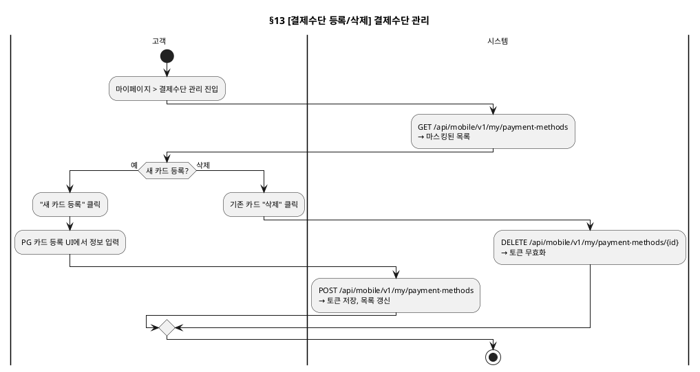

# 세부 유스케이스 — Payment 도메인

> 상위 문서: [readme.md](readme.md)
> **단계**: 상세설계 (S3) | **문서범위**: Bolt (Payment) | **문서종류**: Design
> Order 관련 시나리오는 [DK-세부유스케이스/order.md](order.md) 참조

---

## 13. [결제수단 등록/삭제] 결제수단 관리 Bolt (mobile)

### 기본 흐름

| Step | 액터 | 행위 | 시스템 응답 | 비고 |
|---|---|---|---|---|
| 1 | 고객 | 마이페이지 > 결제수단 관리 진입 | API: GET /api/mobile/v1/my/payment-methods → 마스킹된 목록 | |
| 2 | 고객 | "새 카드 등록" 클릭 | PG 카드 등록 UI 표시 | |
| 3 | 고객 | 카드 정보 입력 | PG로 전송 (서버 미저장) | |
| 4 | 시스템 | — | API: POST /api/mobile/v1/my/payment-methods → 토큰 저장, 목록 갱신 | |
| 5 | 고객 | 기존 카드 "삭제" 클릭 | API: DELETE /api/mobile/v1/my/payment-methods/{id} → 토큰 무효화 | |

---

## 13-1. [환불계좌 입력·검증·저장] 가상계좌 결제 요청 Bolt (mobile) — 설계안(2026-10-29, 미구현)

> REQ-PAY-031, 정책서 payment.md 8.7.1. 환불계좌는 가상계좌 결제 요청 시 함께 입력해 해당 결제에 저장하며, 마이페이지 환불계좌 등록은 두지 않는다(폐기). 카드·간편결제는 환불계좌를 받지 않는다.

### 기본 흐름

| Step | 액터 | 행위 | 시스템 응답 | 비고 |
|---|---|---|---|---|
| 1 | 고객 | 주문서에서 결제수단으로 가상계좌를 선택 | 환불계좌 입력란(은행·계좌번호·예금주) 표시 | 카드·간편결제 선택 시 입력란 없음 |
| 2 | 고객 | 환불계좌를 입력하고 "결제하기" 클릭 | API: POST /api/mobile/v1/my/orders/{orderSheetId}/pay (`refundAccount` 포함) | 결제 요청 Bolt(DK order §3)와 같은 호출 |
| 3 | 시스템 | 환불계좌 검증(결제 요청 시점) | 예금주=주문자 본인, 계좌 실명 확인 | 계좌번호는 암호화 저장·마스킹 표시 |
| 4 | 시스템 | 검증 통과 | 환불계좌를 해당 결제에 저장하고 결제 요청을 접수 | |

### 예외 흐름

| 분기 | 조건 | 시스템 응답 |
|---|---|---|
| E1 | 가상계좌인데 환불계좌 없음 | 400 `REFUND_ACCOUNT_REQUIRED`, 결제 요청 거부 |
| E2 | 예금주가 주문자와 다르거나 실명 확인 실패 | 400 `REFUND_ACCOUNT_INVALID`, 결제 요청 거부 |

---

## 13-2. [결제 확인 중 조회] PG 거래 조회 확정 Bolt (시스템) — 설계안(2026-10-29, 미구현)

> REQ-PAY-005·029, 정책서 payment.md 4.5.2·9.6.1. 고객 화면 액션은 없고, 주문완료 화면은 결제 진행 상태를 폴링해 표시한다.

### 기본 흐름

| Step | 액터 | 행위 | 시스템 응답 | 비고 |
|---|---|---|---|---|
| 1 | 시스템 | PG 승인 요청 후 3초 내 응답 없음 | 결제 상태 → CONFIRMING(결제 확인 중) | 즉시 재요청하지 않음 |
| 2 | 시스템 | PG 거래 조회 | 승인이면 PAID, PAYMENT_APPROVED 발행 | |
| 3 | 시스템 | 조회 결과 미승인 | 실패 1회로 합산, 누적 실패 3회 미만이면 PENDING 복귀 후 3초 간격으로 재요청 | 같은 행·같은 멱등키 |
| 4 | 시스템 | 누적 실패 3회 도달(최초 시도 포함 총 3회 시도) | CANCELLED, PAYMENT_FAILED 발행 | 재고 복원은 Order |

### 예외 흐름

| 분기 | 조건 | 시스템 응답 |
|---|---|---|
| E1 | CONFIRMING 중 고객이 같은 주문으로 재결제 요청 | 거부(중복 승인 방지) |
| E2 | 통신 장애로 승인 응답 수신 중 끊김 | 망취소 대상으로 기록 → 망취소 배치(1시간 주기·3회 재시도·이후 수작업, 정책 4.6.2) |

---

## 13-3. [입금 통보 처리] 가상계좌 입금 통보 Bolt (시스템) — 설계안(2026-10-29, 미구현)

> REQ-PAY-030, 정책서 payment.md 4.4.2. 취소와 입금 통보가 경합하면 취소를 우선한다.

### 기본 흐름

| Step | 액터 | 행위 | 시스템 응답 | 비고 |
|---|---|---|---|---|
| 1 | PG | 가상계좌 입금 통보 전송 | 서명 검증·멱등 확인 후 수신 | |
| 2 | 시스템 | 주문 상태가 입금대기(DEPOSIT_PENDING) | 금액이 일치하면 PAID, PAYMENT_APPROVED 발행. 금액이 다르면 입금 거절(PG 설정) | |
| 3 | 시스템 | 주문이 이미 취소(CANCELLED) 확정 | PAID로 바꾸지 않고 입금액을 환불 대상으로 기록(사유 LATE_DEPOSIT) | 취소 우선 |
| 4 | 시스템 | 결제 시 저장된 환불계좌로 환불 요청 | 운영자 승인 없이 자동 환불, 기준일=입금 통보 수신일, 기한 3영업일(8.1.3) | |

### 예외 흐름

| 분기 | 조건 | 시스템 응답 |
|---|---|---|
| E1 | 환불계좌 오류로 지급 거절 | 환불실패로 바꾸고 계좌 재등록 안내(8.7.2) |
| E2 | PG 오류로 환불 실패 | 1시간 간격 최대 3회 자동 재시도 후 운영자에게 넘김(8.8.2) |
