# 시퀀스 — Catalog 도메인

> 상위 문서: [readme.md](readme.md)
> **단계**: 상세설계 (S3) | **문서범위**: Bolt (Catalog) | **문서종류**: Design

---

## 1. [API] POST /api/admin/v1/products — 상품 등록 (직매입)

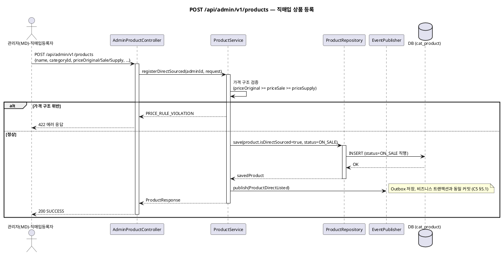

---

## 2. [API] POST /api/partner/v1/products/{id}/review-request — 심사 요청

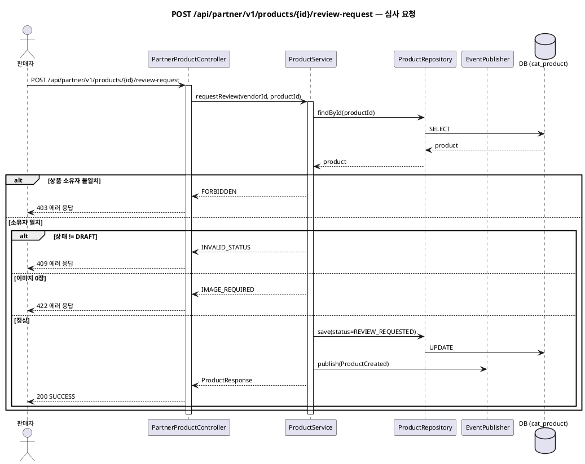

---

## 3. [API] POST /api/admin/v1/products/{id}/approve · reject — 심사 승인·반려

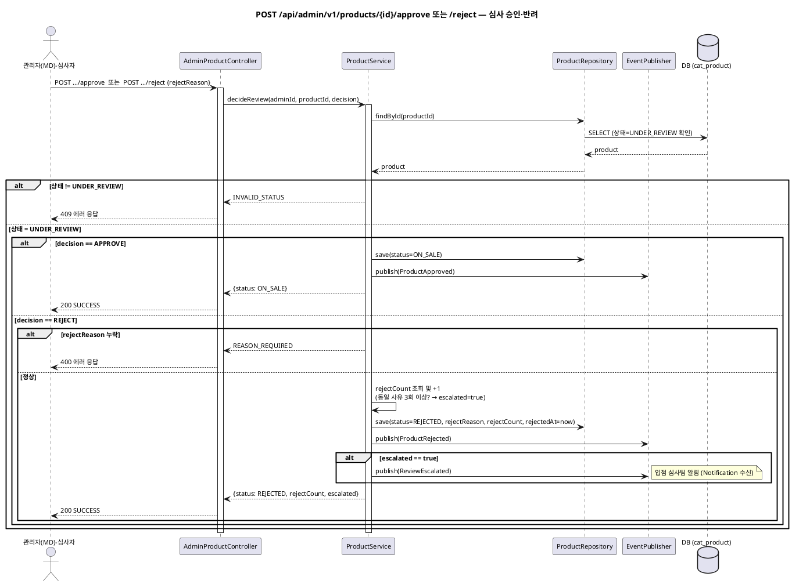

---

## 4. [배치] 재제출 기한 만료 자동 삭제 (60분 주기)

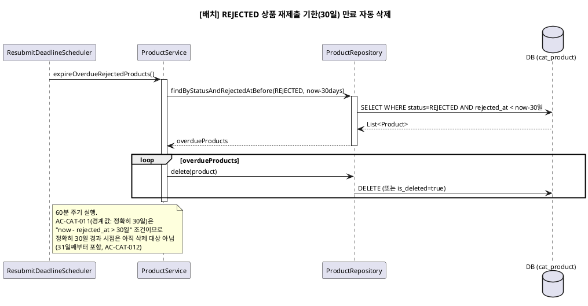

---

## 5. [API] POST /api/partner/v1/products/{id}/options — 옵션그룹·옵션값 설정 (SKU 자동생성)

> **2026-11-09 소급 반영**: `AdminProductController.addImage`(DL §9, API-CAT-044)·
> `AdminProductController.setOptions`(DL §10, API-CAT-045)도 소유자 검증만 생략하고 나머지
> 흐름은 아래와 동일해 별도 다이어그램을 두지 않는다.

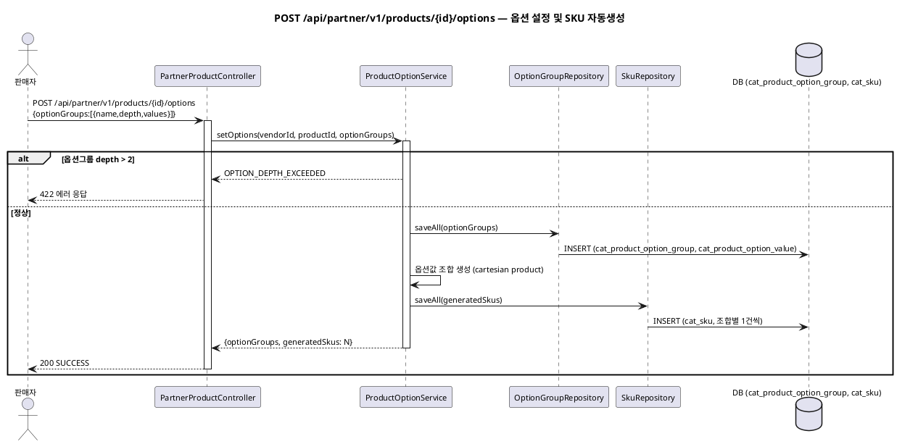

---

## 6. [API] PATCH /api/partner/v1/skus/{id}/stock — 재고 수량 변경·자동전환 (대안A)

> **대안A 핵심 시퀀스**: 발생 원인(여기서는 판매자 직접 등록)과 무관하게, 재고 1 이상
> 복원 시 MD 확인 단계 없이 Service가 직접 상태를 전환한다.

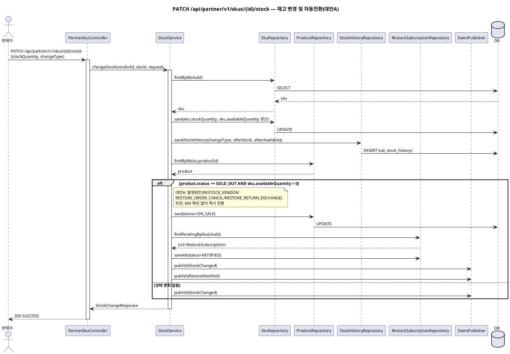

---

## 7. [API] POST /api/internal/v1/skus/{id}/reserve — 재고 차감 (Order 연동, 동기 PublicApi)

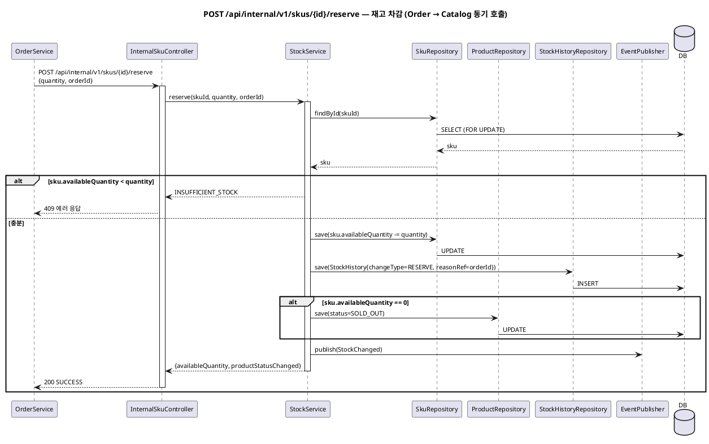

---

## 8. [컨슈머] ORDER_CANCELLED / RETURN_EXCHANGE_CONFIRMED 수신 — 재고 복원·자동전환

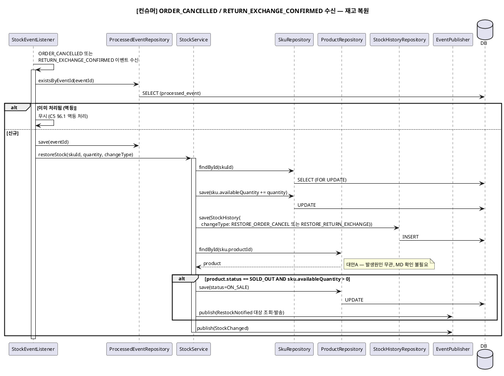

---

## 9. [API] PATCH /api/partner/v1/products/{id}/price — 가격 설정·변경

> **2026-11-04 변경**: 판매가는 더 이상 `cat_product` 컬럼이 아니다. 정가·공급가는
> 즉시 반영하고, 판매가는 `cat_product_price_schedule`에 `source_type=BASE`(무기한) 행으로
> 추가한다(DBA §4.1-1).
>
> **2026-11-09 소급 반영**: `AdminProductController.changePrice`(DL §16, `/api/admin/v1/...`,
> API-CAT-043)도 동일한 `PriceService.changePrice(actorId, productId, request,
> requireOwnership)` 메서드를 호출한다 — `actorId=adminId`, `requireOwnership=false`로
> 소유자 검증만 생략되고 나머지 흐름(가격구조 검증, BASE 행 교체)은 아래 시퀀스와 완전히
> 동일해 별도 다이어그램을 두지 않는다.

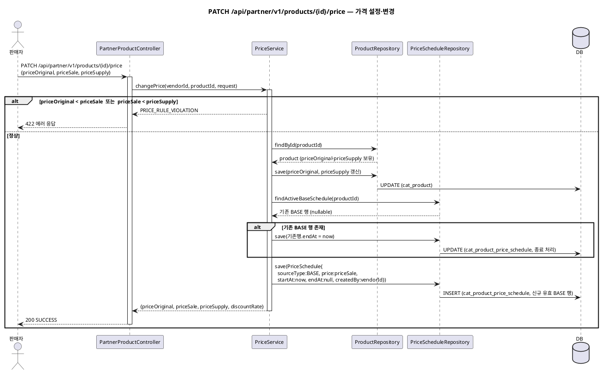

---

## 10. [컨슈머] PROMOTION_PRICE_SCHEDULED / PROMOTION_PRICE_SCHEDULE_CANCELLED 수신 — 행사가 스케줄 등록·취소

> **2026-11-04 재설계**: 기존 "price_sale 직접 갱신/복원" 방식을 폐기했다. Promotion이
> `start_at`~`end_at` 구간을 가진 스케줄 행을 등록하면, 실제 가격 전환은 조회 시점에
> 자동으로 일어난다 — "행사 종료 복원"을 위한 별도 컨슈머 로직이 없다(DBA §4.1-1·§7.2).

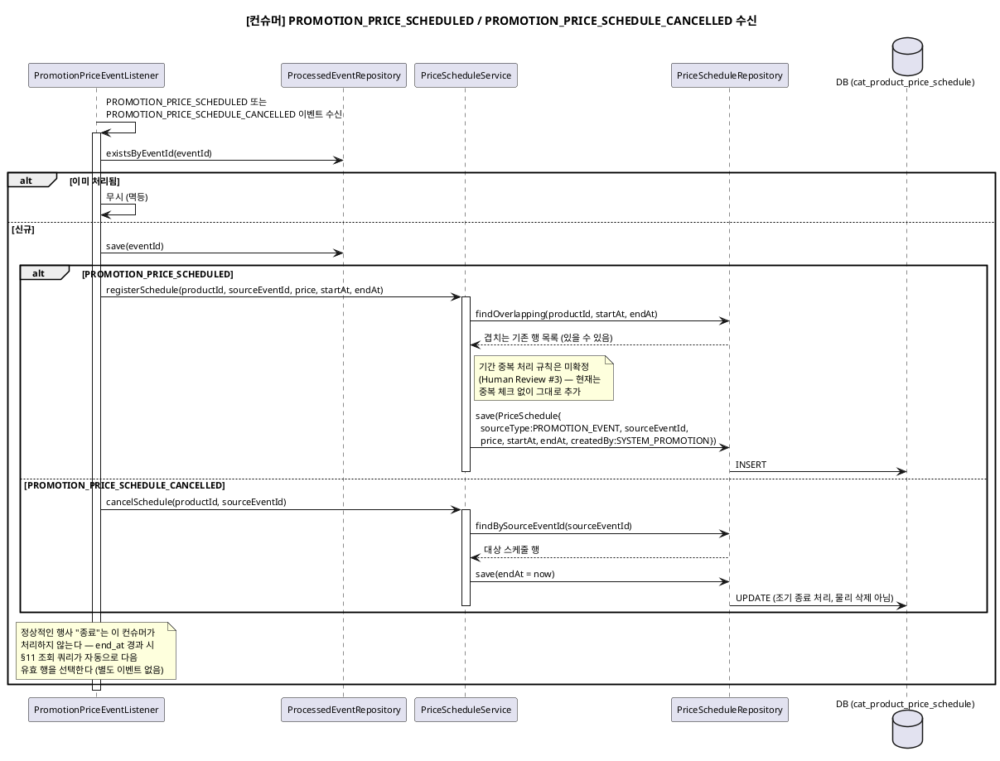

---

## 11. [API] GET /api/mobile/v1/products — 상품 목록 조회 (노출 게이트·우선순위 적용)

> **2026-11-09 변경**: `categoryId`(표준 카테고리)를 `displayCategoryId`(전시 카테고리)로
> 교체하고, `cat_product_display_category`를 경유하도록 join을 바꿨다. `displayCategoryId`가
> 있으면 `is_pinned`/`sort_order`로, 없으면 기존 `exposure_md_override`/`exposure_ai_score`
> 로 정렬한다(DBA §2.5.3·§2.6).

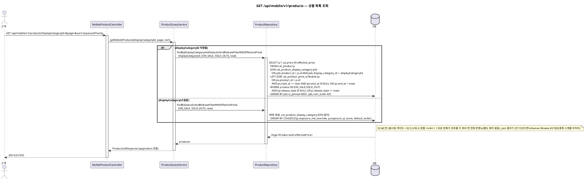

---

## 12. [API] GET /api/mobile/v1/products/{id} — 상품 상세 조회 (화면별 할인노출·연관상품추천)

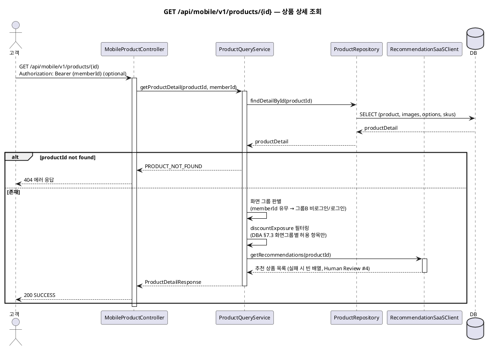

---

## 13. [배치] 전시 페이지 전시기간 자동 전환 (1분 주기)

> **2026-11-09 변경**: SCHEDULED 상태 제거로 `publishScheduledPages()`를 `publishDuePages()`로
> 바꾸고, 대칭으로 `closeDuePages()`(display_end_at 도달 시 PUBLISHED→CLOSED)를 신설했다.

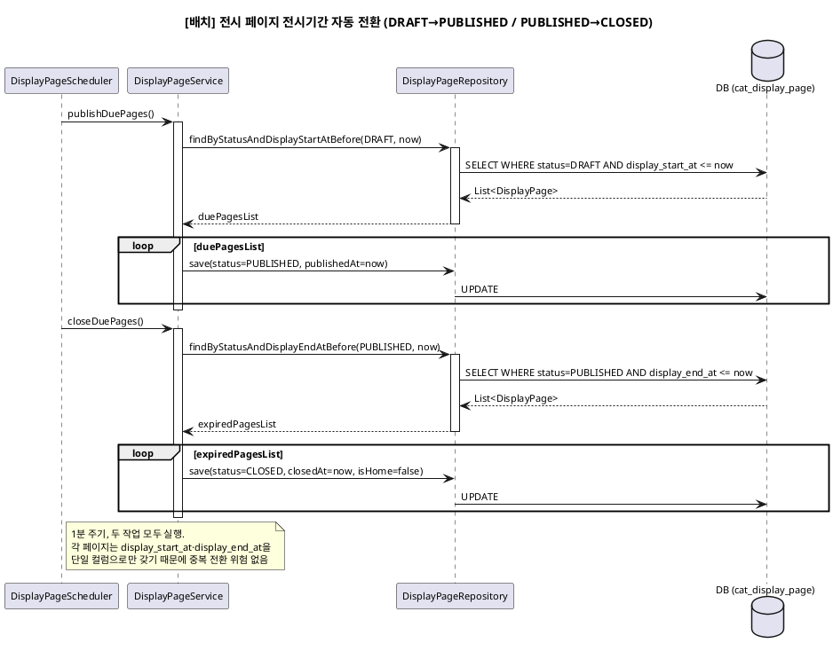

---

## 14. [API] PATCH /api/admin/v1/display-pages/{id}/set-home — 홈 화면 지정 (2026-10-26 신설)

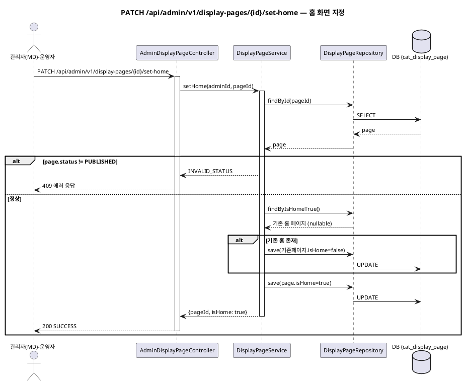

---

## 15. [컨슈머] PROMOTION_EXHIBITION_BANNER_SYNCED / SYNC_CANCELLED 수신 — 이벤트 배너 동기화 (2026-11-04 신설)

> **[Human Review]** 이 시퀀스는 Promotion이 실제로 이 이벤트를 발행한다는 가정 위에
> 있다. 발행 여부 미확인 — DBA §4 Human Review #11~12 참조.

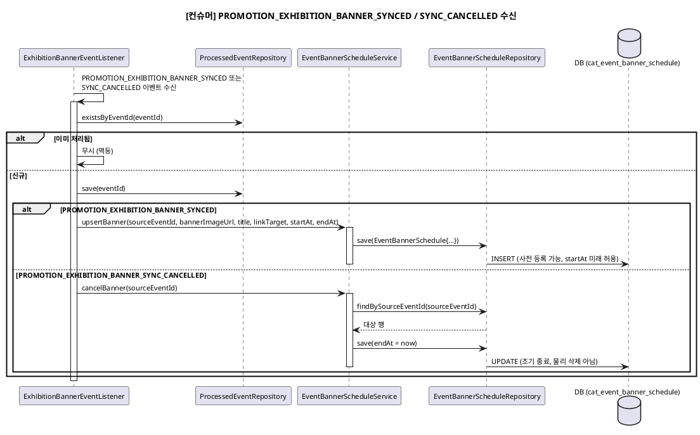

---

## 16. [API] GET /api/mobile/v1/home — 홈 화면 조회 (2026-10-26 신설)

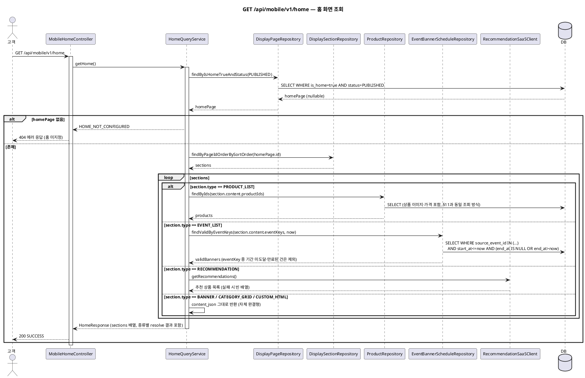

---

## 17. [API] POST /api/partner/v1/products/{id}/duplicate — 상품 복제 등록 (2026-11-09 소급 반영)

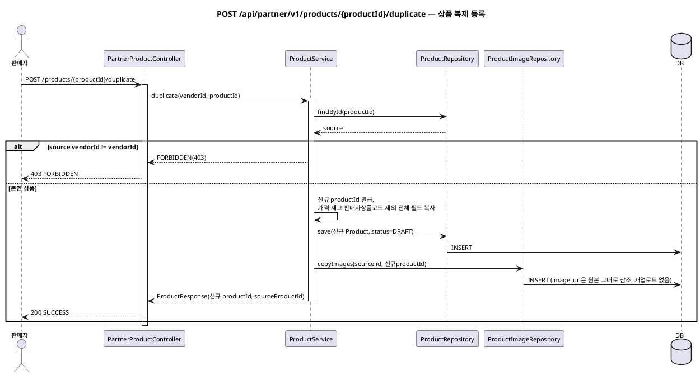

> 옵션그룹·옵션값·SKU도 이미지와 동일하게 원본 구조를 그대로 복사해 신규 SKU를 발급한다
> (DBA §1.5.3). 가격(price_original/sale/supply)과 재고(stock_quantity)는 복사 대상에서
> 제외되며 신규 상품은 판매자가 등록 흐름(§2)으로 재진입해 직접 입력한다.

---

## 18. [API] POST /api/partner/v1/products/bulk-upload — 상품 대량등록(Bulk) (2026-11-09 소급 반영)

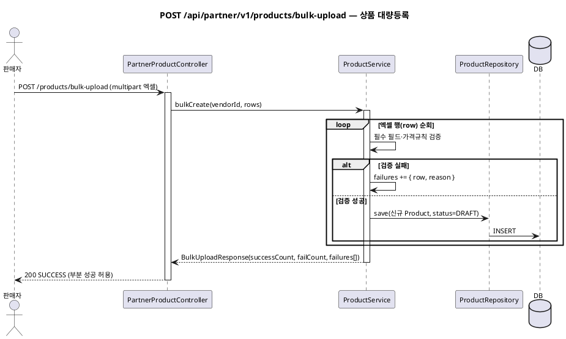

> 행 단위로 독립 트랜잭션 처리한다(부분 성공 허용, DBA §1.5.2) — 1개 행 실패가 전체 업로드를
> 롤백시키지 않는다.

---

## 19. [API] POST/DELETE /api/mobile/v1/products/{id}/wishlist — 찜하기 등록·해제 (2026-11-09 소급 반영)

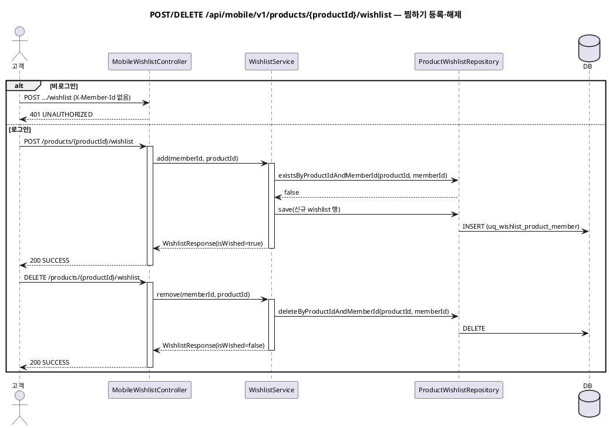

> 자동 삭제(REQ-CAT-062)는 이 시퀀스가 아니라 §6(단종)·§8(품절 자동전환) 전환 로직 내부에서
> `ProductWishlistRepository.deleteAllByProductId`를 함께 호출하는 부수효과로 처리된다
> (DBA §1.14 — 별도 이벤트 없이 Catalog 내부 동기 처리).

---

## 20. [API] GET .../share — SNS 공유 메타데이터 조회 (2026-11-09 소급 반영)

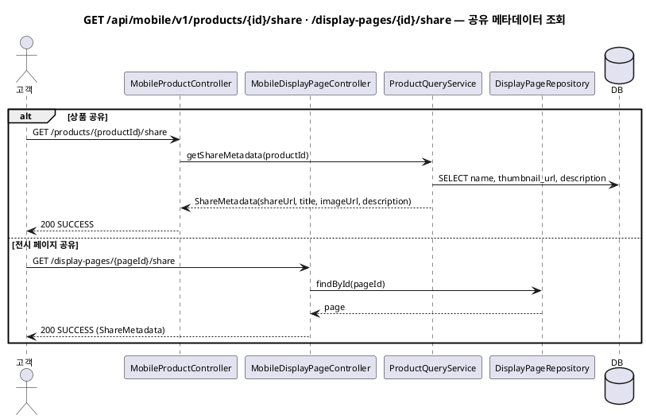

> 기존 데이터를 그대로 재사용하며 리워드·신규 필드가 없다(DBA §1.16). `MobileDisplayPageController`가
> 노출될 화면은 현재 홈(SCR-M-C04) 1건뿐이며, 홈이 아닌 전시 페이지를 고객이 열람하는 화면·경로
> 자체가 미설계 상태다(DQ-프로그램목록 미진항목 #9 참조).

---

## 21. [API] GET /api/internal/v1/products/{id}/max-order-quantity — 주문 수량 제한 값 조회 (Promotion 연동, 2026-11-09 소급 반영)

```plantuml
@startuml
skinparam backgroundColor transparent
skinparam defaultFontSize 11
title GET /api/internal/v1/products/{productId}/max-order-quantity

participant "Promotion 도메인" as PRM
participant "InternalProductController" as IC
participant "ProductQueryService" as PQS
database "DB" as DB

PRM -> IC : GET /products/{productId}/max-order-quantity
activate IC
IC -> PQS : getMaxOrderQuantity(productId)
PQS -> DB : SELECT max_order_quantity
DB --> PQS : value (nullable)
PQS --> IC : value
IC --> PRM : 200 SUCCESS { maxOrderQuantity: value }
deactivate IC

@enduml
```

> `null`은 무제한을 의미한다. 수량조건(1+1 등) 대상 상품 필터링 자체는 Promotion이 수행하고,
> Catalog는 값만 제공한다(DBA §1.8). Order가 주문 시점에 수행하는 실제 초과 거부 검증은
> 이 API와 별개 경로다(Order 쪽 EARS 소관).

---

## 22. [컨슈머-내부] StockChanged 재구독 — 상품 랭킹 집계 (비동기, 2026-11-09 신설)

```plantuml
@startuml
skinparam backgroundColor transparent
skinparam defaultFontSize 11
title StockChanged(내부 재구독) — 상품 랭킹 집계

participant "StockService" as SS
participant "CatalogEventPublisher" as PUB
database "Outbox" as OB
participant "ProductSalesRankingListener" as RL
participant "ProcessedEventRepository" as PER
participant "ProductSalesHourlyRepository" as PSHR
database "DB" as DB

SS -> SS : reserve()/restore() 트랜잭션 커밋\n(재고·sold_quantity_total 갱신, §8과 동일)
SS -> PUB : publish(StockChanged)
PUB -> OB : INSERT (Outbox, 비즈니스 트랜잭션과 동일 커밋)

...비동기...

OB -> RL : StockChanged 전달
activate RL
RL -> PER : isProcessed(eventId)?
PER --> RL : false

alt changeType in [RESERVE, RESTORE_ORDER_CANCEL]
  RL -> PSHR : upsert(productId, saleHour=truncate(now, HOUR), changeQuantity)
  PSHR -> DB : INSERT ... ON CONFLICT(product_id, sale_hour)\nDO UPDATE SET quantity = quantity + ?
else changeType in [RESTORE_RETURN_EXCHANGE, RESTOCK_VENDOR]
  RL -> RL : 집계 제외(DBA §1.17)
end
RL -> PER : markProcessed(eventId)
deactivate RL

@enduml
```

> 핵심 재고 트랜잭션(SS)과 랭킹 집계(RL)는 완전히 분리된 트랜잭션이다 — RL이 실패해도
> 재고·주문 처리에는 영향이 없다(사용자 확인, 2026-11-09). 멱등성은 기존
> `ProcessedEventRepository` 패턴을 그대로 재사용한다. PGM 등록: `DQ-프로그램목록/
> catalog.md` CSM-CAT-007(발행 도메인=수신 도메인=Catalog, 2026-11-09).

---

## 23. [API] GET /api/mobile/v1/products/ranking — 상품 랭킹 조회 (2026-11-09 신설)

```plantuml
@startuml
skinparam backgroundColor transparent
skinparam defaultFontSize 11
title GET /api/mobile/v1/products/ranking — 상품 랭킹 조회

actor 고객 as Client
participant "MobileRankingController" as RC
participant "ProductSalesRankingQueryService" as RQS
participant "ProductSalesHourlyRepository" as PSHR
participant "ProductDisplayCategoryRepository" as PDCR
database "DB" as DB

Client -> RC : GET /products/ranking?period=DAILY&displayCategoryId=
activate RC
RC -> RQS : getRanking(period, displayCategoryId)
activate RQS

RQS -> RQS : period → [fromHour, now] 범위 계산\n(REALTIME=최근 3시간, DAILY=오늘 00:00~, WEEKLY=최근 7일)

alt displayCategoryId 지정됨
  RQS -> PDCR : findProductIdsByDisplayCategoryId(displayCategoryId)
  PDCR --> RQS : productIds
  RQS -> PSHR : sumQuantityByProductIdsAndHourRange(productIds, fromHour, now)
else 미지정
  RQS -> PSHR : sumQuantityByHourRange(fromHour, now)
end
PSHR -> DB : SELECT product_id, SUM(quantity)\nFROM cat_product_sales_hourly\nWHERE sale_hour BETWEEN ? AND ?\nGROUP BY product_id ORDER BY SUM(quantity) DESC LIMIT 50
DB --> PSHR : rows
RQS -> RQS : ON_SALE/SOLD_OUT 외 상태 상품 제외\n(상품 상세 조회와 동일 노출 기준 재사용)
RQS --> RC : RankingResponse(rank, products[])
deactivate RQS
RC --> Client : 200 SUCCESS
deactivate RC

@enduml
```

> 집계 데이터가 없으면 빈 배열을 반환한다(Top N 중 일부 자리가 비어도 그대로 반환, 별도
> 채우기 로직 없음).

---

## 24. [API] GNB 메뉴 등록·수정·순서저장 — admin (2026-11-09 신설)

```plantuml
@startuml
skinparam backgroundColor transparent
skinparam defaultFontSize 11
title POST/PATCH /api/admin/v1/gnb-menus — GNB 메뉴 등록·수정

actor 관리자 as Client
participant "AdminGnbMenuController" as GC
participant "GnbMenuService" as GS
participant "DisplayPageRepository" as DPR
participant "DisplayCategoryRepository" as DCR
participant "GnbMenuRepository" as GMR
database "DB" as DB

Client -> GC : POST /gnb-menus\n{name, linkType, linkTarget, isExposed, displayStartAt, displayEndAt}
activate GC
GC -> GS : create(adminId, request)
activate GS

alt linkType == DISPLAY_PAGE
  GS -> DPR : findBySlug(linkTarget)
  DPR --> GS : page (nullable)
  alt 없음
    GS --> GC : DISPLAY_PAGE_NOT_FOUND
    GC --> Client : 404 에러
  end
else linkType == DISPLAY_CATEGORY
  GS -> DCR : findById(linkTarget)
  DCR --> GS : category (nullable)
  alt 없음
    GS --> GC : DISPLAY_CATEGORY_NOT_FOUND
    GC --> Client : 404 에러
  end
else EVENT_PAGE / EXTERNAL_URL / RANKING
  GS -> GS : 검증 없음 (문자열 그대로 저장)
end

GS -> GMR : save(GnbMenu{createdBy: adminId, sortOrder: max+1})
GMR -> DB : INSERT
GS --> GC : GnbMenuResponse
deactivate GS
GC --> Client : 200 SUCCESS
deactivate GC

@enduml
```

> 순서 저장(`PATCH /gnb-menus/order`)은 §24(전시카테고리 상품순서 저장, DK §24)와 동일하게
> 요청 배열 순서를 그대로 `sortOrder`(0..n-1)로 전체 교체한다 — 별도 다이어그램을 두지
> 않는다.

---

## 25. [API] GET /api/mobile/v1/gnb-menus — GNB 메뉴 조회 (고객, 2026-11-09 신설)

```plantuml
@startuml
skinparam backgroundColor transparent
skinparam defaultFontSize 11
title GET /api/mobile/v1/gnb-menus — GNB 메뉴 조회

actor 고객 as Client
participant "MobileGnbMenuController" as GC
participant "GnbMenuService" as GS
participant "GnbMenuRepository" as GMR
database "DB" as DB

Client -> GC : GET /gnb-menus
activate GC
GC -> GS : getExposedMenus()
activate GS
GS -> GMR : findExposedOrderBySortOrder(now)
GMR -> DB : SELECT WHERE is_exposed=true\n  AND (display_start_at IS NULL OR display_start_at<=now)\n  AND (display_end_at IS NULL OR display_end_at>now)\n  ORDER BY sort_order ASC
DB --> GMR : rows
GMR --> GS : menus
GS --> GC : GnbMenuListResponse(menus)
deactivate GS
GC --> Client : 200 SUCCESS (빈 배열 가능)
deactivate GC

@enduml
```

---

## 26. [API] GET /api/mobile/v1/display-pages/{slug} — 비홈 전시 페이지 뷰어 조회 (2026-11-09 신설)

```plantuml
@startuml
skinparam backgroundColor transparent
skinparam defaultFontSize 11
title GET /api/mobile/v1/display-pages/{slug} — 비홈 전시 페이지 뷰어 조회

actor 고객 as Client
participant "MobileDisplayPageController" as DPC
participant "HomeQueryService" as HQS
participant "DisplayPageRepository" as DPR
participant "DisplaySectionRepository" as DSR
participant "ProductRepository" as PR
participant "EventBannerScheduleRepository" as EBR
participant "RecommendationSaaSClient" as REC
database "DB" as DB

Client -> DPC : GET /display-pages/{slug}
activate DPC
DPC -> HQS : getDisplayPage(slug)
activate HQS

HQS -> DPR : findBySlug(slug)
DPR -> DB : SELECT WHERE slug=?
DB --> DPR : page (nullable)
DPR --> HQS : page

alt page == null 또는 status != PUBLISHED 또는 is_exposed == false
  HQS --> DPC : DISPLAY_PAGE_NOT_FOUND
  DPC --> Client : 404 에러 응답
else 조회 가능
  HQS -> HQS : resolveSections(page)\n(§16 getHome()과 동일한 private 메서드 재사용)
  HQS -> DSR : findByPageIdOrderBySortOrder(page.id)
  DSR --> HQS : sections
  loop sections
    note over HQS: §16과 동일 — PRODUCT_LIST(PR 조회),\nEVENT_LIST(EBR 조회시점 유효 배너),\nRECOMMENDATION(REC 실시간 호출),\nBANNER/CATEGORY_GRID/CUSTOM_HTML(자체 완결형)
  end
  HQS --> DPC : DisplayPageViewResponse(title, slug, sections[])
  deactivate HQS
  DPC --> Client : 200 SUCCESS
end
deactivate DPC

@enduml
```

> `HomeQueryService.getHome()`과 `getDisplayPage(slug)`는 섹션 resolve 로직(`resolveSections`
> private 메서드)을 공유한다 — 차이는 대상 페이지를 찾는 조건뿐이다(`is_home=true` vs
> `slug=?`). DBA §2.15, DQ 미진항목 #9·#13 해소.

---

## 27. [API] POST /api/internal/v1/products/{id}/price-schedule — 행사가 스케줄 등록·취소 (Promotion 연동, 동기, 2026-11-09 신설)

> DQ 미진항목 #5 해소. `PROMOTION_PRICE_SCHEDULED`/`CANCELLED` 이벤트 수신(§10, 비동기)과
> 완전히 동일한 서비스 로직(`PriceScheduleService`)을 호출하는 동기 경로다 — Promotion이
> 배치 지연 없이 즉시 반영이 필요할 때 이벤트 대신 이 API를 직접 호출한다(DBA §1.7.2·§1.7.4).

```plantuml
@startuml
skinparam backgroundColor transparent
skinparam defaultFontSize 11
title POST /api/internal/v1/products/{productId}/price-schedule — 행사가 스케줄 등록·취소 (동기)

participant "Promotion" as PRM
participant "InternalProductController" as IPC
participant "PriceScheduleService" as PSS
participant "PriceScheduleRepository" as PSR
database "DB" as DB

PRM -> IPC : POST /products/{productId}/price-schedule\n(action=SCHEDULE|CANCEL)
activate IPC

alt action == SCHEDULE
  IPC -> PSS : registerSchedule(productId, sourceEventId, price, startAt, endAt)
  activate PSS
  PSS -> PSR : save(신규 PROMOTION_EVENT 행)
  PSR -> DB : INSERT (기간 중복 체크 없이 그대로 추가, Human Review #1)
  PSS --> IPC : PriceScheduleResponse(scheduled)
  deactivate PSS
else action == CANCEL
  IPC -> PSS : cancelSchedule(productId, sourceEventId)
  activate PSS
  PSS -> PSR : findBySourceEventId(sourceEventId)
  PSR --> PSS : schedule
  alt schedule == null
    PSS --> IPC : PRICE_SCHEDULE_NOT_FOUND
    IPC --> PRM : 404 에러 응답
  else 존재
    PSS -> PSR : update(endAt=now)
    PSR -> DB : UPDATE (물리 삭제 아님)
    PSS --> IPC : PriceScheduleResponse(cancelled)
  end
  deactivate PSS
end

IPC --> PRM : 200 SUCCESS
deactivate IPC

@enduml
```

> 비동기 이벤트 경로(§10, `PromotionPriceEventListener`)와 이 동기 경로(`InternalProductController`)
> 모두 `PriceScheduleService.registerSchedule`/`cancelSchedule`을 그대로 호출해 로직이
> 완전히 공유된다 — 멱등 검증(`ProcessedEventRepository`)만 이벤트 경로 전용이고, 동기
> 호출은 Promotion이 자체적으로 재시도 책임을 진다(Service-to-Service, at-most-once 전제).

---

## 28. [API] 전시카테고리 상품순서 관리 API 그룹 — 조회·저장 (2026-11-09 신설)

> DQ 미진항목 #8 해소(저장 쪽). 고객 조회 측(API-CAT-017)은 2026-11-09 §11 갱신으로 이미
> 해소돼 있었고, 이 섹션은 admin이 순서를 조회·저장하는 관리 쪽(API-CAT-039·040)이다.

```plantuml
@startuml
skinparam backgroundColor transparent
skinparam defaultFontSize 11
title 전시카테고리 상품순서 — 조회·저장 (admin)

actor 관리자 as Admin
participant "AdminDisplayCategoryProductController" as DPC
participant "DisplayCategoryProductOrderService" as OS
participant "DisplayCategoryRepository" as DCR
participant "ProductDisplayCategoryRepository" as PDR
database "DB" as DB

Admin -> DPC : GET /display-categories/{displayCategoryId}/products
activate DPC
DPC -> OS : getProducts(displayCategoryId)
activate OS
OS -> DCR : findById(displayCategoryId)
alt 존재하지 않음
  DCR --> OS : null
  OS --> DPC : DISPLAY_CATEGORY_NOT_FOUND
  DPC --> Admin : 404 에러 응답
else 존재
  DCR --> OS : displayCategory
  OS -> PDR : findByDisplayCategoryIdOrderByIsPinnedDescSortOrderAsc(displayCategoryId)
  PDR -> DB : SELECT (isPinned DESC, sortOrder ASC)
  PDR --> OS : products
  OS --> DPC : DisplayCategoryProductListResponse(products[])
  deactivate OS
  DPC --> Admin : 200 SUCCESS (드래그앤드랍 재배열 UI에 바인딩)
end
deactivate DPC

Admin -> DPC : PUT /display-categories/{displayCategoryId}/products/order\n(products[] 재배열된 순서)
activate DPC
DPC -> OS : reorder(displayCategoryId, request.products)
activate OS
loop request.products (index 순회)
  OS -> PDR : update(productId, sortOrder=index, isPinned)
  PDR -> DB : UPDATE (전체 교체, 부분 수정 아님)
end
OS --> DPC : 완료
deactivate OS
DPC --> Admin : 200 SUCCESS
deactivate DPC

@enduml
```

> 조회·저장이 한 화면(DN-admin §8, 드래그앤드랍) 안에서 짝을 이뤄 쓰이므로 §22(전시 페이지
> 관리 API 그룹)·§35(찜하기 API 그룹)와 동일하게 API 그룹 단위로 시퀀스 1건에 묶었다.

---

## 29. [API] GET /api/mobile/v1/me/wishlist — 찜한 상품 목록 조회 (2026-11-09 신설)

> DQ 미진항목 #10 중 API-CAT-036 해소. API-CAT-033(복제등록)·034(대량등록)은 이미 §17·§18에
> 전용 시퀀스가 있어 미진항목 #10 표기가 실제로는 해소돼 있던 상태였다(DQ에서 함께 정정).

```plantuml
@startuml
skinparam backgroundColor transparent
skinparam defaultFontSize 11
title GET /api/mobile/v1/me/wishlist — 찜한 상품 목록 조회

actor 고객 as Client
participant "MobileWishlistController" as WC
participant "WishlistService" as WS
participant "ProductWishlistRepository" as WR
database "DB" as DB

Client -> WC : GET /me/wishlist?page=1&size=20
activate WC
WC -> WS : getMyWishlist(memberId, page, size)
activate WS
WS -> WR : findByMemberIdOrderByCreatedAtDesc(memberId, page, size)
WR -> DB : SELECT
DB --> WR : rows (0건 가능)
WR --> WS : products
WS --> WC : WishlistListResponse(products[], pagination)
deactivate WS
WC --> Client : 200 SUCCESS (products=[]이면 빈 배열, 에러 아님)
deactivate WC

@enduml
```

> SOLD_OUT·DISCONTINUED로 전환된 상품은 §19 note에서 설명한 부수효과(`deleteAllByProductId`)로
> 이미 행이 삭제돼 있어, 이 조회에서 별도 상태 필터링이 필요 없다(REQ-CAT-061~062).

---

## 30. [컨슈머] MemberWithdrawn 수신 — 찜 데이터 정리 (2026-11-09 신설)

> DQ 미진항목 #10(관련 CSM-CAT-008) 해소. PGM-ID(CSM-CAT-008) 자체는 이미 등록돼 있었으나
> §8·§10·§15처럼 세분화된 전용 다이어그램이 없었던 공백을 메운다.

```plantuml
@startuml
skinparam backgroundColor transparent
skinparam defaultFontSize 11
title MemberWithdrawn 수신 — 찜 데이터 정리

participant "Member" as MEM
participant "MemberEventListener" as MEL
participant "ProcessedEventRepository" as PER
participant "WishlistService" as WS
participant "ProductWishlistRepository" as WR
database "DB" as DB

MEM -> MEL : MemberWithdrawn 이벤트\n(memberId, eventId)
activate MEL

MEL -> PER : existsByEventId(eventId)
alt 이미 처리됨
  PER --> MEL : true
  MEL -> MEL : 멱등 — 스킵
else 미처리
  PER --> MEL : false
  MEL -> WS : deleteAllByMember(memberId)
  activate WS
  WS -> WR : deleteAllByMemberId(memberId)
  WR -> DB : DELETE WHERE member_id=?
  deactivate WS
  MEL -> PER : save(eventId, processedAt=now)
  PER -> DB : INSERT
end
deactivate MEL

@enduml
```

> [Human Review] 이 시퀀스 전체가 Member가 회원 탈퇴 시 `MemberWithdrawn`(또는 동등한)
> 이벤트를 실제로 발행한다는 전제 위에 있다 — work-scope(Catalog 한정)상 미확인
> (DBA §6 HR #35, DD HR #10, DI HR #6과 동일 쟁점).

---

## Human Review

| # | 항목 | 사유 |
|---|---|---|
| 1 | §9·§10 `cat_product_price_schedule` 기간 중복 처리 | DBA §4.1-1·DF Human Review #6과 동일 쟁점 — Promotion 정책 소관, 현재 시퀀스는 중복 체크 없이 그대로 INSERT한다(§10 note 참조). 확정 후 `findOverlapping` 결과에 따른 분기 추가 필요 |
| 2 | §11 조회 쿼리의 join 결과 2건 이상(중복 스케줄) 처리 | 위 #1이 미확정이라 조회 쿼리도 "항상 1건"을 가정하고 있다 — 확정 규칙에 따라 `ORDER BY discount_rate DESC LIMIT 1` 등으로 보강 필요 |
| 3 | **[Promotion 관련]** §15 `PROMOTION_EXHIBITION_BANNER_SYNCED`/`SYNC_CANCELLED`의 Promotion 측 실제 발행 여부 | 사용자 확인(2026-11-04) — 이 시퀀스 전체가 Promotion이 기획전 등록·수정·취소 시 이벤트를 발행한다는 전제 위에 있음. work-scope(Catalog 한정)상 미확인. Promotion 담당자 확인 필요 |
| 4 | §16 홈 화면 조회 시 EVENT_LIST 섹션의 eventKey가 캐시에 없는 경우(동기화 지연·실패) 처리 | 해당 배너만 건너뛰는지, 전체 요청을 실패시키는지 미확정 — 현재 시퀀스는 "유효하지 않은 건 제외" 전제로 작성 |
| 5 | ~~§20 전시 페이지 공유(API-CAT-037b)의 `MobileDisplayPageController`가 실제로 노출될 고객 화면 부재~~ | **해소(2026-11-09)** — §26(비홈 전시 페이지 뷰어 조회) 신설로 SCR-M-C07이 그 화면이 됨. DQ 미진항목 #9·#13 해소와 동일 |
| 6 | **[Member 관련]** §30 `MemberWithdrawn` 수신의 Member 측 실제 이벤트 발행 여부 | work-scope(Catalog 한정)상 미확인 — DBA §6 HR #35, DD HR #10, DI HR #6과 동일 쟁점. Member 담당자 확인 필요 |

---

## 근거

| 항목 | 출처 |
|---|---|
| API endpoint | `deliverables/S3-상세설계/DL-인터페이스명세/catalog.md` 41개 API 중 핵심 흐름 16개 + 컨슈머 2건 + 배치 2건 상세화 |
| 복제등록·대량등록·찜하기·SNS공유·주문수량제한 시퀀스(§17~21) 소급 반영 | 사용자 지시(2026-11-09) — DK §16·17·19~21, DL §33~38 |
| 상품 랭킹 집계(§22, 비동기 내부 재구독)·조회(§23) | 사용자 지시(2026-11-09) — DK §25~26, DL §41, DBA §1.17·§2.13, `DI-이벤트플로우/catalog.md` StockChanged 내부 재구독 |
| GNB 메뉴 등록·수정(§24)·조회(§25) | 사용자 지시(2026-11-09) — DK §27, DL §42~43, DBA §2.14 |
| 비홈 전시 페이지 뷰어 조회(§26) | 사용자 지시(2026-11-09) — DK §28, DL §44, DBA §2.15, §16(홈) resolveSections 재사용 |
| 행사가 스케줄 동기 등록·취소(§27), 전시카테고리 상품순서 조회·저장(§28), 찜한 상품 목록 조회(§29), MemberWithdrawn 수신(§30) | 사용자 지시(2026-11-09) — DQ 미진항목 #5·#8·#10 해소. API-CAT-026·039~040·036, CSM-CAT-008에 대응하는 전용 시퀀스 신설 |
| 참여 객체 | `deliverables/S2-구조설계/DF-도메인모델ERD/catalog.md` 엔티티 (ProductRepository·SkuRepository·StockHistoryRepository·PriceScheduleRepository·DisplayPageRepository·RestockSubscriptionRepository) |
| 상태 전이 | `deliverables/S2-구조설계/DH-상태머신/catalog.md` |
| 재고 자동전환(대안A) 시퀀스 | `deliverables/S2-구조설계/DBA-도메인정책서/catalog.md` §2.4 — §6·§8 두 경로(직접등록·이벤트수신) 모두 동일 전환 로직 명시 |
| 출시일 게이트(C안)·노출우선순위·유효판매가 쿼리 결합 | DBA §2.6·§6.1·§4.1-1 — 별도 배치 없이 조회 쿼리 1회로 처리 |
| 판매가 기간별 스케줄 (BASE/PROMOTION_EVENT) | DBA §4.1-1·§7.2, DD REQ-CAT-026·049~051 — "마스터 속성과 변동 속성 분리" 사용자 피드백(2026-11-04) 반영 |
| 도메인 간 호출 | `deliverables/S2-구조설계/DI-이벤트플로우/catalog.md` 동기 PublicApi/비동기 이벤트 구분 |
| Controller 네이밍 | `deliverables/S3-상세설계/DM-시퀀스/order.md` 공통 규칙 §1 (C3 §4.2) — Catalog는 앱별(Admin/Partner/Mobile/Internal) Controller 분리를 기본으로 따름 |
| EventPublisher = Outbox 패턴 | `deliverables/S3-상세설계/DM-시퀀스/order.md` 공통 규칙 §2 (C5 §5.1) |
| 컨슈머 멱등 처리 | C5 §6.1 (processed_event 테이블, eventId UNIQUE) — order.md와 동일 패턴 |
| 에러 분기 | `deliverables/S3-상세설계/DJ-GWT수용기준/catalog.md` 예외 시나리오 |
| 홈 화면 지정·조회, 이벤트 배너 동기화 (§14~16) | 사용자 확인(2026-10-26) — DD REQ-CAT-052~055, DBA §6.4·§6.4-1·§7.5. Promotion 이벤트 발행 여부는 Human Review #3 |

