# 시퀀스 — Order 도메인

> 상위 문서: [readme.md](readme.md)
> **단계**: 상세설계 (S3) | **문서범위**: Bolt (Order) | **문서종류**: Design
> Payment 관련 시퀀스는 [DM-시퀀스/payment.md](payment.md) 참조

---

## 1. [API] POST /api/mobile/v1/my/cart/items — 장바구니 담기

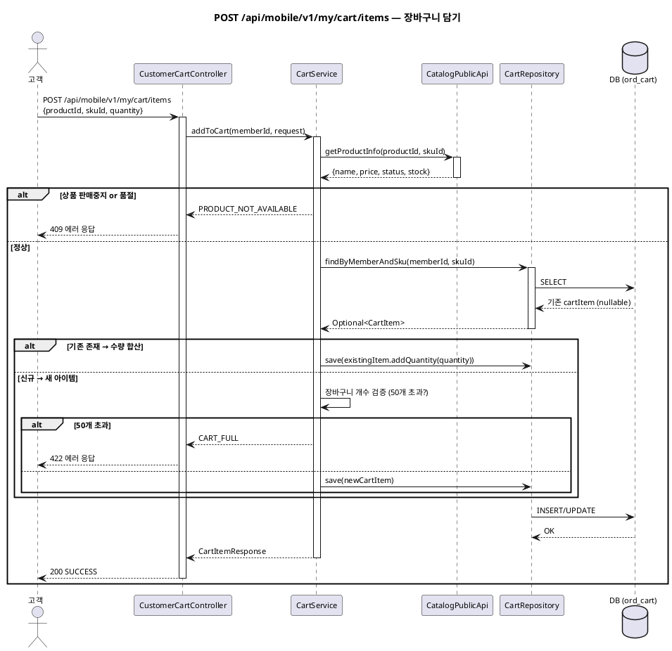


---

## 2. [API] GET /api/mobile/v1/my/cart — 장바구니 조회

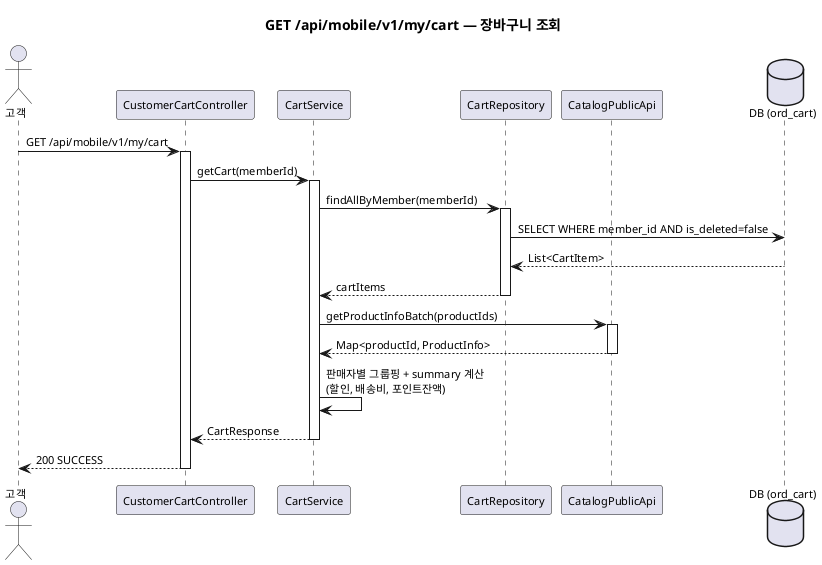


---

## 3. [API] POST /api/mobile/v1/my/orders/sheet — 주문서 생성

> 최종 수정: 2026-10-19 (실제 구현 반영 — URL 정정 + 실제 구현 보조 다이어그램 추가)

> **(2026-10-19 구현 확인·보완)** 제목·다이어그램 URL을 구버전(`/api/v1/orders/sheet`)에서 실제 Controller 매핑(`/api/mobile/v1/my/orders/sheet`, `OrderController.kt`)으로 정정했다 — order-domain-api-migration 작업 때 DL-인터페이스명세는 갱신됐지만 이 시퀀스 문서는 갱신 대상에서 빠져 있던 것을 이번 작업으로 발견·추가 정정(참고: readme.md §1, DQ-프로그램목록/order.md §2-1도 동일 간극이 있어 함께 정정).

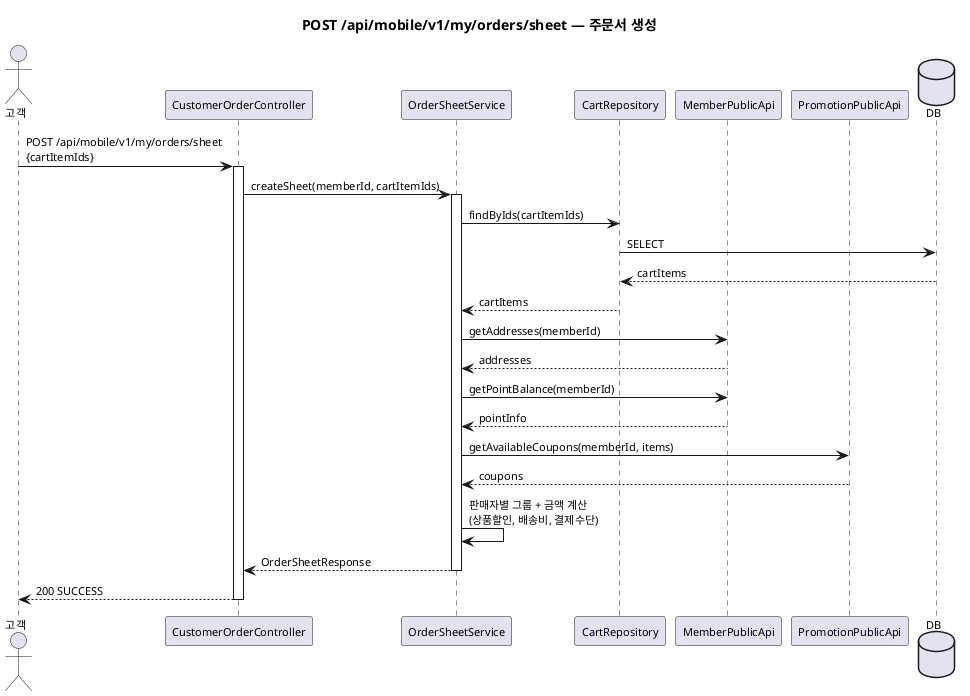

> **신규 (2026-10-19 프로토타입 구현, 2026-10-20 네이밍 갱신): 실제 호출 흐름은 위 다이어그램보다 훨씬 단순하다** — Cart 영속 계층이 없어 CartRepository/MemberApi/PromotionApi(옛 이름: MemberPublicApi/PromotionPublicApi)를 전혀 호출하지 않는다. `OrderController.createOrderSheet()` → `OrderService.createOrderSheet()`가 Mock 파일(`mobile__POST_my_orders_sheet.json`)을 로드해 `order_sheet_id`만 UUID로 덮어쓴 뒤 그대로 반환한다(design.md §1-1).

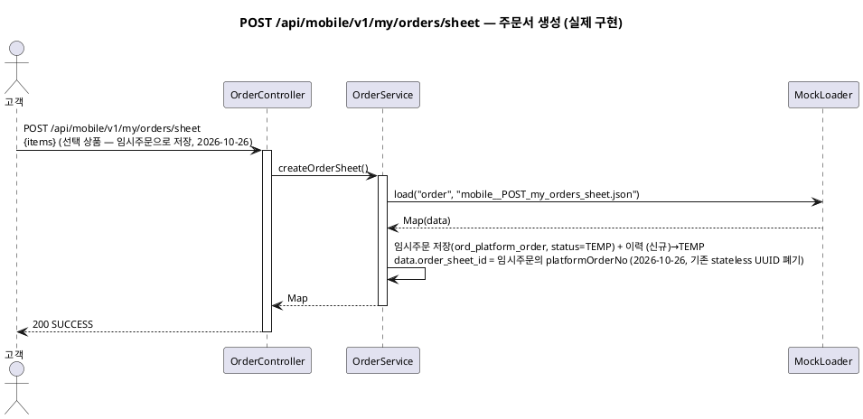

### 3-1. PUT /api/mobile/v1/my/orders/sheet/{orderSheetId}/discount — 주문서 쿠폰/포인트 적용 (2026-10-26 신설)

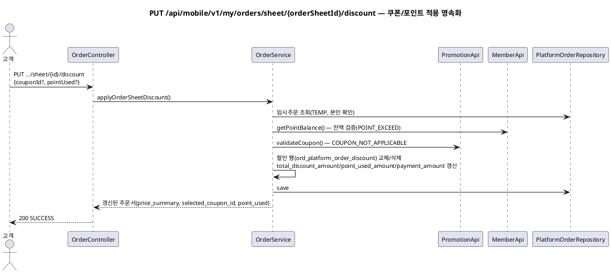

> 결제(§4)는 요청 바디의 `couponId`/`pointUsed`를 무시하고 이 단계에서 저장된 값을 재검증해 확정한다.

---

## 4. [API] POST /api/mobile/v1/my/orders/{orderSheetId}/pay — 결제 요청

> 최종 수정: 2026-10-29 (비동기 접수 기준으로 현행화 — 결제하기는 **접수만 동기**, 재고차감·PG 요청은 §4-1 컨슈머가 비동기 처리. 구 동기 재고 선점·`ORDER_RECEIVED`/`PAYMENT_PENDING` 다이어그램은 §4-2로 이동(폐기))

- **세부UC 참조**: [주문서 제출] 주문서 작성·제출 Bolt (DK §3)
- **상태전이**: `TEMP` → `STOCK_REQUESTED` (플랫폼주문·판매자 주문·주문상품 일괄). 이후 `STOCK_DEDUCTED`·`DEPOSIT_PENDING`·`STOCK_FAILED`는 §4-1
- **원칙**: ① 상품·쿠폰·포인트는 요청 바디가 아니라 주문서 진입 시 저장된 임시주문(DB)에서 읽어 서버가 재검증·재계산한다(요청 바디의 `items`/`couponId`/`pointUsed`는 무시). ② 재고차감 요청은 주문 상태 변경과 **같은 트랜잭션**으로 아웃박스에 적재한다. ③ PG 요청(가상계좌 발급)은 접수 응답 후 컨슈머가 처리한다(응답에 포함되지 않음)

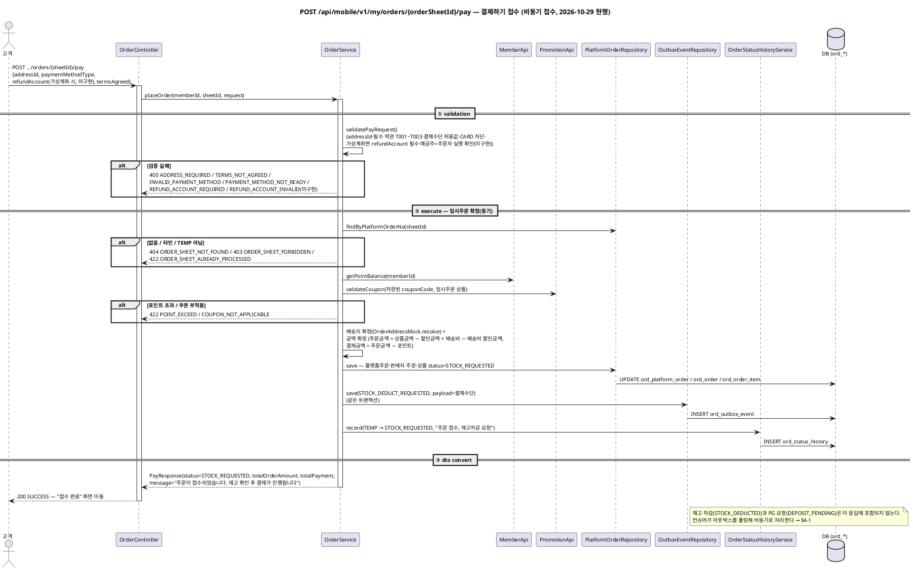

> **환불계좌 (REQ-PAY-031, 미구현)**: 가상계좌 결제는 요청 바디에 `refundAccount`(은행·계좌번호·예금주, 예금주=주문자 본인·실명 확인)를 받아 결제에 저장한다. 현행 프로토타입은 이 필드를 받지 않는다(DL §6). 카드·간편결제는 불필요하며 마이페이지 환불계좌 등록은 폐기됐다.

> **현행 동작 메모**: 접수 응답의 `status`는 `STOCK_REQUESTED`다(구 `PAYMENT_PENDING`·`DEPOSIT_PENDING` 아님). 카드는 아직 차단(`PAYMENT_METHOD_NOT_READY`)이고 가상계좌만 진행한다. PG 실패·입금 통보·입금기한 만료는 미구현이다(DH 구현 현행화). 접수 후 진행 상태(재고 확인 중 → 입금 대기)는 화면이 폴링하지 않아 고정 안내문만 보인다(DN `order-complete.md`, Bolt14 SC29-1).

### 4-1. 재고차감·PG 요청 비동기 처리 — 아웃박스 + 별도 컨슈머 앱 (2026-10-26 신설)

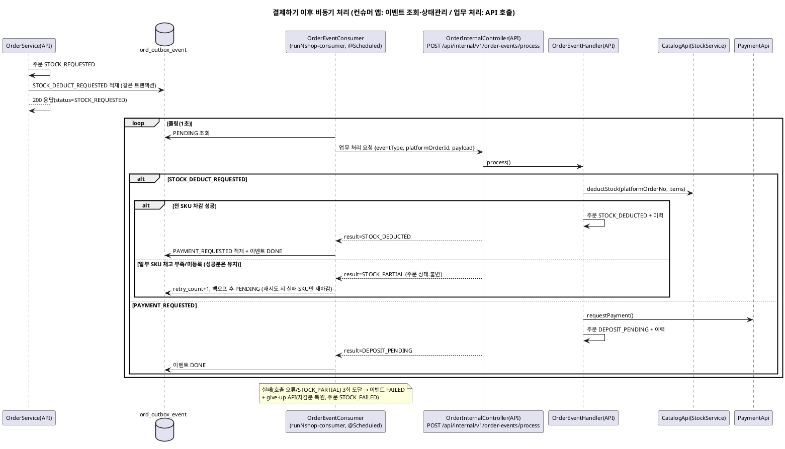

> 컨슈머는 다중 인스턴스 실행 가능(이벤트 점유 `FOR UPDATE SKIP LOCKED` + PROCESSING, 임대 만료 시 PENDING 복귀). API 처리는 멱등(이미 처리된 주문은 현재 상태를 result로 반환, 재고 차감은 SKU 단위 멱등).


### 4-2. [폐기] 이전 설계·구현 이력 (2026-10-19 이전)

> **주의 — 아래 두 다이어그램은 현행과 다르다.** 첫째는 동기 재고 선점(`reserveStock`)과 `ORDER_RECEIVED`/`PAYMENT_PENDING`, PG 승인 큐(타임아웃 30초)를 쓰는 **원안**이고, 둘째는 요청 바디 `items`로 상품을 받아 PG 요청까지 동기로 끝내던 **2026-10-19 프로토타입 구현**이다. 현행은 위 §4와 §4-1이며, 구현·테스트는 현행을 기준으로 한다. PG 승인 대기시간은 정책서 확정(3초, 4.2.5)과 달라 Bolt5 착수 전 재작성한다. 이력 보존용으로만 남긴다.

> 최종 수정: 2026-10-19 (실제 구현 반영 — URL 정정 + 실제 구현 보조 다이어그램 추가)

> **(2026-10-19 구현 확인·보완)** 제목·다이어그램 URL을 구버전(`/api/v1/orders/{orderSheetId}/pay`)에서 실제 Controller 매핑(`/api/mobile/v1/my/orders/{orderSheetId}/pay`, `OrderController.kt`)으로 정정했다 — §3과 동일 사유로 이번 작업에서 발견·추가 정정.

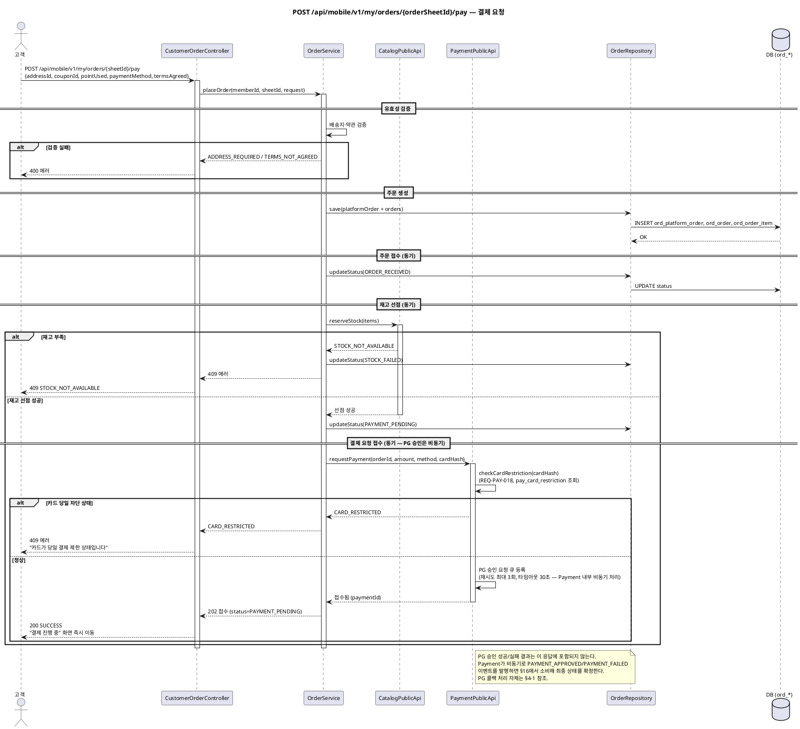

> **(2026-10-19 구현 확인, 2026-10-20 네이밍 갱신)** 위 note가 설명하는 §16 컨슈머(PAYMENT_APPROVED/PAYMENT_FAILED)는 현재 호출되지 않는다 — `EventPublisher`/이벤트 발행 코드 자체가 `OrderService.placeOrder()`에 없다. 결제 확정은 `PaymentApi.requestPayment()`(옛 이름: PaymentPublicApi)의 동기 응답(`accepted=true` 고정)만으로 즉시 끝난다.

> **신규 (2026-10-19 프로토타입 구현): 실제 흐름은 재고선점·PG 비동기 승인을 생략하고 즉시 완결된다**(상세: `.agents/tasks/order-create-mobile-api/design.md` §4-2). Cart 영속 계층이 없어 결제 대상 상품은 요청 바디 `items[]`로 직접 받고(DL §6 보완 참조), `sheetId`는 로깅/추적 전용 stateless 값이라 이 메서드 어디서도 조회에 쓰이지 않는다. 참여자 이름은 2026-10-20 네이밍 갱신(`XxxPublicApi`→`XxxApi`)을 반영한다.

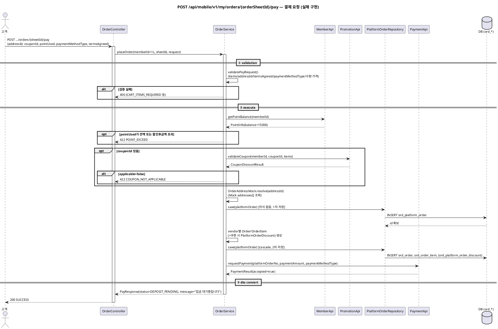

---

## 5. [API] POST /api/mobile/v1/my/orders/{orderId}/cancel — 고객 주문 취소

> 최종 수정: 2026-10-29 (현행 결정 반영 — 입금대기 취소 추가, 입금 통보 경합 시 취소 우선, 취소 클레임 생성)

- **세부UC 참조**: [고객 단순 취소] 고객 주문 취소 Bolt (DK §5)
- **상태전이**: Order `DEPOSIT_PENDING`/`PAYMENT_COMPLETED` → `CANCELLED`. 취소 클레임(`claim_type=CANCEL`, channel=SELF): 입금대기는 `RECEIVED`→`COMPLETED`, 결제완료는 `RECEIVED`→`REFUNDED`→`COMPLETED`
- **원칙**: ① 고객 직접 취소는 **입금대기·결제완료**에서만 허용한다(REQ-ORD-018·080). `PREPARING`(송장 등록 전)은 시스템상 취소요청·승인 절차가 없고 고객센터 문의 → 어드민 CS 예외 취소(§11)이며, 배송중(송장 등록 후)은 취소·반품 모두 불가(배송완료 후 반품·교환). ② 취소는 주문 전체 단위(부분 취소 없음). ③ 입금대기 취소는 가상계좌 폐기 + 재고 복원만 하고 환불은 없다. ④ 취소 처리와 같은 트랜잭션에서 취소 클레임을 생성한다(REQ-ORD-082, 상태 흐름은 제안값). ⑤ 입금대기 취소·취소 클레임·입금 통보 경합은 **미구현**이다(현행은 결제완료 취소 경로 위주 설계안).

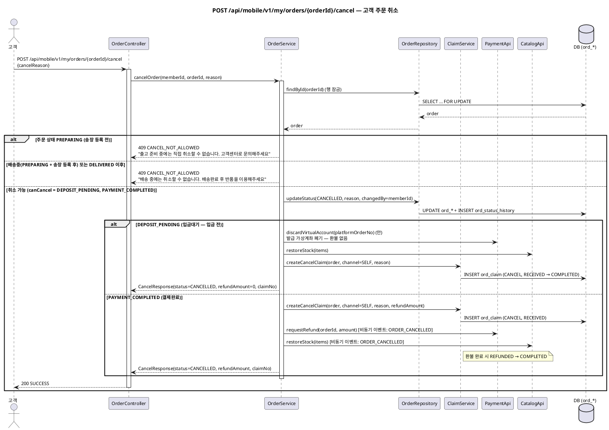

### 5-1. 입금 통보와 취소 경합 — 취소 우선 (REQ-ORD-080, REQ-PAY-030, AC-ORD-092)

> 입금대기 주문에 고객 취소와 가상계좌 입금 통보가 동시에 도착하면 **취소가 우선**한다. 주문 행 잠금(또는 낙관적 락 `version`)으로 직렬화하며, 먼저 커밋된 쪽을 따른다. 취소가 확정된 뒤 도착한 입금 통보는 주문을 PAYMENT_COMPLETED로 바꾸지 않고 입금액을 환불 대상으로 기록해 **저장된 환불계좌로 운영자 승인 없이 자동 환불**한다(사유 `LATE_DEPOSIT`, 기준일=입금 통보 수신일, 기한 정책 8.1.3 3영업일). 입금 통보 처리 자체는 Payment 도메인 시퀀스([payment.md §4-3](payment.md))·DH를 따른다. **미구현**.

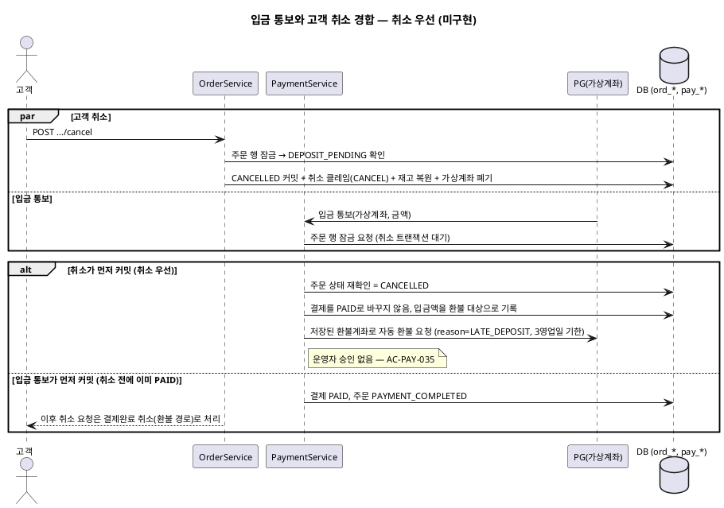


---

## 6. [API] POST /api/mobile/v1/my/orders/{orderId}/confirm — 구매확정

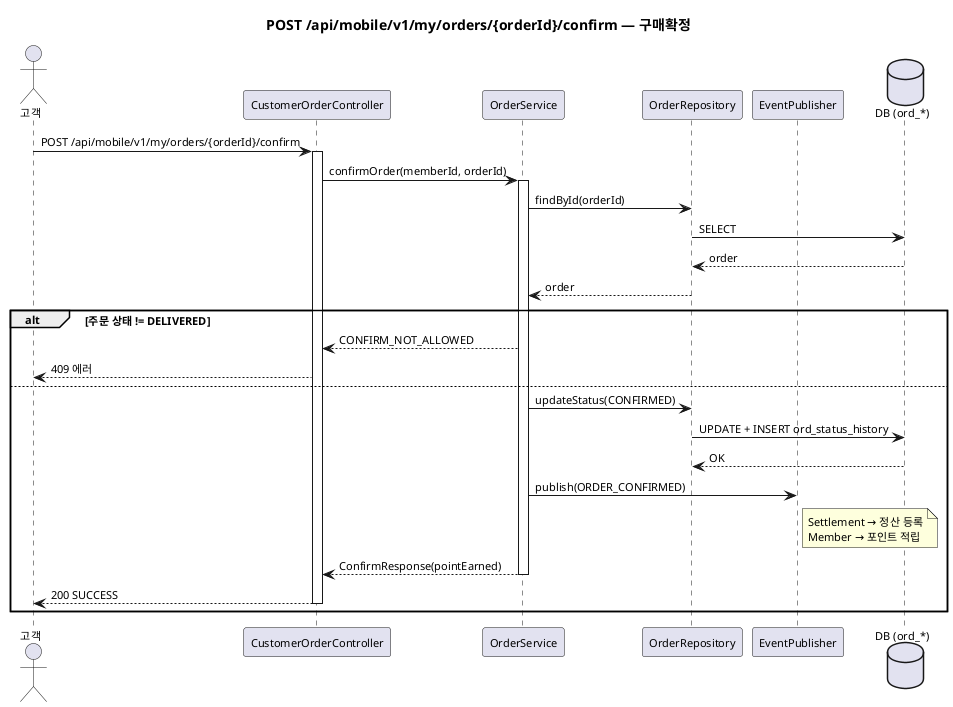


---

## 7. [API] POST /api/mobile/v1/my/orders/{orderId}/claims — 반품/교환 신청

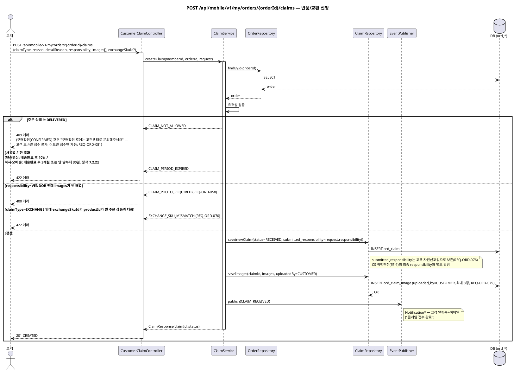


---

## 7-1. [API] POST /api/admin/v1/claims/{claimId}/blame-decision — 귀책 판정

> 신규 (2026-08-21 바텀업 재검증): 인터페이스명세(DL) §19-1에는 있었지만 시퀀스가 없던 것을 보완. CUSTOMER/VENDOR 분기와 EXCHANGE 재고선점 실패(REQ-ORD-069)까지 포함한 전체 분기를 다룬다.

- **트리거**: CS 담당자가 클레임 접수 내용을 확인하고 귀책을 확정
- **상태전이**: Claim `RECEIVED` → `PAYMENT_PENDING`(CUSTOMER) / `RECEIVED` 유지 + shipment(PICKUP) 생성 → 이후 §12/§14 경유 `INSPECTING`(VENDOR)

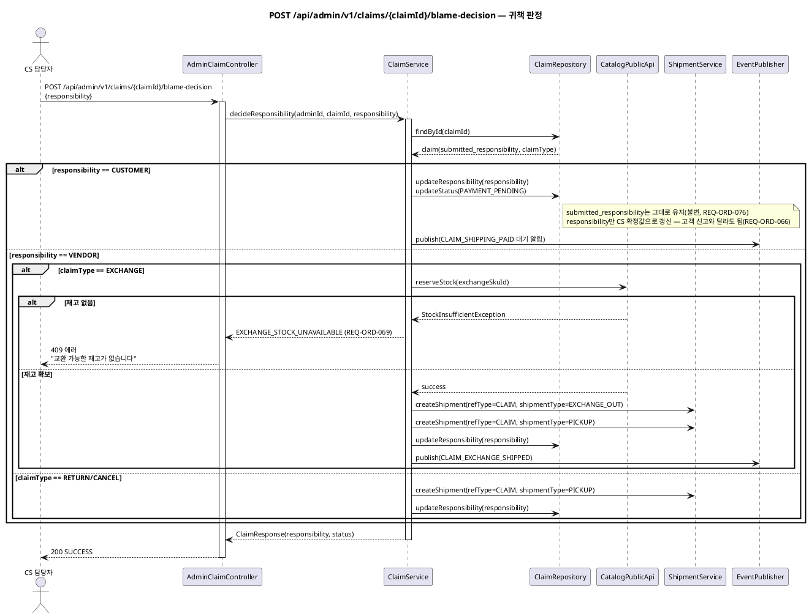


---

## 7-2. [API] POST /api/mobile/v1/my/claims/{claimId}/cancel — 고객 클레임 자진 취소

> 신규 (2026-08-21 바텀업 재검증): REQ-ORD-073/071 대응. RECEIVED/PAYMENT_PENDING 상태까지만 허용, INSPECTING 이후는 거부.

- **트리거**: 고객이 마이페이지 클레임상세에서 취소 요청
- **상태전이**: Claim `RECEIVED`/`PAYMENT_PENDING` → `REJECTED`(사유="고객 자진 철회")

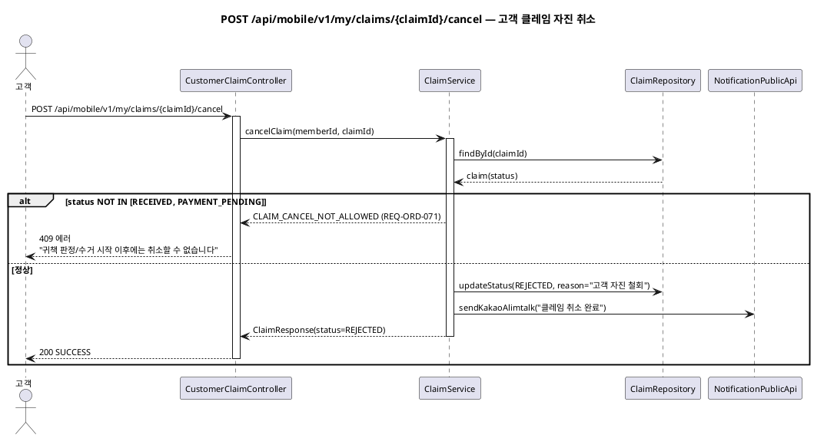


---

## 8. [API] POST /api/partner/v1/orders/{orderId}/ship — 출고 처리

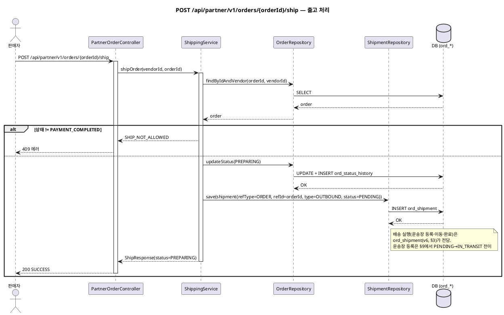


---

## 9. [API] POST /api/partner/v1/shipping/{orderId} — 운송장 등록

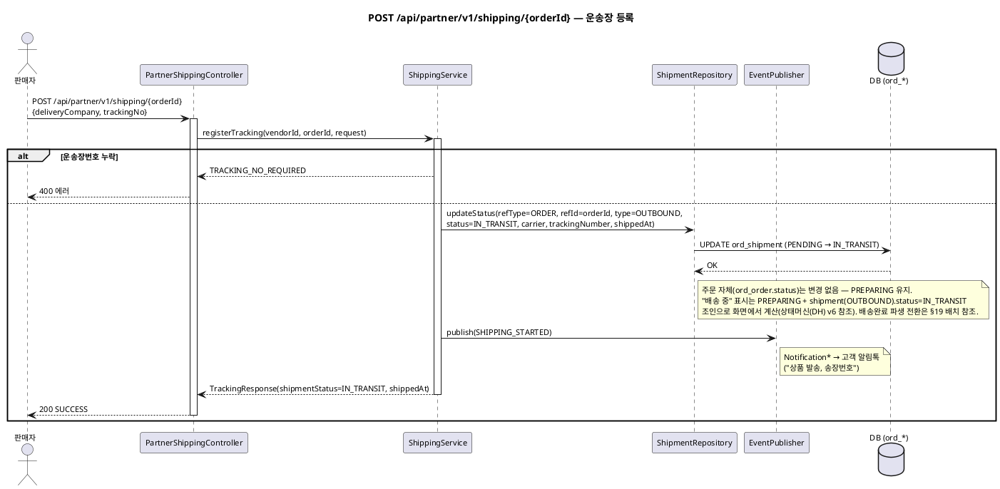


---

## 10. [배치] 클레임 자동완료 — REFUNDED/DISPOSED → COMPLETED

- **트리거**: 스케줄러 (매 시간 정각)
- **상태전이**: Claim `REFUNDED` → `COMPLETED`, Claim `DISPOSED` → `COMPLETED` (배치 자동 전환)
- **비고**: Claim 11상태 모델(DH)에는 어드민이 직접 호출하는 "클레임 완료" API가 없다. `PICKED_UP → REFUNDED`는 §13(환불 처리), `PICKUP_REJECTED → DISPOSED`는 §20(폐기 처리)에서 각각 어드민이 수행하고, `REFUNDED`/`DISPOSED`에 도달한 클레임은 본 배치가 주기적으로 스캔해 `COMPLETED`로 자동 전환한다. `RETURN_PAYMENT_PENDING → COMPLETED`(shipment(RETURN) DELIVERED 기준) 자동전환은 택배사 반송완료 확인과 같은 배치에서 처리하므로 §19를 참조. **`CLAIM_COMPLETED`는 정산·알림·재고복원·포인트 복원 이벤트**이며 Payment는 이 이벤트로 환불하지 않는다 — 클레임(반품) 환불은 어드민 [환불 처리](§13, API-029)만 트리거한다(2026-11-03 확정). 교환 클레임은 환불이 없어 이 배치 대상이 아니며, 맞교환 출고 shipment(EXCHANGE_OUT) 배송완료 시 `PICKED_UP → COMPLETED`로 전환된다(§19).

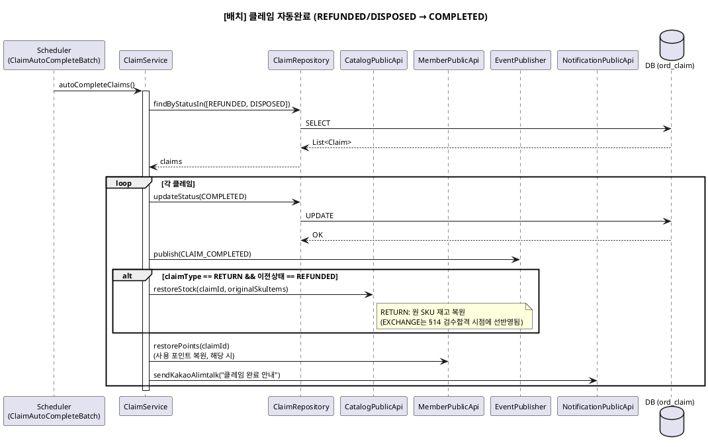


---

## 11. [API] POST /api/admin/v1/orders/{orderId}/force-cancel — CS 예외 취소

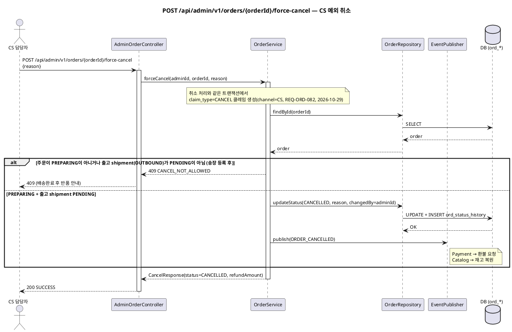


---

## 12. [API] POST /api/mobile/v1/my/claims/{claimId}/shipping-payment — 클레임 배송비 결제

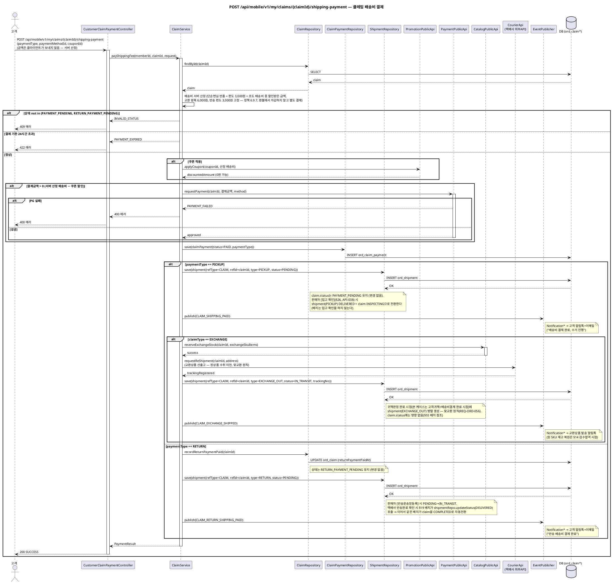


---

## 13. [API] POST /api/admin/v1/claims/{claimId}/refund — 환불 처리

> **환불 기한(2026-11-03 확정)**: 환불 승인은 품질 합격 판정이다. 3영업일 기한은 합격 일시부터 세며, 어드민은 합격 후 3영업일 안에 이 API를 호출한다(정책서 8.1.2·8.1.3·8.8.1). 합격 전(회수 송장 집하 시점 등)에는 환불하지 않는다.

> **환불 트리거 단일화(2026-11-03 확정)**: 클레임(반품) 환불은 이 절의 어드민 [환불 처리](API-029) 동기 호출(`requestRefund`)만 트리거한다. 이후 §10 배치가 발행하는 `CLAIM_COMPLETED`는 정산·알림·재고복원·포인트 이벤트일 뿐 Payment는 이 이벤트로 환불하지 않는다(중복 환불 요청 없음). 주문 취소 환불은 `ORDER_CANCELLED`(자동), 입금 통보 경합(LATE_DEPOSIT)은 자동이다.
> 환불금액 = 상품주문금액 + 환불 대상 배송비(고객이 실제 낸 초도 배송비, 전체 취소·판매자 귀책 전체 반품만). 반품·교환 배송비는 별도 결제분이라 차감하지 않는다.

```plantuml
@startuml
skinparam backgroundColor transparent
skinparam defaultFontSize 11
title POST /api/admin/v1/claims/{claimId}/refund — 환불 처리

actor "CS 담당자" as Admin
participant "AdminClaimController" as ACC
participant "ClaimService" as CS
participant "ClaimRepository" as CR
participant "PaymentPublicApi" as PAY
participant "EventPublisher" as EP
database "DB (ord_claim)" as DB

Admin -> ACC : POST /api/admin/v1/claims/{claimId}/refund\n{refundMethod, bankAccount}
activate ACC

ACC -> CS : processRefund(adminId, claimId, request)
activate CS

CS -> CR : findById(claimId)
CR -> DB : SELECT
DB --> CR : claim
CR --> CS : claim

alt 상태 != PICKED_UP
  CS --> ACC : INVALID_STATUS (수거완료 상태만 환불 가능)
  ACC --> Admin : 409 에러
else 정상

  alt refundMethod == ORIGINAL
    CS -> PAY : requestRefund(orderId, amount)
    activate PAY
    PAY --> CS : refundSuccess
    deactivate PAY
  else refundMethod == BANK_TRANSFER
    CS -> CS : 입금정보 저장 (bankAccount)\n이체는 담당자 수동 진행
  end

  CS -> CR : updateStatus(REFUNDED)
  CR -> DB : UPDATE ord_claim

  CS -> EP : publish(CLAIM_REFUNDED)
  note right of EP: → Notification(환불완료 알림톡+이메일)

  CS --> ACC : RefundResult
  deactivate CS
  ACC --> Admin : 200 SUCCESS
  deactivate ACC
end

@enduml
```


---

## 14. [API] POST /api/partner/v1/claims/{claimId}/inspect-pass — 품질점검 합격

> **교환 종료(2026-11-03 확정)**: 교환은 환불이 없다. 교환 상품은 선출고하므로 합격(PICKED_UP) 판정과 선출고 shipment(EXCHANGE_OUT)의 배송완료(고객 수령)가 모두 충족되면(순서 무관) `PICKED_UP → COMPLETED`로 전환하고, `CLAIM_COMPLETED`는 그 COMPLETED 전환 시(§19) 발행한다 — 합격 시점에는 발행하지 않는다.

```plantuml
@startuml
skinparam backgroundColor transparent
skinparam defaultFontSize 11
title POST /api/partner/v1/claims/{claimId}/inspect-pass — 품질점검 합격

actor 판매자 as Partner
participant "PartnerClaimController" as PCC
participant "ClaimService" as CS
participant "ClaimRepository" as CR
participant "CatalogPublicApi" as CAT
participant "EventPublisher" as EP
database "DB (ord_claim)" as DB

Partner -> PCC : POST /api/partner/v1/claims/{claimId}/inspect-pass\n{memo}
activate PCC

PCC -> CS : inspectPass(vendorId, claimId, memo)
activate CS

CS -> CR : findById(claimId)
CR -> DB : SELECT
DB --> CR : claim
CR --> CS : claim

alt 상태 != INSPECTING
  CS --> PCC : INVALID_STATUS (품질점검 상태만 합격 가능)
  PCC --> Partner : 409 에러
else 정상
  note right of CS
    합격 판정 기준(DH v4)
    RETURN: 상품 상태 양호(훼손 없음)
    EXCHANGE: 택(TAG) 유지 여부
  end note

  CS -> CR : updateStatus(PICKED_UP, memo)
  CR -> DB : UPDATE ord_claim
  DB --> CR : OK

  alt claimType == EXCHANGE
    CS -> CAT : restoreStock(claimId, originalSkuItems)
    activate CAT
    CAT --> CS : success
    deactivate CAT
    note right of CAT: 원상품 재고 복원\n(교환 SKU는 §12 귀책판정 완료 시점에 shipment(EXCHANGE_OUT)으로\n이미 선출고·차감됨 — 맞교환 원칙)

    note right of CS
      claimType=EXCHANGE는 환불 대상이 아니므로 §13(환불) 없이,
      선출고한 shipment(EXCHANGE_OUT)가 배송완료(고객 수령)이고 합격 상태이면
      §19에서 PICKED_UP → COMPLETED 전환 + CLAIM_COMPLETED 발행
      (합격 시점에는 CLAIM_COMPLETED를 발행하지 않는다)
    end note
  else claimType == RETURN
    note right of CS: 원 SKU 재고복원은 어드민 환불(§13, PICKED_UP→REFUNDED) 이후\n§10 배치(REFUNDED→COMPLETED, CLAIM_COMPLETED 발행)에서 수행
  end

  CS --> PCC : InspectResult(status=PICKED_UP)
  deactivate CS
  PCC --> Partner : 200 SUCCESS
  deactivate PCC
end

@enduml
```


---

## 15. [API] POST /api/partner/v1/claims/{claimId}/inspect-reject — 품질점검 거부

```plantuml
@startuml
skinparam backgroundColor transparent
skinparam defaultFontSize 11
title POST /api/partner/v1/claims/{claimId}/inspect-reject — 품질점검 거부

actor 판매자 as Partner
participant "PartnerClaimController" as PCC
participant "ClaimService" as CS
participant "ClaimRepository" as CR
database "DB (ord_claim)" as DB

Partner -> PCC : POST /api/partner/v1/claims/{claimId}/inspect-reject\n{rejectReason}
activate PCC

PCC -> CS : inspectReject(vendorId, claimId, rejectReason)
activate CS

alt rejectReason 누락
  CS --> PCC : REASON_REQUIRED
  PCC --> Partner : 400 에러
else

  CS -> CR : findById(claimId)
  CR -> DB : SELECT
  DB --> CR : claim
  CR --> CS : claim

  alt 상태 != INSPECTING
    CS --> PCC : INVALID_STATUS
    PCC --> Partner : 409 에러
  else 정상
    CS -> CR : updateStatus(PICKUP_REJECTED, rejectReason)
    CR -> DB : UPDATE ord_claim
    DB --> CR : OK

    CS --> PCC : InspectResult(status=PICKUP_REJECTED)
    deactivate CS
    PCC --> Partner : 200 SUCCESS
    deactivate PCC
  end
end

@enduml
```


---

## 16. [컨슈머] PAYMENT_APPROVED/PAYMENT_FAILED 이벤트 수신 — 결제 완료·실패 후처리

> **(2026-10-29 개정)**: 현행 결제 접수 흐름은 §4·§4-1이다 — 재고는 접수 후 컨슈머가 차감하고(`STOCK_DEDUCTED`), 가상계좌 발급 후 주문은 **`DEPOSIT_PENDING`(입금대기)**이 된다. 이 절은 구 `PAYMENT_PENDING` 기준을 폐기하고 `DEPOSIT_PENDING`(가상계좌) 또는 결제 인증 대기 상태(안, DH 구현 현행화; 카드 등)를 입력 상태로 한다. 입금 통보·PG 승인 수신 처리, 결제 실패·입금기한(12시간) 만료 보상(§24)은 **미구현**이다(Bolt8 SC18-1, Bolt14 SC10-1·SC28-3).

- **트리거**: Payment 도메인 → `PAYMENT_APPROVED`(승인 또는 가상계좌 입금 통보) 또는 `PAYMENT_FAILED` 이벤트 발행
- **세부UC 참조**: [주문접수] UC-ORD-004 결제완료 후처리
- **상태전이**: Order `DEPOSIT_PENDING`(또는 결제 인증 대기) → `PAYMENT_COMPLETED`(승인·입금 통보, REQ-ORD-013) / `STOCK_DEDUCTED` → `PAYMENT_FAILED`(별도 종료 상태, 누적 실패 3회 도달, 재고 복원, REQ-ORD-014, DH). 결제 실패는 `CANCELLED`가 아니라 `PAYMENT_FAILED`다(2026-11-03 확정). **이미 `CANCELLED`인 주문에 입금 통보가 오면 PAID로 바꾸지 않는다**(취소 우선, §5-1)
- **재시도 기준**: PG 승인 실패 응답·3초 무응답(조회 미승인 확정)은 최초 시도 포함 총 3회(재시도 간격 3초 고정)이며 Payment 내부에서 처리한다. 3회 도달 시에만 `PAYMENT_FAILED`가 발행되어 이 컨슈머가 받는다.

```plantuml
@startuml
title [컨슈머] PAYMENT_APPROVED/PAYMENT_FAILED 수신 — 결제 완료·실패 후처리

participant "EventListener\n(OrderPaymentEventListener)" as Listener
participant "OrderService" as Service
participant "OrderRepository" as Repo
participant "CatalogApi" as Catalog
participant "EventPublisher" as Event
participant "NotificationApi" as Noti

alt PAYMENT_APPROVED 수신 (승인 또는 입금 통보)
    Listener -> Service : handlePaymentApproved(orderId, paymentId)
    activate Service
    Service -> Repo : findById(orderId) (행 잠금)
    Repo --> Service : Order(status)
    alt status == DEPOSIT_PENDING (또는 결제 인증 대기)
        Service -> Repo : updateStatus(PAYMENT_COMPLETED) + 이력
        Service -> Event : publish(ORDER_PAID)
        Service -> Noti : sendKakaoAlimtalk("주문확인")
        Service -> Noti : sendEmail("주문확인")
    else status == CANCELLED (취소가 먼저 확정된 뒤 입금 통보)
        note right of Service : 주문을 PAYMENT_COMPLETED로 바꾸지 않는다 (취소 우선, REQ-ORD-080)\n입금액은 Payment가 저장된 환불계좌로 자동 환불(LATE_DEPOSIT, AC-PAY-035) — §5-1
    end
    deactivate Service
else PAYMENT_FAILED 수신 (누적 실패 3회 도달 — 승인 실패 응답·무응답 합산)
    Listener -> Service : handlePaymentFailed(orderId, paymentId, reason)
    activate Service
    Service -> Repo : findById(orderId)
    Repo --> Service : Order(status=STOCK_DEDUCTED, PG 승인 시도 구간)
    Service -> Catalog : restoreStock(items)
    Service -> Repo : updateStatus(PAYMENT_FAILED) + 이력
    Service -> Noti : sendKakaoAlimtalk("결제 실패 안내")
    deactivate Service
end
@enduml
```


---

## 17. [배치] D+11 자동구매확정 — 배송완료 후 11일 경과

- **트리거**: 스케줄러 (매일 02:00)
- **세부UC 참조**: [구매확정] UC-ORD-006 자동구매확정
- **상태전이**: Order `DELIVERED` → `CONFIRMED` (Payment 상태는 변경 없음 — 정산은 Settlement 도메인이 `ORDER_CONFIRMED` 이벤트를 구독해 비동기 처리)
- **대상 조건**: 배송완료 후 11일이 지난 주문. **반품·교환 클레임이 진행 중인 건은 제외**한다(정책 5.6.2, AC-ORD-110) — 클레임이 반려·취소로 종료되면 다음 배치에서 대상이 된다.
- **실패 재처리**(정책 5.6.3, AC-ORD-111, 미구현): 처리 실패 건은 다음 실행에서 다시 시도하고, 같은 건이 3회 연속 실패하면 운영자 알림을 발송한다.

```plantuml
@startuml
title [배치] D+11 자동구매확정

participant "Scheduler\n(AutoConfirmBatch)" as Batch
participant "OrderService" as Service
participant "OrderRepository" as Repo
participant "EventPublisher" as Event
participant "NotificationPublicApi" as Noti

Batch -> Service : autoConfirmDelivered()
activate Service

Service -> Repo : findDeliveredBefore(now - 11days)\n+ 진행 중 반품·교환 클레임 없는 건만\n(NOT EXISTS 클레임 status NOT IN 종료상태)\n+ 이전 실패 건(재처리 대상) 포함
Repo --> Service : List<Order>

loop 각 주문
    alt 처리 성공
        Service -> Repo : updateStatus(CONFIRMED)
        Service -> Event : publish(ORDER_CONFIRMED)
        note right: → Settlement(정산 확정)\n→ Member(포인트 적립)
        Service -> Noti : sendKakaoAlimtalk("자동구매확정 안내")
    else 처리 실패 (예외)
        Service -> Repo : recordFailure(orderId, failCount+1) — 다음 배치에서 재처리
        opt failCount >= 3 (3회 연속 실패)
            Service -> Noti : sendAdminAlert("자동 구매확정 3회 연속 실패", orderId)
        end
    end
end

deactivate Service
@enduml
```


---

## 18. [배치] 배송비결제 24시간 만료 — 미결제 클레임 자동취소

- **트리거**: 스케줄러 (매 시간 정각)
- **세부UC 참조**: [클레임접수] UC-ORD-012 배송비 결제기한 만료
- **상태전이**: Claim `PAYMENT_PENDING` → `PAYMENT_EXPIRED` (수거 배송비), Claim `RETURN_PAYMENT_PENDING` → `PAYMENT_EXPIRED` (반송 배송비 24시간 미결제, DH, AC-ORD-113). 배송비 결제 12시간 경과 리마인드는 §23

```plantuml
@startuml
title [배치] 배송비결제 24시간 만료

participant "Scheduler\n(ShippingPaymentExpiryBatch)" as Batch
participant "ClaimService" as Service
participant "ClaimRepository" as Repo
participant "ClaimPaymentRepository" as PayRepo
participant "EventPublisher" as Event
participant "NotificationPublicApi" as Noti

Batch -> Service : expireUnpaidShippingFees()
activate Service

Service -> PayRepo : findPendingExpiredBefore(now)
PayRepo --> Service : List<ClaimPayment>(status=PENDING, expired_at < now)

loop 각 미결제 건
    Service -> Repo : updateClaimStatus(PAYMENT_EXPIRED)
    Service -> PayRepo : updatePaymentStatus(EXPIRED)
    Service -> Event : publish(CLAIM_PAYMENT_EXPIRED)
    Service -> Noti : sendKakaoAlimtalk("배송비 미결제로 클레임 취소")
end

deactivate Service
@enduml
```


---

## 18-1. [배치] RECEIVED 24시간 CS 미처리 리마인드

> 신규 (2026-08-21 바텀업 재검증): REQ-ORD-068 대응. 지금까지는 화면 대시보드 집계 표시만 있고 실제 발송 배치가 없었다.

- **트리거**: 스케줄러 (매 시간 정각)
- **세부UC 참조**: [클레임접수] CS 접수확인 SLA
- **상태전이**: 없음 (알림만 발송, claim.status는 RECEIVED 유지)

```plantuml
@startuml
title [배치] RECEIVED 24시간 CS 미처리 리마인드

participant "Scheduler\n(ClaimReceivedSlaBatch)" as Batch
participant "ClaimService" as Service
participant "ClaimRepository" as Repo
participant "NotificationPublicApi" as Noti

Batch -> Service : remindUnprocessedReceived()
activate Service

Service -> Repo : findByStatusAndCreatedBefore(RECEIVED, now - 24h)
Repo --> Service : List<Claim>

loop 각 미처리 클레임 (last_reminded_at이 24h 이상 지났거나 NULL인 건만)
    Service -> Noti : sendAdminAlert("접수 24시간 경과 미처리 클레임", claimId)
    Service -> Repo : updateLastRemindedAt(now)
    note right of Noti: CS 대시보드 "미처리임박" 집계(DN-화면레이아웃)의 실제 발송 트리거
end

deactivate Service
@enduml
```


---

## 19. [배치] 배송상태 갱신 — 택배사 API 조회 (60분 주기)

- **트리거**: 스케줄러 (매 60분)
- **세부UC 참조**: [배송관리] UC-ORD-008 배송상태 동기화
- **상태전이**: `ord_shipment.status` `IN_TRANSIT` → `DELIVERED`/`FAILED` (v6, 배송 실행 전용·order/claim 공용). 파생 전환: Order `PREPARING` → `DELIVERED`(shipment type=OUTBOUND 구독), Claim `RETURN_PAYMENT_PENDING` → `COMPLETED`(shipment type=RETURN 구독), Claim `PICKED_UP` → `COMPLETED`(교환, shipment type=EXCHANGE_OUT 구독). **수거(PICKUP) 입고 확인과 INSPECTING 전환은 이 배치가 아니라 판매자 [입고 확인](§26, API-038)이 수행한다**

```plantuml
@startuml
title [배치] 배송상태 갱신 (60분 주기, v6 — ord_shipment 전용)

participant "Scheduler\n(ShipmentStatusSyncBatch)" as Batch
participant "ShipmentService" as Service
participant "ShipmentRepository" as Repo
participant "CourierApi\n(택배사 외부API)" as Courier
participant "ClaimRepository" as ClaimRepo
participant "OrderRepository" as OrderRepo
participant "EventPublisher" as Event
participant "NotificationPublicApi" as Noti

Batch -> Service : syncShipmentStatus()
activate Service

Service -> Repo : findByStatus(IN_TRANSIT)
Repo --> Service : List<Shipment>(shipment_type IN [OUTBOUND, RETURN, EXCHANGE_OUT] — PICKUP은 판매자 [입고 확인](§26)이 처리하므로 배치 대상 아님)

loop 각 배송건
    Service -> Courier : getTrackingStatus(trackingNo)
    Courier --> Service : TrackingResult

    alt 배송완료
        Service -> Repo : updateStatus(DELIVERED)
        Repo -> Repo : (DB) UPDATE ord_shipment

        alt shipment_type == OUTBOUND
            Service -> Event : publish(SHIPMENT_DELIVERED, refType=ORDER, refId=orderId)
            note right of Event: order.status는 이 배치가 직접 갱신하지 않는다.\nOrderService가 이벤트를 구독해 파생 전환(아래 == 섹션 참조) — 2단계 분리
            Service -> Noti : sendKakaoAlimtalk("배송완료 안내")
        else shipment_type == PICKUP (조회 대상 아님 — 방어적 분기)
            note right of Service: 배치는 입고 확인을 하지 않는다(2026-11-03 확정) — 수거 shipment(PICKUP)의\nDELIVERED 전환과 claim INSPECTING 전환은 판매자 [입고 확인](§26)이 수행.\n택배사 배송완료 신호만으로 claim.status를 변경하지 않는다
        else shipment_type == RETURN
            note right of Service: claim.status는 변경하지 않음(RETURN_PAYMENT_PENDING 유지)\nCOMPLETED 자동전환은 아래 "클레임 자동완료" 섹션에서 별도 처리
            Service -> Noti : sendKakaoAlimtalk("반송 배송완료 안내")
        else shipment_type == EXCHANGE_OUT
            note right of Service: 교환상품 고객 수령 — 클레임이 PICKED_UP(합격)이면\n아래 "교환 클레임 종료" 섹션에서 COMPLETED 전환(맞교환 원칙 — §12/§14 참조)
            Service -> Noti : sendKakaoAlimtalk("교환상품 배송완료 안내")
        end
    else 배송실패/반송 신호
        Service -> Repo : updateStatus(FAILED)
        Repo -> Repo : (DB) UPDATE ord_shipment
        Service -> Noti : sendKakaoAlimtalk("배송 실패 안내, CS 확인 요청")
    else 상태변경 없음
        note right: skip
    end
end

== 주문 배송완료 파생 전환 (OrderService, SHIPMENT_DELIVERED 이벤트 구독) ==

Event -> OrderRepo : updateStatus(DELIVERED)\n(shipment type=OUTBOUND 구독분만, orderId 기준)
OrderRepo -> OrderRepo : (DB) UPDATE ord_order
note right of OrderRepo: D+11 자동확정 타이머 시작(§17), 고객 알림톡

== 클레임 자동완료 (RETURN_PAYMENT_PENDING → COMPLETED, shipment(RETURN) DELIVERED 기준 배치 자동전환) ==

Service -> ClaimRepo : findByStatusWithReturnShipmentDelivered(RETURN_PAYMENT_PENDING)
ClaimRepo --> Service : List<Claim>(연관 shipment(RETURN).status = DELIVERED)

loop 각 클레임 (CLAIM_REFUNDED류 알림톡 발행 패턴 참고)
    Service -> ClaimRepo : updateStatus(COMPLETED)
    Service -> Event : publish(CLAIM_COMPLETED)
    Service -> Noti : sendKakaoAlimtalk("클레임 완료 안내")
end

== 교환 클레임 종료 (PICKED_UP → COMPLETED, shipment(EXCHANGE_OUT) DELIVERED 기준) ==

Service -> ClaimRepo : findByStatusWithExchangeOutDelivered(PICKED_UP)
ClaimRepo --> Service : List<Claim>(claimType=EXCHANGE, 연관 shipment(EXCHANGE_OUT).status = DELIVERED)
note right of Service: 합격(PICKED_UP) 전에 배송완료된 건은 합격 판정 시점에 이미 충족 — 다음 주기에 전환.\n환불 없음(교환은 환불 대상 아님)

loop 각 교환 클레임
    Service -> ClaimRepo : updateStatus(COMPLETED)
    Service -> Event : publish(CLAIM_COMPLETED)
    note right of Event: 발행 시점 = COMPLETED 전환 시 (정산·알림·포인트 이벤트, Payment 환불 없음)
    Service -> Noti : sendKakaoAlimtalk("교환 완료 안내")
end

deactivate Service
@enduml
```


---

## 20. [API] POST /api/admin/v1/claims/{claimId}/dispose — 폐기 처리

- **트리거**: 어드민 수동 처리 (품질점검 불합격 건 중 반송 불가 판단)
- **상태전이**: Claim `PICKUP_REJECTED` → `DISPOSED`

```plantuml
@startuml
skinparam backgroundColor transparent
skinparam defaultFontSize 11
title POST /api/admin/v1/claims/{claimId}/dispose — 폐기 처리

actor "CS 담당자" as Admin
participant "AdminClaimController" as ACC
participant "ClaimService" as CS
participant "ClaimRepository" as CR
participant "EventPublisher" as EP
database "DB (ord_claim)" as DB

Admin -> ACC : POST /api/admin/v1/claims/{claimId}/dispose\n{reason}
activate ACC

ACC -> CS : disposeClaim(adminId, claimId, reason)
activate CS

CS -> CR : findById(claimId)
CR -> DB : SELECT
DB --> CR : claim
CR --> CS : claim

alt 상태 != PICKUP_REJECTED
  CS --> ACC : INVALID_STATUS (품질점검 거부 건만 폐기 가능)
  ACC --> Admin : 409 에러
else 정상
  CS -> CR : updateStatus(DISPOSED, reason)
  CR -> DB : UPDATE ord_claim

  CS -> EP : publish(CLAIM_DISPOSED)
  note right of EP: Notification* → 고객 알림톡\n("상품 폐기 처리됨")\nDISPOSED→COMPLETED 자동전환은 §10 배치 참조

  CS --> ACC : ClaimResponse(status=DISPOSED)
  deactivate CS
  ACC --> Admin : 200 SUCCESS
  deactivate ACC
end

@enduml
```


---

## 21. [API] POST /api/admin/v1/claims/{claimId}/request-return-payment — 반송 배송비 추가결제 요청

- **트리거**: 어드민 수동 처리 (품질점검 불합격 건 중 반송 가능 판단)
- **상태전이**: Claim `PICKUP_REJECTED` → `RETURN_PAYMENT_PENDING`
- **금액**: 반송 배송비는 품질점검 전체 불합격 시 편도 3,000원 고정(정책 6.9.7)이며, 환불에서 차감하지 않고 고객이 별도 결제한다. 필드명은 DL §35 `returnShippingFee`를 따른다.

```plantuml
@startuml
skinparam backgroundColor transparent
skinparam defaultFontSize 11
title POST /api/admin/v1/claims/{claimId}/request-return-payment — 반송 배송비 추가결제 요청

actor "CS 담당자" as Admin
participant "AdminClaimController" as ACC
participant "ClaimService" as CS
participant "ClaimRepository" as CR
participant "EventPublisher" as EP
database "DB (ord_claim)" as DB

Admin -> ACC : POST /api/admin/v1/claims/{claimId}/request-return-payment\n{returnShippingFee=3000 (생략 시 기본값, 다른 값은 거부)}
activate ACC

ACC -> CS : requestReturnPayment(adminId, claimId, returnShippingFee)
activate CS

CS -> CR : findById(claimId)
CR -> DB : SELECT
DB --> CR : claim
CR --> CS : claim

alt 상태 != PICKUP_REJECTED
  CS --> ACC : INVALID_STATUS (품질점검 거부 건만 반송 요청 가능)
  ACC --> Admin : 409 에러
else 정상
  CS -> CR : updateStatus(RETURN_PAYMENT_PENDING, returnShippingFee)
  CR -> DB : UPDATE ord_claim

  CS -> EP : publish(CLAIM_RETURN_PAYMENT_REQUESTED)
  note right of EP: Notification* → 고객 알림톡\n("반송 배송비 결제 필요")\n고객 결제는 §12(paymentType=RETURN)에서 처리\n24시간 미결제 시 §18 배치가 PAYMENT_EXPIRED로 자동취소

  CS --> ACC : ClaimResponse(status=RETURN_PAYMENT_PENDING)
  deactivate CS
  ACC --> Admin : 200 SUCCESS
  deactivate ACC
end

@enduml
```


---

## 22. [API] POST /api/partner/v1/shipping/{shipmentId}/reship — 배송 실패 재발송 처리 (신규)

> v6 후속 보완 (2026-08-21): REQ-ORD-062 대응. FAILED 상태의 shipment(어떤 shipment_type이든 공통)를 재발송 처리한다.

- **트리거**: 판매자 또는 CS 담당자 수동 처리 (§19 배치가 FAILED로 전환한 건)
- **상태전이**: `ord_shipment.status` `FAILED` → `PENDING` → (운송장 재등록 시) `IN_TRANSIT`

```plantuml
@startuml
skinparam backgroundColor transparent
skinparam defaultFontSize 11
title POST /api/partner/v1/shipping/{shipmentId}/reship — 배송 실패 재발송 처리

actor "판매자 / CS 담당자" as Actor
participant "PartnerShippingController" as SC
participant "ShipmentService" as Service
participant "ShipmentRepository" as Repo
database "DB (ord_shipment)" as DB

Actor -> SC : POST /api/partner/v1/shipping/{shipmentId}/reship\n{carrier, trackingNo}
activate SC

SC -> Service : reship(shipmentId, carrier, trackingNo)
activate Service

Service -> Repo : findById(shipmentId)
Repo --> Service : Shipment

alt 상태 != FAILED
  Service --> SC : RESHIP_NOT_ALLOWED (FAILED 상태만 재발송 가능)
  SC --> Actor : 409 에러
else 정상
  Service -> Repo : updateStatus(PENDING)
  Repo -> DB : UPDATE ord_shipment
  Service -> Repo : registerTracking(carrier, trackingNo)
  Repo -> DB : UPDATE ord_shipment (carrier, trackingNo)
  Service -> Repo : updateStatus(IN_TRANSIT)
  Repo -> DB : UPDATE ord_shipment
  note right: 이후 §19 배치가 다시 추적(60분 주기)

  Service --> SC : ShipmentResponse(status=IN_TRANSIT)
  deactivate Service
  SC --> Actor : 200 SUCCESS
  deactivate SC
end

@enduml
```


---

## 23. [배치] 클레임 배송비 결제 12시간 리마인드 (BAT-004)

> 신규 (2026-10-29): DQ-프로그램목록 BAT-004(UC-26 추가예정, 시퀀스 §23 추가 예정)의 시퀀스를 기존 계획 항목대로 추가한다. 프로그램 신설이 아니다. REQ-ORD-043, AC-ORD-045.

- **트리거**: 스케줄러 (매 시간 정각)
- **상태전이**: 없음 (알림만 발송). 24시간 만료는 §18
- **대상**: Claim `PAYMENT_PENDING`(수거 배송비) 또는 `RETURN_PAYMENT_PENDING`(반송 배송비) 상태로 결제 요청 후 12시간이 지났으나 아직 리마인드하지 않은 건

```plantuml
@startuml
title [배치] 클레임 배송비 결제 12시간 리마인드
participant "Scheduler\n(ShippingPaymentReminderBatch)" as Batch
participant "ClaimService" as Service
participant "ClaimPaymentRepository" as PayRepo
participant "NotificationApi" as Noti

Batch -> Service : remindUnpaidShippingFees()
activate Service
Service -> PayRepo : findPendingRequestedBefore(now - 12h, reminded=false)
PayRepo --> Service : List<ClaimPayment>(status=PENDING)
loop 각 미결제 건
    Service -> Noti : sendKakaoAlimtalk("배송비 미결제 리마인드(남은 시간 안내)")
    Service -> PayRepo : markReminded(claimPaymentId)
end
deactivate Service
@enduml
```


---

## 24. [배치] 입금기한 12시간 만료 + 재고 복원 (BAT-006)

> 신규 (2026-10-29): DQ-프로그램목록 BAT-006(계획, 입금기한 만료+재고 복원)의 시퀀스. 프로그램 신설이 아니라 기존 계획 항목의 시퀀스다. REQ-ORD-014, AC-ORD-016. **미구현**(Bolt14 SC28-3).

- **트리거**: 스케줄러 (주기 예: 매 시간, DQ BAT-006)
- **상태전이**: Order `DEPOSIT_PENDING` → `CANCELLED`(사유 입금기한 만료). 취소 클레임은 생성하지 않는다(REQ-ORD-082는 고객 직접 취소·어드민 예외 취소 한정)
- **경합**: 만료 처리와 입금 통보가 겹치면 취소 확정 후 도착한 입금 통보는 §5-1과 같이 자동 환불(LATE_DEPOSIT)한다. 주문 행 잠금으로 직렬화한다

```plantuml
@startuml
title [배치] 입금기한 12시간 만료 + 재고 복원
participant "Scheduler\n(DepositExpiryBatch)" as Batch
participant "내부 API\n(OrderInternalController)" as IC
participant "OrderService" as Service
participant "OrderRepository" as Repo
participant "PaymentApi" as PAY
participant "CatalogApi" as CAT

Batch -> IC : 입금기한 만료 처리 요청
IC -> Service : expireDepositPending(now)
activate Service
Service -> Repo : findByStatusAndDepositDueBefore(DEPOSIT_PENDING, now)
Repo --> Service : List<PlatformOrder> (입금기한 12시간 경과)
loop 각 주문 (행 잠금, 상태 재확인)
    alt 아직 DEPOSIT_PENDING
        Service -> PAY : discardVirtualAccount(platformOrderNo) (안)
        Service -> CAT : restoreStock(items)
        Service -> Repo : updateStatus(CANCELLED, reason=입금기한 만료) + 이력
    else 그사이 입금 통보로 PAYMENT_COMPLETED
        note right of Service : 건너뜀
    end
end
deactivate Service
@enduml
```


---

## 25. [배치] 임시주문(TEMP) 30분 TTL 정리 (BAT-005)

> 신규 (2026-10-29): DQ-프로그램목록 BAT-005(계획)의 시퀀스. 프로그램 신설이 아니다. DH `TEMP → CANCELLED`(30분 TTL 만료). **미구현**(Bolt14 SC28-4) — 현행은 이탈한 주문서가 TEMP로 누적된다.

- **트리거**: 스케줄러 (주기 예: 10분, DQ BAT-005)
- **상태전이**: Order(플랫폼주문·판매자 주문·상품) `TEMP` → `CANCELLED`. 재고는 접수 전이라 차감되지 않았으므로 복원하지 않는다

```plantuml
@startuml
title [배치] 임시주문(TEMP) TTL 정리
participant "Scheduler\n(TempOrderCleanupBatch)" as Batch
participant "내부 API\n(OrderInternalController)" as IC
participant "OrderService" as Service
participant "PlatformOrderRepository" as Repo

Batch -> IC : 임시주문 정리 요청
IC -> Service : cleanupExpiredTemp(now)
activate Service
Service -> Repo : findByStatusAndCreatedBefore(TEMP, now - 30min)
Repo --> Service : List<PlatformOrder>
loop 각 임시주문
    Service -> Repo : updateStatus(CANCELLED, reason=주문서 이탈(TTL 만료)) + 이력
end
deactivate Service
@enduml
```


---

## 26. [API] POST /api/partner/v1/claims/{claimId}/pickup-confirm — 입고 확인

> 신규 (2026-11-03): DQ API-038(DL §27, DK §21)의 시퀀스. 입고 확인 주체는 **판매자 [입고 확인] 액션**이며 배송추적 배치(§19)는 입고 확인을 하지 않는다. **미구현**(DL §27).

- **트리거**: 판매자 [입고 확인 → 품질점검 시작] 클릭
- **상태전이**: shipment(PICKUP) `IN_TRANSIT` → `DELIVERED`, Claim `PAYMENT_PENDING`(고객귀책, 배송비 결제 완료) 또는 `RECEIVED`(판매자귀책) → `INSPECTING` — 같은 트랜잭션

```plantuml
@startuml
skinparam backgroundColor transparent
skinparam defaultFontSize 11
title POST /api/partner/v1/claims/{claimId}/pickup-confirm — 입고 확인

actor 판매자 as Partner
participant "PartnerClaimController" as PCC
participant "ClaimService" as CS
participant "ClaimRepository" as CR
participant "ShipmentRepository" as SR
participant "NotificationPublicApi" as Noti
database "DB (ord_claim, ord_shipment)" as DB

Partner -> PCC : POST /api/partner/v1/claims/{claimId}/pickup-confirm
activate PCC

PCC -> CS : confirmPickup(vendorId, claimId)
activate CS

CS -> CR : findById(claimId)
CR -> DB : SELECT
DB --> CR : claim
CR --> CS : claim

alt 본인 판매자 클레임 아님
  CS --> PCC : FORBIDDEN
  PCC --> Partner : 403 에러
else 수거 shipment(PICKUP)가 IN_TRANSIT 아님 또는 클레임 상태 부적합
  CS --> PCC : INVALID_STATUS
  PCC --> Partner : 409 에러
else 정상
  CS -> SR : updateStatus(PICKUP shipment, DELIVERED)
  SR -> DB : UPDATE ord_shipment
  CS -> CR : updateStatus(INSPECTING)
  CR -> DB : UPDATE ord_claim + INSERT ord_status_history
  DB --> CR : OK

  CS -> Noti : sendKakaoAlimtalk("수거완료, 품질점검 진행 안내")

  CS --> PCC : PickupConfirmResult(claimId, pickupConfirmedAt)
  deactivate CS
  PCC --> Partner : 200 SUCCESS
  deactivate PCC
end

@enduml
```
