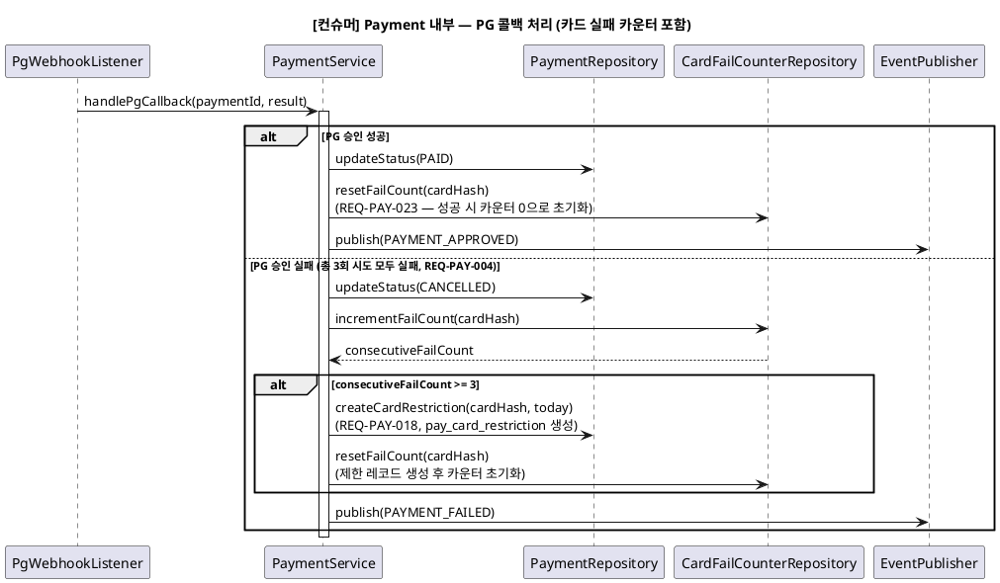
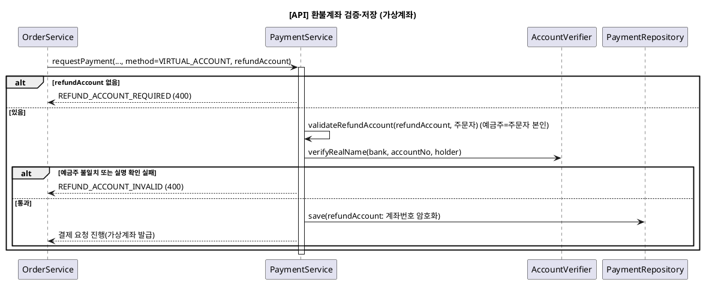
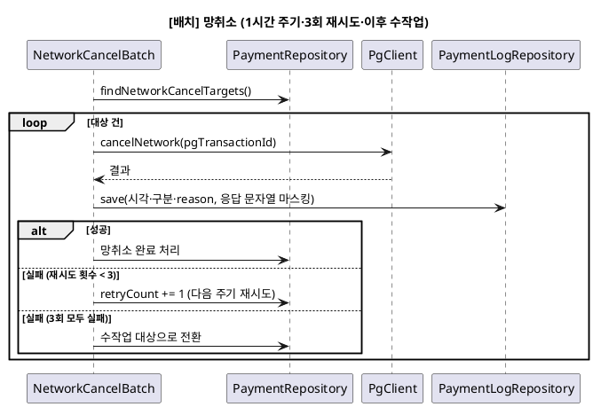

# 시퀀스 — Payment 도메인

> 상위 문서: [readme.md](readme.md)
> **단계**: 상세설계 (S3) | **문서범위**: Bolt (Payment) | **문서종류**: Design
> Order 관련 시퀀스는 [DM-시퀀스/order.md](order.md) 참조

---

## 4-1. [컨슈머] Payment 내부 — PG 콜백 처리 (비동기, 카드 실패 카운터 포함)

> 신규 (2026-08-21 바텀업 재검증): §4에서 "Payment 내부 비동기 처리"로 블랙박스 처리했던 부분을 구체화. REQ-PAY-023(카드 연속실패 카운터)이 여기서 실제로 호출된다.

- **트리거**: PG사 콜백(승인/실패 웹훅) 또는 Payment 자체 재시도 루프 종료
- **상태전이**: Payment `PENDING` → `PAID`(승인) / 승인 실패 응답·3초 무응답(거래 조회 미승인)이 누적 3회(최초 시도 포함 총 3회 시도)에 도달하면 `CANCELLED` 전이 후 `PAYMENT_FAILED` 이벤트 발행(REQ-PAY-004, 3회 미만이면 `PENDING` 복귀·재요청은 §4-2). `pay_card_fail_counter` 증가(실패) 또는 0 리셋(성공)



---

## 4-2. [컨슈머] PG 승인 요청 — 3초 대기·결제 확인 중(CONFIRMING)·거래 조회·실패 합산 (설계안, 2026-10-29, 미구현)

> 신규: REQ-PAY-003·004·005·029, 정책서 payment.md 4.5.2·9.6.1. 비동기 접수(DM order §4) 이후 컨슈머가 `PAYMENT_REQUESTED`를 처리하는 구간의 Payment 내부 흐름이다.

- **트리거**: `PAYMENT_REQUESTED` 컨슈머(승인 요청) 또는 PENDING 복귀 후 재요청
- **상태전이**: `PENDING` → `PAID` / 무응답 시 `CONFIRMING` → 거래 조회 승인이면 `PAID`, 미승인이면 실패 1회 합산 후 `PENDING` 복귀(3회 미만) 또는 `CANCELLED`(3회 도달)
- **규칙**: 응답 대기 3초, 재시도 간격 3초 고정, 최초 시도 포함 총 3회 시도(재시도 최대 2회). 자동 재시도는 같은 행·같은 멱등키·`pay_group_no` 불변, 시도마다 `pay_payment_log` 기록. CONFIRMING 중 같은 주문 재결제는 거부.

```plantuml
@startuml
title [컨슈머] PG 승인 요청 — 3초 대기·CONFIRMING·거래 조회

participant "PaymentRequestedConsumer" as Cons
participant "PaymentService" as PaySvc
participant "PgClient" as PG
participant "PaymentRepository" as PayRepo
participant "PaymentLogRepository" as Log
participant "EventPublisher" as Event

Cons -> PaySvc : requestPayment(request)
activate PaySvc
PaySvc -> PaySvc : PG 인증금액 vs 서버 산정 결제금액 대조 (불일치 시 AMOUNT_MISMATCH 422 거부, 승인 요청 안 함)
PaySvc -> PG : requestApproval(request) (응답 대기 3초)
PaySvc -> Log : save(요청: 시각·구분·금액·pg_transaction_id·reason)
(요청 원문 미저장)

alt 승인 응답
    PG --> PaySvc : 승인 성공
    PaySvc -> Log : save(응답 문자열, 개인정보 마스킹)
    PaySvc -> PayRepo : updateStatus(PAID)
    PaySvc -> Event : publish(PAYMENT_APPROVED)
else 실패 응답
    PG --> PaySvc : 승인 실패
    PaySvc -> PaySvc : failCount += 1 (§4-1 카드 실패 카운터 별개)
else 3초 내 무응답
    PaySvc -> PayRepo : updateStatus(CONFIRMING)
(즉시 재요청 안 함, 재결제 차단)
    PaySvc -> PaySvc : confirmByInquiry(paymentId) (REQ-PAY-029)
    PaySvc -> PG : inquire(pgTransactionId)
    alt 조회 결과 승인
        PG --> PaySvc : 승인
        PaySvc -> PayRepo : updateStatus(PAID)
        PaySvc -> Event : publish(PAYMENT_APPROVED)
    else 조회 결과 미승인
        PG --> PaySvc : 미승인
        PaySvc -> PaySvc : failCount += 1 (실패 1회로 합산)
    end
end

opt 실패가 합산된 경우
    alt 누적 실패 < 3
        PaySvc -> PayRepo : updateStatus(PENDING) (같은 행·같은 멱등키)
        PaySvc -> Cons : 3초 뒤 재요청 예약
    else 누적 실패 = 3 (총 3회 시도)
        PaySvc -> PayRepo : updateStatus(CANCELLED)
        PaySvc -> Event : publish(PAYMENT_FAILED) (재고 복원은 Order)
    end
end
deactivate PaySvc
@enduml
```

---

## 4-3. [컨슈머] 가상계좌 입금 통보 처리 — 취소 우선·LATE_DEPOSIT 자동 환불 (설계안, 2026-10-29, 미구현)

> 신규: REQ-PAY-030, 정책서 payment.md 4.4.2·8.1.3·8.7.2·8.8.2. 취소와 입금 통보가 경합하면 취소를 우선한다.

- **트리거**: PG 가상계좌 입금 통보 웹훅
- **상태전이**: 입금대기 `WAITING_DEPOSIT`(주문 `DEPOSIT_PENDING`) → `PAID`(취소 전 정상 입금) / 취소 확정 주문이면 `PAID`로 바꾸지 않고 환불 대상 기록 → 자동 환불(사유 `LATE_DEPOSIT`) → 환불 성공 시 `PAYMENT_REFUNDED` 이벤트 발행(2026-11-04 신규, DI payment.md)

```plantuml
@startuml
title [컨슈머] 가상계좌 입금 통보 — 취소 우선·LATE_DEPOSIT

participant "PgWebhookListener" as Webhook
participant "PaymentService" as PaySvc
participant "PaymentRepository" as PayRepo
participant "RefundService" as Refund
participant "PgClient" as PG
participant "EventPublisher" as Event

Webhook -> PaySvc : handleDepositNotice(notice) (REQ-PAY-030)
서명 검증·멱등 확인
activate PaySvc
PaySvc -> PayRepo : findByVirtualAccount(notice)

alt 주문이 취소(CANCELLED) 확정 — 취소 우선
    PaySvc -> PayRepo : recordRefundTarget(입금액, reason=LATE_DEPOSIT)
(PAID로 바꾸지 않음)
    PaySvc -> Refund : refundToAccount(paymentId, 입금액, LATE_DEPOSIT)
기준일=입금 통보 수신일, 기한 3영업일(8.1.3), 운영자 승인 없음
    Refund -> PG : requestRefund(저장된 refundAccount 사용)
    alt 환불 성공
        PG --> Refund : 성공
        Refund -> Event : publish(PAYMENT_REFUNDED, reason=LATE_DEPOSIT)\n(2026-11-04 신설)
    else 환불계좌 오류로 지급 거절
        PG --> Refund : 거절
        Refund -> PayRepo : 환불실패 전환·계좌 재등록 안내(8.7.2)
    else PG 오류
        PG --> Refund : 실패
        Refund -> Refund : 1시간 간격 최대 3회 재시도 후 운영자 이관(8.8.2, 정본. 현행 구현의 즉시 실패·보상 1회는 이력)
    end
else 입금대기 상태
    alt 입금액 = 결제 금액
        PaySvc -> PayRepo : updateStatus(PAID)
        PaySvc -> Event : publish(PAYMENT_APPROVED)
    else 금액 불일치
        PaySvc -> PaySvc : 입금 거절(PG 설정), 로그 기록
    end
end
deactivate PaySvc
@enduml
```

---

## 4-4. [API] 환불계좌 검증·저장 — 가상계좌 결제 요청 시 (설계안, 2026-10-29, 미구현)

> 신규: REQ-PAY-031, 정책서 payment.md 8.7.1. 호출은 `POST /api/mobile/v1/my/orders/{orderSheetId}/pay`(DM order §4)의 `refundAccount`이며, 마이페이지 환불계좌 등록은 폐기됐다. 카드·간편결제는 이 단계를 건너뛴다. 예금주 일치·실명 확인은 결제 요청 시점에 수행한다.
>
> 환불 호출 경로: 클레임(반품) 환불은 어드민 [환불 처리](API-029) 요청 시에만 PG 부분 환불을 호출하며, Payment는 CLAIM_COMPLETED 이벤트로 환불하지 않는다(정산·알림·재고복원·포인트용 이벤트). 주문 취소 환불은 ORDER_CANCELLED 수신 시 자동, LATE_DEPOSIT은 §4-3 자동 환불이다.



---

## 4-5. [배치] 망취소 — 승인 응답 수신 중 통신 장애 건 (설계안, 2026-10-29, 미구현)

> 신규: 정책서 payment.md 4.6.2. 승인 응답 수신 중 통신 장애가 난 건은 망취소 대상으로 기록하고, PG 망취소 요청과 결과 조회는 배치로 진행한다.

- **트리거**: 1시간 주기 배치
- **규칙**: 건별 최대 3회 재시도, 3회 모두 실패하면 수작업 대상으로 넘긴다.


